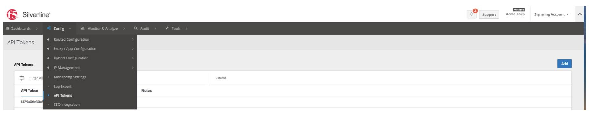
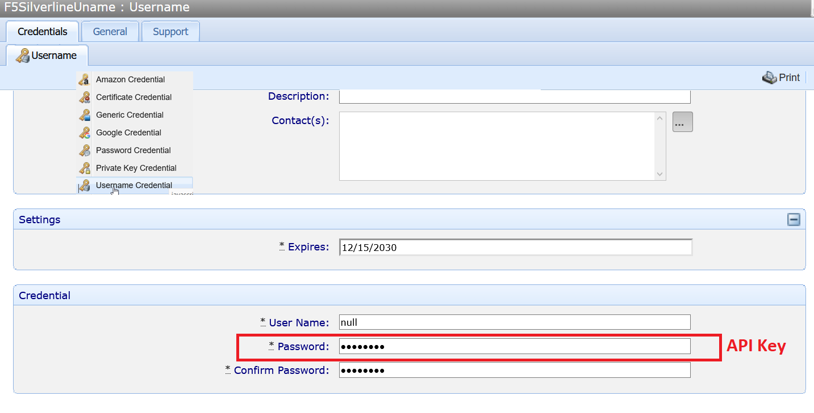
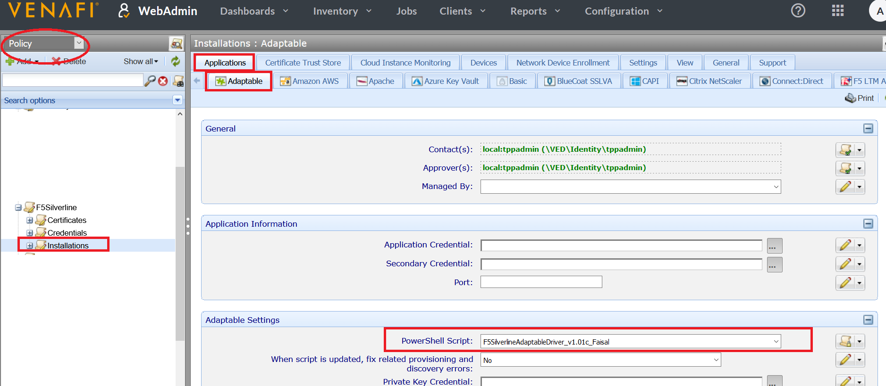
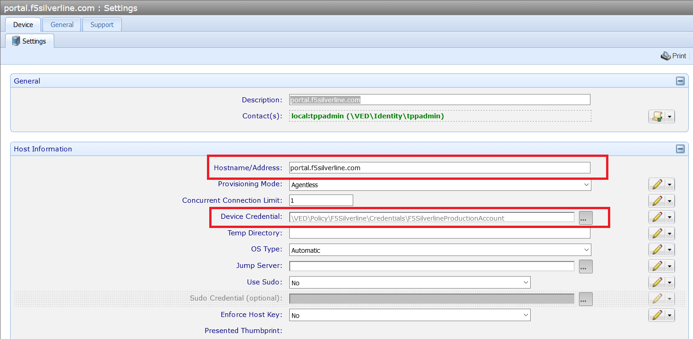
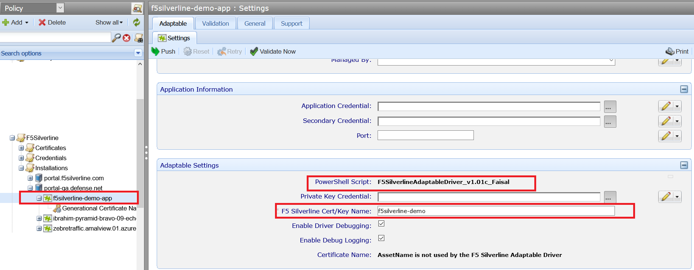
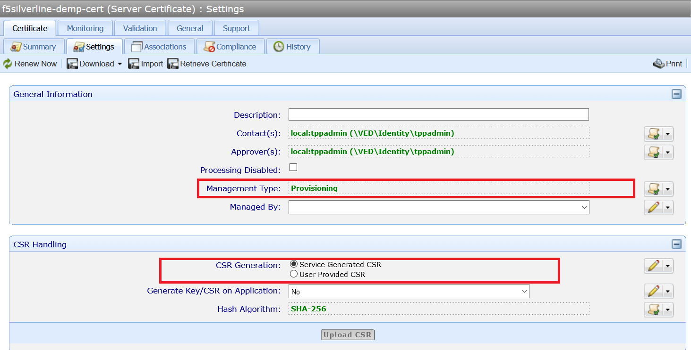
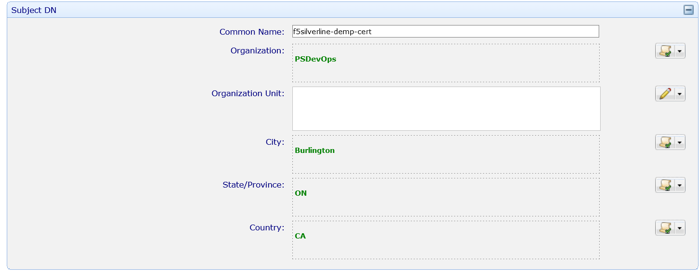
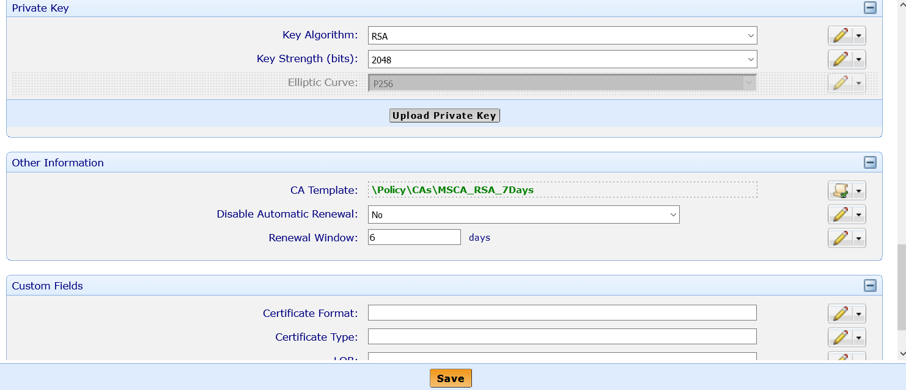

# F5 Silverline Installation and Configuration Guide

The certificate provisioned to F5 Silverline must be issued by an intermediate CA. It must not be issued directly by a root CA.

## Prerequisites

- Certificate Manager, Self-Hosted 20.3 or later.
- An F5 Silverline API token. Only a user in the **Customer Admin** group can request one.

To create the token:

1. In the Silverline portal, go to **Configuration** and select **API Tokens**.
2. Click **Add** to provision a new token.

## Installation

The driver is the PowerShell script `F5SilverlineAdaptableDriver.ps1`. It must be installed on all Certificate Manager, Self-Hosted servers acting as log servers and application servers, and configuration is required after installation.

1. Place the script file in the `<Certificate Manager Home>\Scripts\AdaptableApp` folder on all Certificate Manager, Self-Hosted servers.
2. Restart the `ved` and `venafilogserver` services on each server.
3. Restart IIS on servers acting as web servers.

## Configuration

### Configure a Username Credential Object

1. Create a username credential in Certificate Manager, Self-Hosted. The **Password** field contains the API token and the **Username** field can be `null`.

### Configure the Adaptable App at the Policy Folder Level

1. Browse to the policy folder that will hold the F5 Silverline device and application objects.
2. Go to **Applications** > **Adaptable**.
3. Set the **PowerShell Script** field to the F5 Silverline Adaptable Application driver.

### Configure Device, Application and Certificate Objects

1. Create a device object.
2. Set the **Hostname/Address** field to `portal.f5silverline.com`.
3. Set the credential.

   

4. Create an application object.
5. Set the **F5 Silverline Cert/Key Name** field.

   

6. Create a certificate object.
7. Make sure **Management Type** is **Provisioning**.

## Usage

Renew the certificate. Certificate Manager, Self-Hosted issues the new certificate and the driver uploads it to F5 Silverline.

