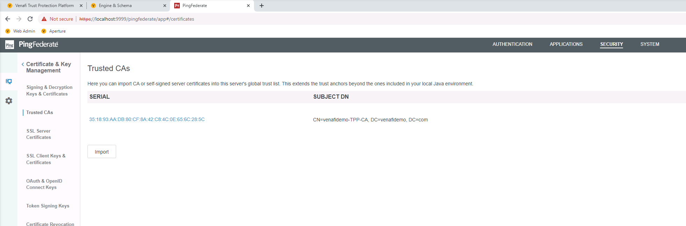
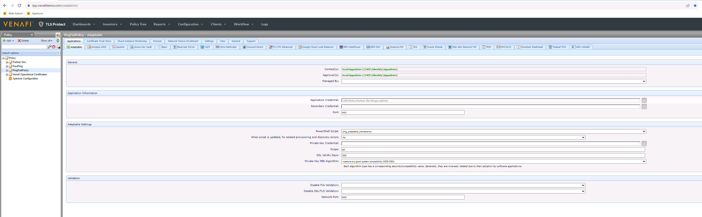
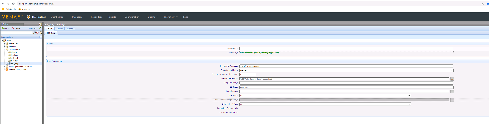
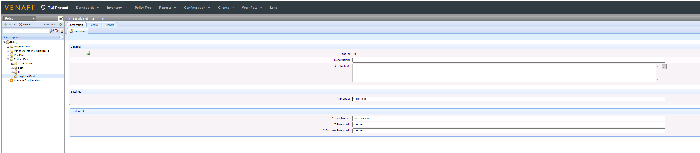
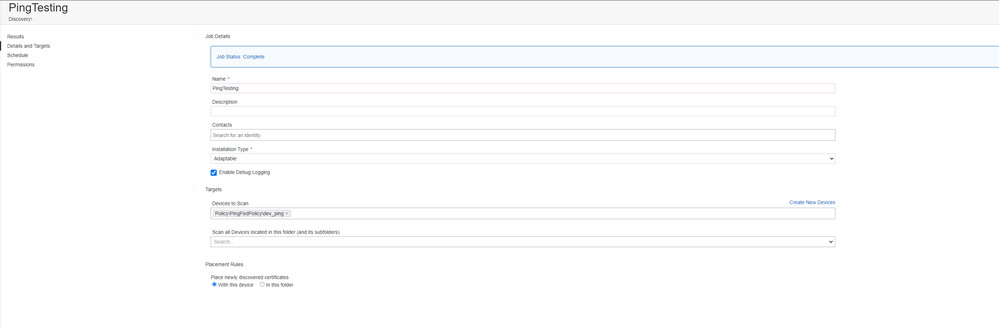
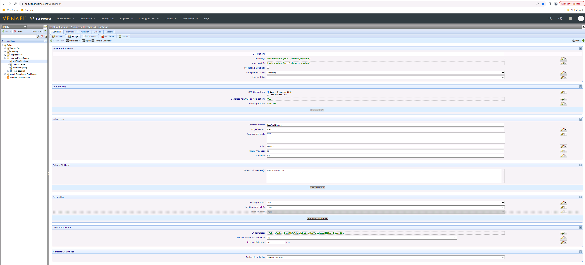
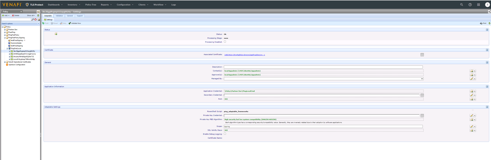
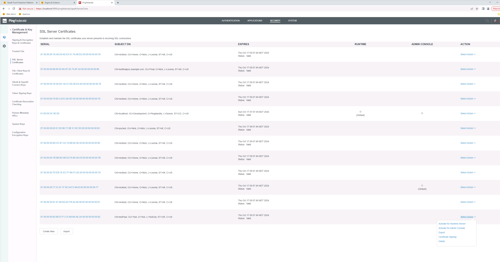

# Ping Adaptable Application Driver

The Ping Adaptable Application driver (`ping_adaptable_driver.ps1`) manages SSL and signing certificates in PingFederate from Certificate Manager, Self-Hosted. Because of how PingFederate works, Certificate Manager, Self-Hosted does not manage the private keys. The driver creates keys and certificates inside Ping's default keystore and sends them to Certificate Manager, Self-Hosted for signing, so all key operations stay local to Ping.

You cannot import an externally generated private key and certificate into the Ping configuration through this driver.

Author: Nick Hunt, IDMWORKS LLC (2023-11-19).

## Prerequisites

- A supported version of Certificate Manager, Self-Hosted. See the [Adaptable Application PowerShell reference](https://docs.venafi.com/Docs/current/TopNav/Content/Drivers/c-drivers-AdaptableApp-PowerShell-reference.php).
- A PingFederate user with administrative and API rights, so the driver can enumerate and manage certificate objects.
- The root certificate of any CA that will sign requests from Ping, imported into PingFederate so Ping trusts it. This is not needed if the CA is already in the standard Java keystore on the Ping nodes.

## Installation

1. Download `ping_adaptable_driver.ps1` from this listing.
2. Copy it to the Adaptable Application scripts folder on every Certificate Manager, Self-Hosted server (for example `C:\Program Files\Venafi\Scripts\AdaptableApp\`).

## Configuration

In most cases you start with onboard discovery to find the certificates already in use in PingFederate and import them into inventory. After that, any renewal started from Certificate Manager, Self-Hosted provisions the new certificate into Ping.

1. Create a policy and add the Adaptable configuration and script. Set **Scope** to `ssl` or `signing`, and set **SSL Validity Days**, which is the lifetime of the certificates created and managed under the policy.

    

2. Create the Ping device under the policy. Enter **Hostname/Address** as `https://<host>:<port>`. The rest of the endpoint path is not needed unless you use a custom path for the administrative API.

    

3. Add the credential for the policy, using the username and password of the PingFederate API user.

    

4. Configure a discovery job to pull existing certificate information out of Ping during initial setup. The job does not pull private keys, but it references the certificate and application object so they can be updated.

    

5. Add the certificate under the device as a reference to the certificate.

    

6. Under the device, add an Adaptable application so the certificate can be resolved (the discovery job may create it for you). This links the certificate with the Ping application according to the certificate's scope.

    

## Usage

After a certificate is provisioned, sign in to the PingFederate administrator console and activate it for SSL, or attach it to a policy or connection.

