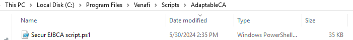
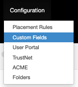
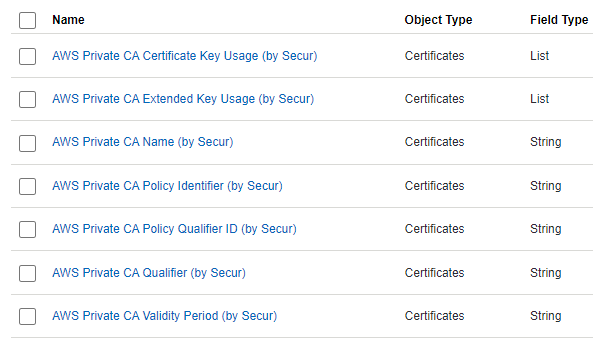
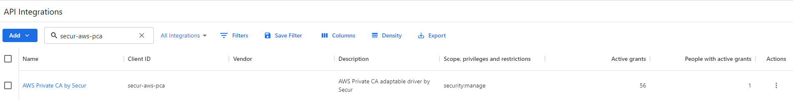
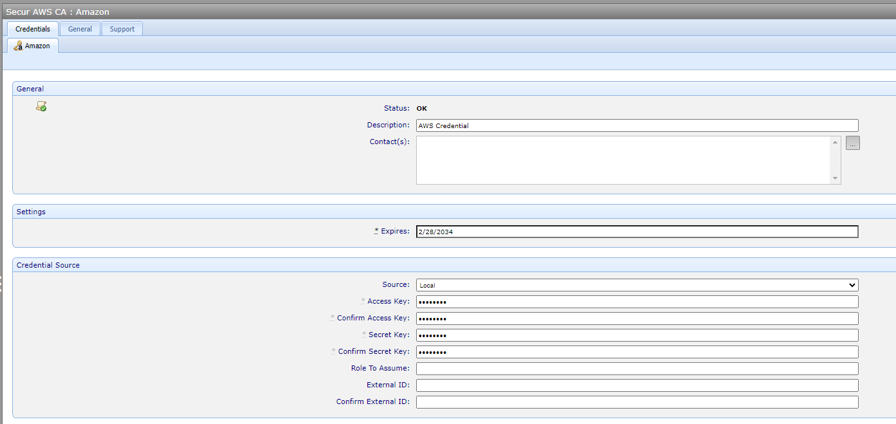
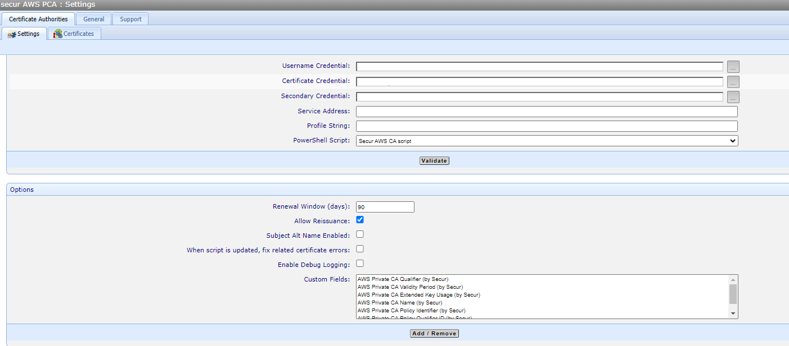
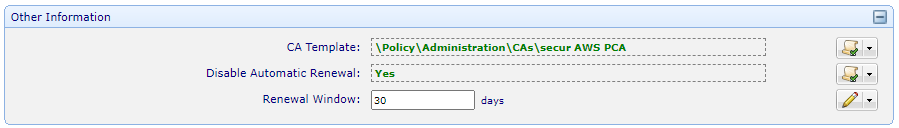
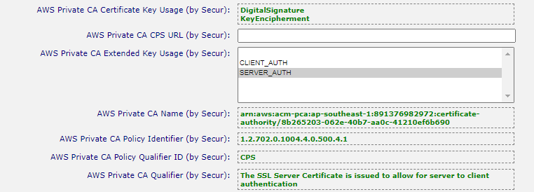

# Integration README

This document describes how to configure the Secur Solutions AWS Private CA Adaptable CA driver for Certificate Manager, Self-Hosted.

> This integration guide, as well as the software and/or products described in it, are furnished under agreement with Secur Solutions and may be used only in accordance with the terms of such agreement. Except as permitted by such agreement, no part of this publication may be reproduced, stored in a retrieval system, or transmitted, in any form or by any means, electronic, mechanical, recording, or otherwise, without prior written permission of Secur Solutions.

## Prerequisites

- Certificate Manager, Self-Hosted
- An AWS Private CA
- The AWS CLI installed on every Certificate Manager, Self-Hosted server that runs the driver. See [Installing the AWS CLI](https://docs.aws.amazon.com/cli/latest/userguide/getting-started-install.html).

The driver sends its AWS CLI calls to the `ap-southeast-1` region. Confirm that this matches the region of your AWS Private CA before you use it.

## Installation

1. Copy `Secur AWS CA script.ps1` to `C:\Program Files\Venafi\Scripts\AdaptableCA` on each Certificate Manager, Self-Hosted server.

   

## Configuration

1. Create the custom fields in Aperture, using the exact names in the [custom field reference](#custom-field-reference).

   

2. Add the values the driver expects to the list fields:
   - **AWS Private CA Certificate Key Usage (by Secur)**: `DigitalSignature`, `DataEncipherment`, `KeyEncipherment`, `NonRepudiation`
   - **AWS Private CA Extended Key Usage (by Secur)**: `CLIENT_AUTH`, `SERVER_AUTH`

   

   For the certificate profile name, make sure the allowed characters include the ones you use, for example `^[A-Za-z0-9-_\s]*$`.

3. Create an API integration with the client ID, scope and privileges shown below.

   

4. Create an AWS credential in the `Administration\Credentials` folder named `Secur AWS CA`. Use your AWS access key as the access key and your AWS secret key as the secret key.

   

5. Create the Adaptable CA template object and select the custom fields as shown below.

   

6. Configure the policy folder to use the CA template.

   

   Sample field values:

   

You can now issue certificates.

## Custom Field Reference

- **AWS Private CA Name (by Secur)** (required): the ARN of the AWS Private CA.
- **AWS Private CA Validity Period (by Secur)** (required): the certificate validity in days.
- **AWS Private CA Certificate Key Usage (by Secur)**: one or more key usage values.
- **AWS Private CA Extended Key Usage (by Secur)**: one or more extended key usage values, or `NOT_REQUIRED`.
- **AWS Private CA Policy Identifier (by Secur)**: the certificate policy OID.
- **AWS Private CA Policy Qualifier ID (by Secur)**: the policy qualifier ID.
- **AWS Private CA Qualifier (by Secur)**: the CPS URI for the policy qualifier.

The policy identifier, qualifier ID and qualifier are applied only when all three are set.
