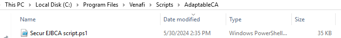
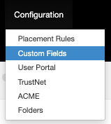
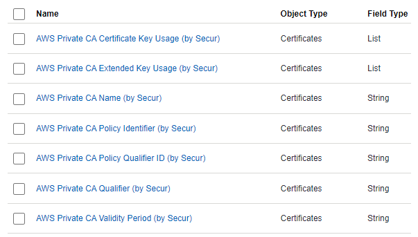
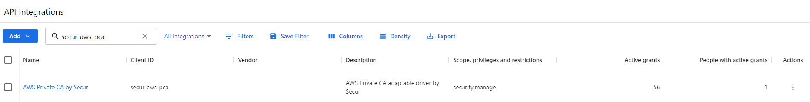
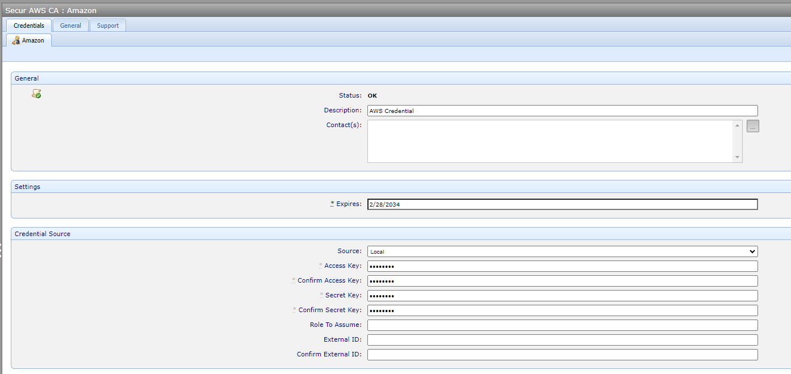
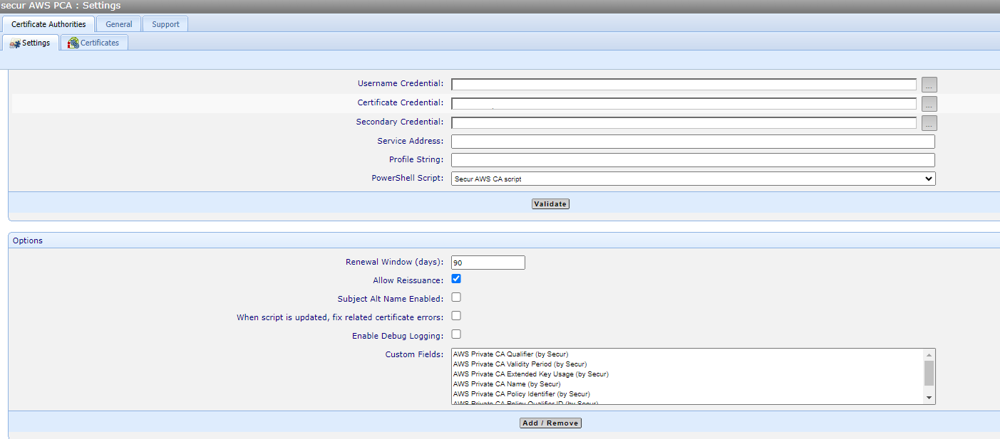
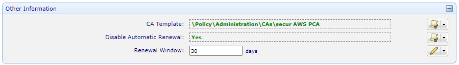
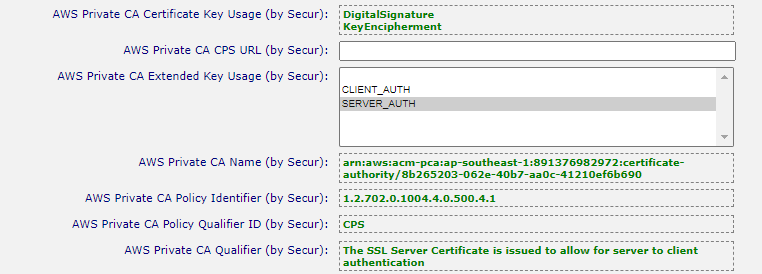

# Integration README

The purpose of this document is to provide information regarding the configuration of Secur Solutions' AWS Private CA adaptable driver for integration with Venafi Trust Protection Platform (TPP).

*The information provided in this document is considered proprietary and confidential.*

>This integration guide, as well as the software and/or products described in it, are furnished under agreement with Secur Solutions and may be used only in accordance with the terms of such agreement.
>Except as permitted by such agreement, no part of this publication may be reproduced, stored in a retrieval system, or transmitted, in any form or by any means, electronic, mechanical, recording, or otherwise, without prior written permission of Secur Solutions.

## TABLE OF CONTENTS

- [About Us](#about-us)
- [Integration with Venafi](#integration-with-venafi)
- [Prerequisites](#prerequisites)
- [Installation and Configuration](#installation-and-configuration)
    - [TPP Configuration](#tpp-configuration)

## About Us
### &nbsp; **SECUR SOLUTIONS GROUP**

**Innovation is in our DNA.**

Secur Solutions Group's mission is market leadership in Smart Card issuance and Digital Identity. 

We seek to be a forward thinking and process centred organisation that delivers innovative solutions to our customers while consistently outperforming our peers. We do so by being market aware and providing a dynamic and challenging environment for our internal team. 

We are privately owned, with a Ministry of Finance (Singapore) S8 qualification. In territory, we have majority coverage of the financial card issuance and government card issuance space, and partnerships with the major System Integrators. We have achieved the Singapore Quality Class (SQC 2017) and are Bizsafe certified. 

We are the pioneering and oldest Entrust distribution partner in Southeast Asia and a multiple award winner within the Entrust network.

## Integration with Venafi

Venafi’s Trust Protection Platform integrates with the Secur Solutions's AWS Private CA adaptable driver for the purposes of customizing and issuing certificates with key usage and extended key usage specifically for AWS Private CA.

## Prerequisites

Before following the steps in this integration guide, the following prerequisite items must be installed and configured:

- Venafi Trust Protection Platform
- **AWS CLI** 

## Installation and Configuration

## AWS CLI
Users must install AWS CLI in order for the drivers to be able to access to your AWS Private CA. Please follow the following link to setup and install [AWS CLI](https://docs.aws.amazon.com/cli/latest/userguide/getting-started-install.html) 

## TPP Configuration

Users must add Secur AWS CA script.ps1 script to the `"C:\Program Files\Venafi\Scripts\AdaptableCA"` directory on the Venafi platform servers in order to call AWS APIs through the script. Before using this template, users must configure the following custom fields in Trust Protection Platform. Please note that these custom field names should be configured with exact names and values.

1. Install the adaptable driver into the `C:\Program Files\Venafi\Scripts\AdaptableCA` folder on the Trust Protection Platform server 

    

2. Create the custom fields in Aperture

    

    > For more information about the necessary Custom Fields, please see the [custom field reference](#custom-field-reference) at the bottom of this page.

3. Add the following 7 entries (They are expected by the driver)
    - AWS Private CA Certificate Key Usage should contain DigitalSignature, DataEncipherment, KeyEncipherment, NonRepudiation
    - AWS Private CA Extended Key Usage should contain CLIENT_AUTH, SERVER_AUTH
    

    > For the Certificate Profile name, make sure it includes the charset you will be using, ie: `^[A-Za-z0-9-_\s]*$`

4. Configure the API Integrations

    Create a new API Integration with the following client ID, scope and privileges. 

    

5. Create AWS Credentials 
    Create an AWS Credential in TLS Protect's Administration Credentials folder. The credential name should be "Secur AWS CA" and the access key is your AWS Access key and secret key is the AWS Secret key. 

    

6. Create the AWS CA Template object and configure it as below, making sure that the additional custom fields are selected as well:

    

7. Configure the Policy folder to use that CA Template:

    

    Sample values for the fields

            

Congratulations! You should now be able to issue certificates.