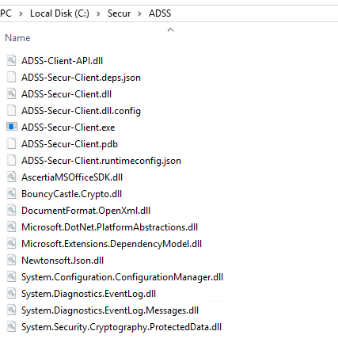
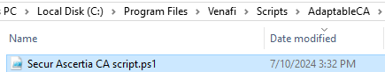
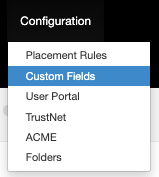
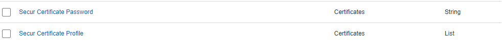
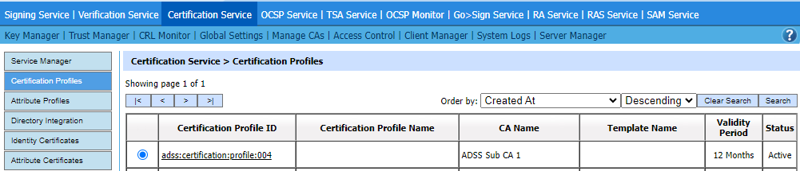
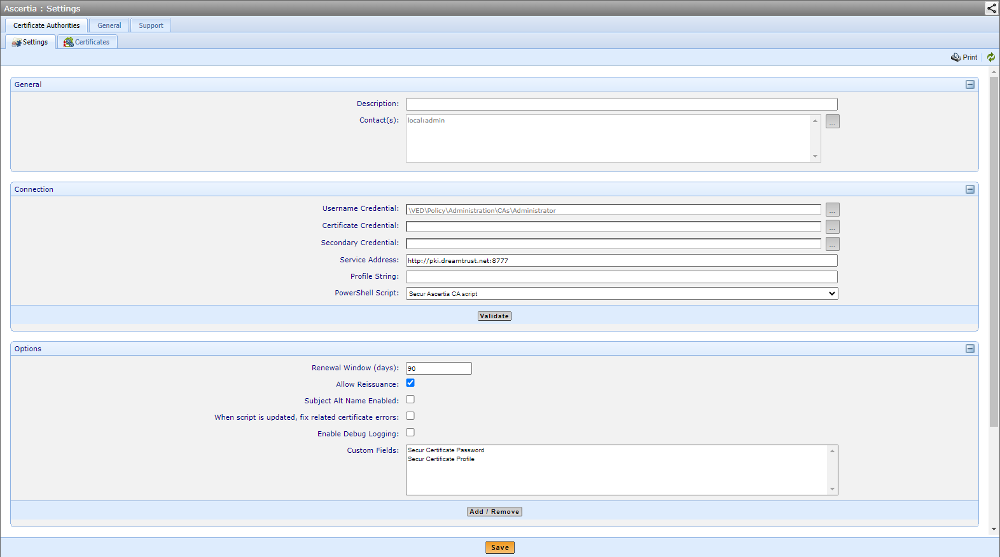
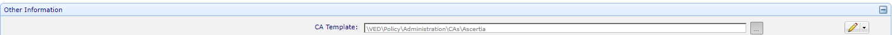

# Integration README

The purpose of this document is to provide information regarding the configuration of Secur Solutions' Ascertia ADSS adaptable driver for integration with Venafi Trust Protection Platform (TPP).

*The information provided in this document is considered proprietary and confidential.*

>This integration guide, as well as the software and/or products described in it, are furnished under agreement with Secur Solutions and may be used only in accordance with the terms of such agreement.
>Except as permitted by such agreement, no part of this publication may be reproduced, stored in a retrieval system, or transmitted, in any form or by any means, electronic, mechanical, recording, or otherwise, without prior written permission of Secur Solutions.

## TABLE OF CONTENTS

- [About Us](#about-us)
- [Integration with Venafi](#integration-with-venafi)
- [Prerequisites](#prerequisites)
- [Installation and Configuration](#installation-and-configuration)
    - [TPP Configuration](#tpp-configuration)

## About Us
### &nbsp; **SECUR SOLUTIONS GROUP**

**Innovation is in our DNA.**

Secur Solutions Group's mission is market leadership in Smart Card issuance and Digital Identity. 

We seek to be a forward thinking and process centred organisation that delivers innovative solutions to our customers while consistently outperforming our peers. We do so by being market aware and providing a dynamic and challenging environment for our internal team. 

We are privately owned, with a Ministry of Finance (Singapore) S8 qualification. In territory, we have majority coverage of the financial card issuance and government card issuance space, and partnerships with the major System Integrators. We have achieved the Singapore Quality Class (SQC 2017) and are Bizsafe certified. 

We are the pioneering and oldest Entrust distribution partner in Southeast Asia and a multiple award winner within the Entrust network.

## Integration with Venafi

Venafi’s Trust Protection Platform integrates to Ascertia ADSS CA with Secur Solutions's Ascertia CA adaptable driver for certificate issuance.

## Prerequisites

Before following the steps in this integration guide, the following prerequisite items must be installed and configured:

- Venafi Trust Protection Platform
- **Ascertia ADSS Secur application** 

## Installation and Configuration

## Ascertia Secur application
Users must install the Ascertia Secur application in order for the drivers to be able to access to your Ascertia ADSS CA signing service. Please copy the contents of the ADSS Secur Client folder in the repository to `C:\Secur\ADSS\` folder on the Trust Protection Platform server 

## TPP Configuration

Users must add Secur Ascertia CA script.ps1 script to the `"C:\Program Files\Venafi\Scripts\AdaptableCA"` directory on the Venafi platform servers in order for TPP to integrate with Ascertia's ADSS through the script. Before using this template, users must configure the following custom fields in Trust Protection Platform. Please note that these custom field names should be configured with exact names and values.

1. Install the adaptable driver into the `C:\Program Files\Venafi\Scripts\AdaptableCA` folder on the Trust Protection Platform server 

    

2. Create the custom fields in Aperture

    

3. Add the following 2 entries (They are expected by the driver)
    - Secur Certificate Password
    - Secur Certificate Profile should be a list that contains the Certification Profile ID as the values that you can get from your ADSS certificate signing profiles.
    
    

4. Create the Ascertia CA Template object and configure it as below, making sure that the service address points to your ADSS server address, username credential and the additional custom fields are selected as well:

    

5. Configure the Policy folder to use that CA Template and you can also configure the certificate password and certificate policies here as well:

    

Congratulations! You should now be able to issue certificates.
