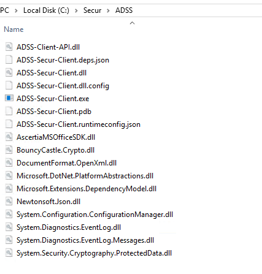
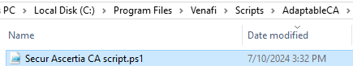
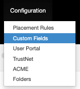
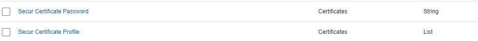
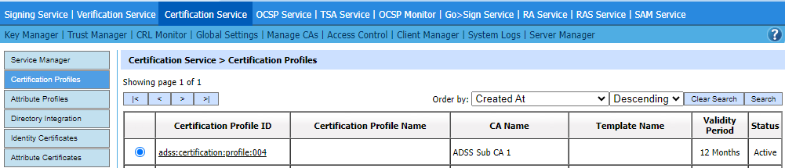
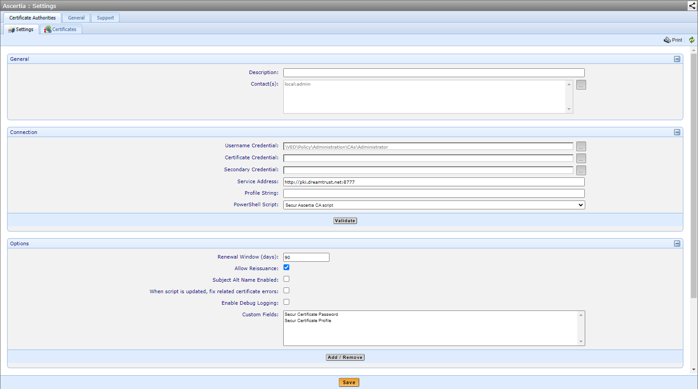
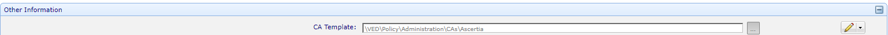

# Integration README

This document describes how to configure the Secur Solutions Ascertia ADSS Adaptable CA driver for Certificate Manager, Self-Hosted.

> This integration guide, as well as the software and/or products described in it, are furnished under agreement with Secur Solutions and may be used only in accordance with the terms of such agreement. Except as permitted by such agreement, no part of this publication may be reproduced, stored in a retrieval system, or transmitted, in any form or by any means, electronic, mechanical, recording, or otherwise, without prior written permission of Secur Solutions.

## Prerequisites

- Certificate Manager, Self-Hosted
- Ascertia ADSS Server with the Certification Service
- The ADSS Secur Client (`ADSS-Secur-Client.zip` in this listing)

## Installation

1. Extract `ADSS-Secur-Client.zip` and copy the contents of the `ADSS Secur Client` folder to `C:\Secur\ADSS\` on each Certificate Manager, Self-Hosted server.

   

2. Copy `Secur Ascertia CA script.ps1` to `C:\Program Files\Venafi\Scripts\AdaptableCA` on each Certificate Manager, Self-Hosted server.

   

## Configuration

1. Create the custom fields in Aperture, using these exact names:
   - **Secur Certificate Password**
   - **Secur Certificate Profile**: a list whose values are the certification profile IDs from your ADSS certificate signing profiles.

   

   

   

2. Create the Ascertia Adaptable CA template object. Set the service address to your ADSS server address, select the username credential, and select the custom fields.

   

3. Configure the policy folder to use the CA template. You can also set the certificate password and certification profile on the policy folder.

   

You can now issue certificates.
