# CSC TPP Adaptable Driver Overview

This Adaptable Driver may be used when ordering any CSC TrustedSecure certificates via the CSC API from Venafi Trust Protection Platform. Two sets of credentials are used, one for the CSC API (user token and API key), and one to store the TPP credentials (access token + refresh token) to update object attributes and the CSC API credentials in TPP. 

**Useful CSC documentation**: https://www.cscglobal.com/cscglobal/docs/dbs/domainmanager/api-v2/ 

[[_TOC_]]

## Configuration fields, files, & requirements

This Adaptable CA Driver utilizes 2 configuration files, An AdaptableCA driver, and a set of TPP custom fields to provide the information nessesary to request and manage certificates issued through the CSC API. 

When installing this Adaptable CA Driver, ensure that copies of these configuration files are present in the same folder as the Adaptable CA driver file on **every** TPP engine. 

### Requirements
The below are required to use this integration
1) CSC global Domain Manger API access credentials
2) TPP API Integration that has the below scopes:
    - security:manage
    - configuration:manage
3) A service account or TPP local account that has the below permissions:
    - Write permission on all Certificate objects using the CSC Adaptable CA Driver.
    - Write permission on the Credential objects that hold the CSC API credentials and Venafi API credentials.
      - These credential objects will be created during the configuration and installation of TPP and the Adaptable driver. 
    - Access to the TPP API Integration mentioned in requirement 2 
4) The CSC AdaptableCA Driver and both configuration files. 

### "AdaptableCA-CSC.json"
This configuration file stores information regarding how the driver communicates to the CSC API and TPP. 

- **base_url** = the base url of the CSCglobal API to authenticate to.
- **venafi_auth_url** = token refresh url endpoint for the TPP instance. Used by script to refresh 
  the Oauth token. Should be the full url + path
	- ex) https://mytppserver.corp.net/vedauth/Authorize/Token
- **venafi_update_url** = Url endpoint for the websdk config/write endpoint to update custom fields
  and configuration values stored in venafi, as well as the "notes" attribute on certificates. Should be the full url + path
	- ex) https://mytppserver.corp.net/vedsdk/Config/Write
- **venafi_credentials_update_url** = URL endpoint for the websdk credentials/update endpoint to 
  update the stored Oauth token and refresh token used to authenticate to TPP. Should be the 
  full url + path
  - ex) https://mytppserver.corp.net/vedsdk/Credentials/Update
- **credentails_path** = Full DN path to the username credentials object that stores the Venafi TPP
  Oauth token and refresh token used to authenticate to TPP by the adaptable CA script. 
  All \ characters shoudl be escaped with a \ to ensure they are JSON compliant. 
	- ex) `\\VED\\Policy\\Partner Dev\\CSC\\Administration\\CSC credential\\Venafi_api_key_token`
  - Note: The format of the credentials stored in the Username credential object should be the access token, a pipe symbol "|", and the refresh token. Do not add spaces.
    - ex: `Access Token|Refresh Token`
- **client_id** = the clientid to use to identify which TPP API integration the script is authenticating as. 
	ex) CSCglobalCA

### "properties.json"
This configuration file stores all the information needed to request certificates from the CSC API that is not set in the TPP custom fields. Information set in this configuration file applies to **every certificate** requested through the driver, as long as that information is not set by a TPP custom field. 

The below fields only apply to the **CSC Trusted Secure Extended validation certificate** and can remain blank for the remaining certificate products. 
- Country 
- City
- State
- Date Of Incorporation
- Doing Business As
- Business Category


Items like CSC User Defined Fields (UDFs) are set in this file if they are defined in the CSC global account. UDF keys and values are defined in the "customFields" property as a JSON array of hash tables. Up to 13 UDF name:value pairs can be added. Use the formatting below. 
```json
"customFields": [
        {
            "name": "UDF1",
            "value": "test2"
        },
        {
            "name": "UDF2",
            "value": "test-3"
        },
		    {
            "name": "",
            "value": ""
        }
    ]
```

#### Avaliable ServerSoftware values

| ServerSoftware                     | Value |
| ---                                | ---   |
| OTHER                              | -1 |
| APACHE_MODSSL                      | 2 |
| APACHE_SSL                         | 3 |
| C2NET_STRONGHOLD                   | 4 |
| CISCO_3000_SERIES_VPN_CONCENTRATOR | 33 |
| CITRIX                             | 34 |
| COBALT_RAQ                         | 5 |
| COVALENT_SERVER_SOFTWARE           | 6 |
| ENSIM                              | 29 |
| H_SPHERE                           | 32 |
| IBM_HTTP_SERVER                    |	7 |
| IBM_INTERNET_CONNECTION_SERVER     | 8 |
| IPLANET                            |	9 |
| JAVA_WEBSERVER_JAVASOFT_SUN        | 10 |
| LOTUS_DOMAINO_GO                   | 12 |
| MICROSOFT_IIS_1X_TO_4X             | 13 |
| MICROSOFT_IIS_5X_TO_6X             | 14 |
| MICROSOFT_IIS_7X_TO_LATER          | 35 |
| NETSCAPE_ENTERPRISE_SERVER         | 15 |
| NETSCAPE_FASTTRACK                 | 16 |
| NGINX                              | 36 |
| NOVELL_WEB_SERVER                  | 17 |
| ORACLE                             | 18 |
| PLESK                              | 30 |
| QUID_PRO_QUO                       | 19 |
| R3_SSL_SERVER                      | 20 |
| RAVEN_SSL                          | 21 |
| REDHAT_LINUX                       | 22 |
| SAP_WEB_APPLICATION_SERVER         | 23 |
| TOMCAT                             | 24 |
| WEBSITE_PROFESSIONAL               | 25 |
| WEBSTAR_4X_AND_LATER               | 26 |
| WEBTEN_FROM_TENON                  | 27 |
| WHM_CPANEL                         | 31 |
| ZEUS_WEB_SERVER                    | 28 |


### TPP Custom Fields
The TPP Custom fields are used to set information that can differ per certificate and can be set by TPP policy if required. 

- Certificate Type
  - Field Type: String
  - Required Field: Yes
  - Applies to: Certificate
  - Options:
    | Certificate Type | Value |
    | ---              | ---   |
    | Premium          | 0     |
    | Wildcard         | 1     |
    | UCC              | 2     |
    | EV               | 3     |
- Domain Control Validation
  - Field Type: List
    - List options:
      - Cname
      - Email
  - Required Field: Yes
  - Applies to: Certificate
- Email
  - Field Type: String
  - Required Field: No
  - Applies to: Certificate
    - Use: Email address in validation template. 
- SAN Validation Email List 
  - Field Type: String
  - Required Field: No
  - Applies to: Certificate
  - Use: Domains for this certificate that are going to be validated via Email validation should be entered here using the below format
    - `domain1|email1, domain2|email2`


# Installation & Configuration

## 1) Fill Out properties.json Configuration File

Populate the **properties.json** configuration file with the information that pertains to your CSC global account. Information populated here will be set for every certificate requested through this CSC Adaptable CA driver. 

The below fields only apply to the **CSC Trusted Secure Extended validation certificate** and can remain blank for the remaining certificate products. 
- Country 
- City
- State
- Date Of Incorporation
- Doing Business As
- Business Category

See the [Configuration fields and files > properties.json](#propertiesjson) section above for an explanation of this file. 

## 2) Create Custom Fields
Trust Protection Platform custom fields should be created with **exact** below names as the CSC API uses names as identifiers. Some of these custom fields are mandatory and some are not. This is configured while creating the Custom Fields in Venafi TPP.

- Certificate Type
  - Field Type: String
  - Required Field: Yes
  - Applies to: Certificate
- Domain Control Validation
  - Field Type: List
    - List options:
      - Cname
      - Email
  - Required Field: Yes
  - Applies to: Certificate
- Email
  - Field Type: String
  - Required Field: No
  - Applies to: Certificate
    - Use: Email address in validation template. 
- SAN Validation Email List 
  - Field Type: String
  - Required Field: No
  - Applies to: Certificate

## 3) Create Trust Protection Platform Policy Structure

The next step is to create the policy structure. Please reach out to Venafi if you need assistance creating policy structure. For reference purposes, we've added some screenshots below that demonstrate the various steps:

<figure>
  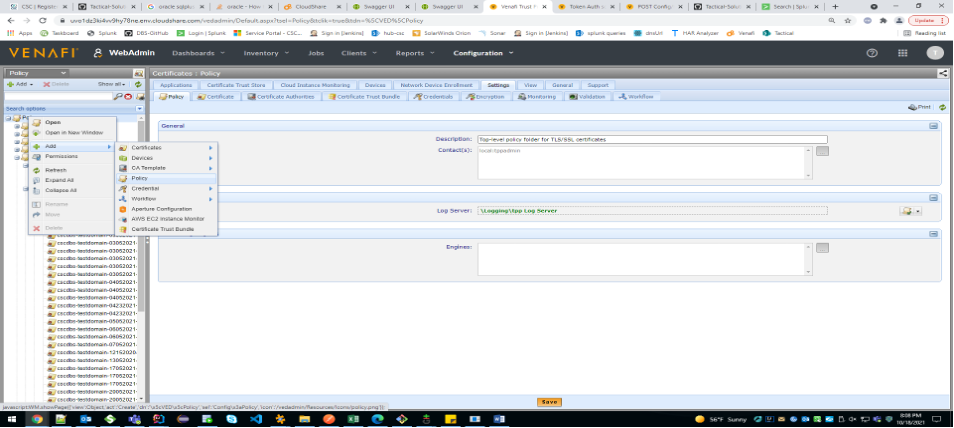
  <figcaption>Add Policy</figcaption>
</figure>

<figure>
  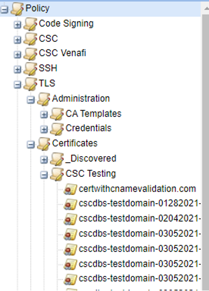
  <figcaption>Policy Structure</figcaption>
</figure>

## 4) Create CSC Credential Object
Users will need to create a CSC Credential object. This will contain the API key and the user token that will enable CSC API to authenticate the request. The CSC Adaptable CA Driver keeps this credential up to date when it needs rotating. 

**Navigation:** Right click on your Credential folder and then click `Add > Credential > Username Credential`

<figure>
  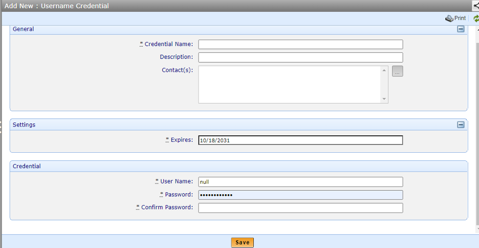
  <figcaption>New Username Credential for CSC</figcaption>
</figure>

- A Credential name must be entered. This can be anything that would help identify this credential object to other users of the Venafi platform.
  - **CSC Global CA API Credential** is recommended
- The CSC API does not expect a username and this field can be 'null'
- The password should be a combination of the user token and the API key obtained from CSC. These two values should be separated by a pipe `|` symbol (Ex. `USER TOKEN|API KEY`)
- Repeat the same for the 'Confirm Password' field

## 5) Create Venafi Application Integration

A Venafi Application Integration must be create to allow the Adaptable CA Driver to connect to TPP to maintain up to date authentication information for the CSC global API. Authentication to TPP will occur using Oauth tokens. 

**Useful Documentation:** https://docs.venafi.com/Docs/current/TopNav/Content/API-ApplicationIntegration/t-APIAppIntegrations-creating.php 

1) Use the product switcher to switch to the TPP Platform menu bar
2) Click **API > Integrations**
3) Click **New**
4) Configure the integration as follows:
    - Name: CSCglobalCA
    - ClientID: CSCglobalCA
    - Description: API integration for use with the CSC Global AdaptableCA Driver
    - Click **next**
    - Grant the below Scopes
      - configuration:manage
      - security:manage
    - Use the global default token refresh settings. 
    - Click **next**
    - Grant the service account or local user created for this integration access to the API integration.
5) Click **Done**


## 6) Create Venafi Credential Object

Users will also need to add a Credential object that has authorization to update the 'Notes' section under 'Attributes' in the 'Support' tab of a Certificate object. To create this object you will need the Oauth access token and refresh token provided after authenticating to the Venafi API with the API integration created in [Step 5](#5-create-venafi-application-integration).

**How to get Oauth tokens using TPP Swagger UI**

If you are not familliar with the API, you can get these tokens using the built in swagger page in your TPP instance. 
1) Navigate to your tpp instance and log in.
2) Go to https://mytppserver.corp/vedsdk/#/authorize/AuthorizeOAuth
3) on the POST /vedauth/authorize/oauth endpoint click the **Try it out** button.
4) Copy paste in the **JSON example of token request** from the API integration you created and change the username and password fields to be the username and password of the account granted access to the CSCgloablCA API integration. 
5) Click the **Execute** Button
6) Scroll down to the responses section and copy the values for **access_token** and **refresh_token** out of the response. 


**Navigation:** Right click on your Credential folder and then click `Add > Credential > Username Credential`

<figure>
  
  <figcaption>New Username Credential for Venafi</figcaption>
</figure>

- A Credential name must be entered. This can be anything that would help identify this credential object to other users of the Venafi platform
- **CSC Global Venafi API Credential** is recommended
- The User name can be "null"
  - TPP api will be authenticated to using Oauth tokens stored in the pasword fields. 
- The password should be a combination of the access token and the refresh token obtained from the Venafi API. These two values should be separated by a pipe `|` symbol with no spaces (Ex. `ACCESS_TOKEN|REFRESH_TOKEN`)
- Repeat the same for the 'Confirm Password' field

## 7) Create CA Template Object
The CA Template object is where the configuration of the proper credentials, custom fields and renewal window is done.

**Navigation:** Right click on your target Policy folder and then click `Add > CA Template > Adaptable`

<figure>
  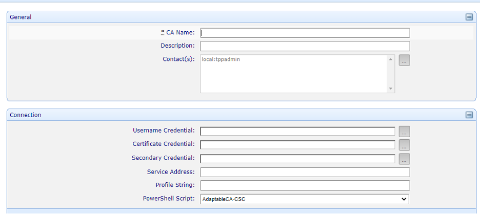
  <figcaption>New CA Template</figcaption>
</figure>

- Enter a valid CA name that can be used as an identifier
- For the Username credential, browse and select the CSC Credential created in [Step 4](#4-create-csc-credential-object)
- For the Secondary credential, browse and select the Venafi Credential created in [Step 6](#6-create-venafi-credential-object)
- For the PowerShell Script, select the CSC Adaptable script

<figure>
  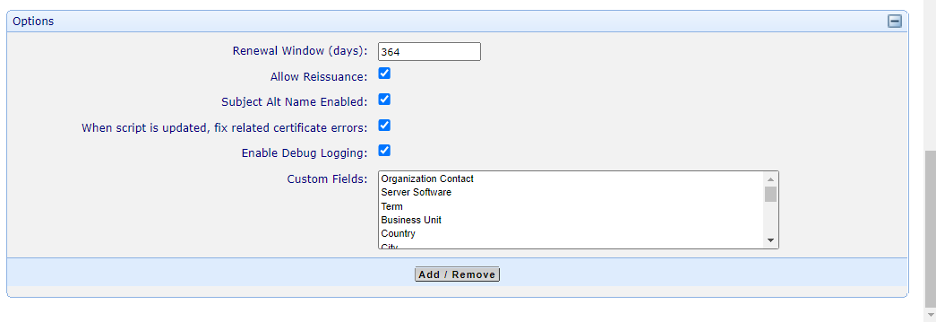
  <figcaption>New CA Template Options</figcaption>
</figure>

- **Renewal Window (days)**: Enter a valid renewal window for the certificate. Outside the renewal window, `Renew Now` will trigger a request for a certificate *reissue* and within the renewal window, `Renew Now` will trigger a request for a certificate *renewal*.
- **Custom fields**: Previously added custom fields from [Step 2](#2-create-custom-fields) should now be added here depending on the certificate product requirement. Most of the fields are common for all certificate product types.

## 8) Fill out the Adaptable AdaptableCA-CSC.json file

Populate the **AdaptableCA-CSC.json** file with the required endpoint and clientid information to connect to the CSC global API and the Venafi API. 

For a description of the required information see [Configuration fields and files > AdaptableCA-CSC.json](#adaptableca-cscjson) section above for an explanation of this file and contents. 

The **clientid** provided in this file should match the clientid on the API Integration created in [Step 5](#5-create-venafi-application-integration).

## 9) Copy Driver and configuration files to the AdaptableCA folder

Onces steps 1-9 have been completed copy the Adaptable driver file and both CSC configuration files to the Venafi AdaptableCA folder on **every** TPP engine in your cluster. 

**Destination folder:** `<Venafi root directory>`\Scripts\AdaptableCA\
**Files to Copy**
- AdaptableCA-CSC.ps1
- AdaptableCA-CSC.json
- properties.json

<br/><br/>
  
# Requesting Certificates

## Create New Certificate Object

Before a Certificate can be requested, a certificate object must be created. Follow the below steps to create the certificate object. 

**Navigation:** Right click on `Certificate > Add > Certificates > Server Certificate`

<figure>
  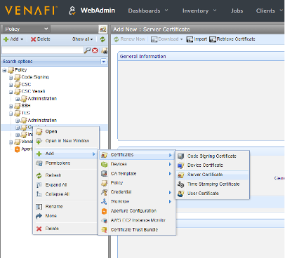
  <figcaption>Add Server Certificate Object</figcaption>
</figure>


Once at the *Add New : Server Certificate* screen, enter the required information to create the certificate object. Items with a "*" next to the field name are required to create the certificate object.

- **Certificate Name:** Enter a name for the certificate object
- CSR Generation - CSR generation can be done in two ways:
  - **Service Generated CSR:** This selection means that the user will provide the certificate details in the Subject DN section and the CSR will be generated by Venafi
  - **User Provided CSR:** This selection means the user will supply the CSR - Upon, selecting, the Upload CSR button will be enabled and the user can upload a CSR they have generated.

<figure>
  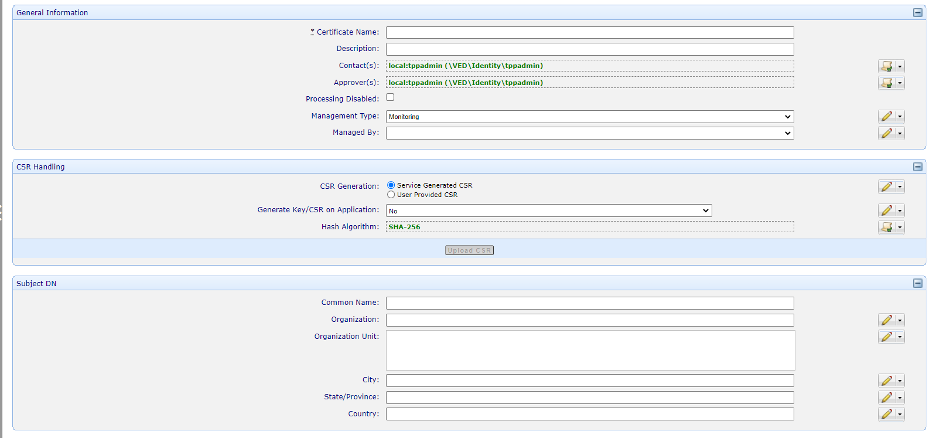
  <figcaption>Enter Server Certificate Details</figcaption>
</figure>

- **Subject Alt Name** - Additional names can be provided in two ways. 
  - One is through the **Add or Remove** button on the **Subject Alternative Name(s)** field as shown below. Additional names that use CNAME for domain control validation can be entered here. For these domains, SAN type should be selected as DNS and domain names should be entered in the SAN value text box with comma as a separator. 
  - Any domains that are going to be validated using **Email validation** should be passed through the 'SAN Validation Email list' in the custom fields section. This text box will accept domain names and their validation emails in the following format - `domain1|email1,domain2|email2`, and so on
- For **CA Template**, browse and select the CA Template object created in [Step 7](#7-create-ca-template-object)
- **Renewal window** is the lead time that users can mention when they wish their certificates to be renewed. 
  - If **Disable Automatic Renewal** is set to **No**, then then TPP will attempt to renew the certificate automatically when the number of days before expiration specified in the **Renewal window** occurs for the certificate. 

<figure>
  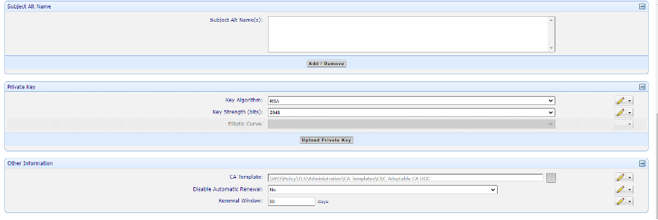
  <figcaption>More Certificate Details</figcaption>
</figure>

After entering the details for the certificate, population of the custom fields is required to request a CSC global certificate.

**NOTE**: Your mandatory custom fields may already be set by your TPP administrator using Policy. 

- In the Custom Fields section, populate the values for the **Certificate Type**, **Domain Control Validation**, **Email**, and **SAN Validation Email List** custom fields accordingly if they do not already have values.


<figure>
  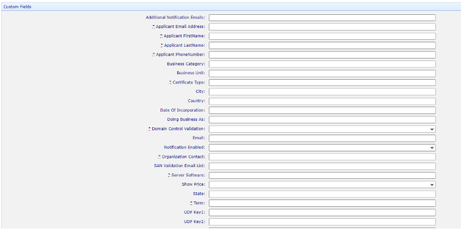
  <figcaption>Custom Fields</figcaption>
</figure>

After the certificate information has been entered and the CSC custom fields have been populated click **Save** - you should see the following screen:

<figure>
  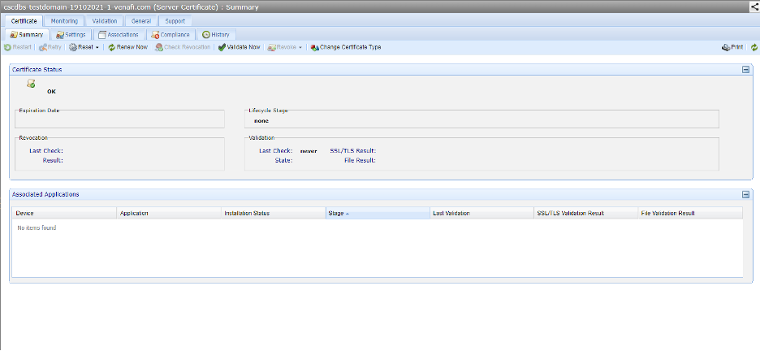
  <figcaption>OK</figcaption>
</figure>

At this point, the setup is complete. To raise/submit an order or renew a certificate, click the **Renew Now** button. All certificate data can be viewed under the Settings tab. Once the order is submitted, it will be in the "Retrieving Certificate" stage until the certificate is issued. 

**NOTE**: During this stage you may recieve emails requesting validation of the certificate request if Email was selected for the Domain Control Validation method. 

<figure>
  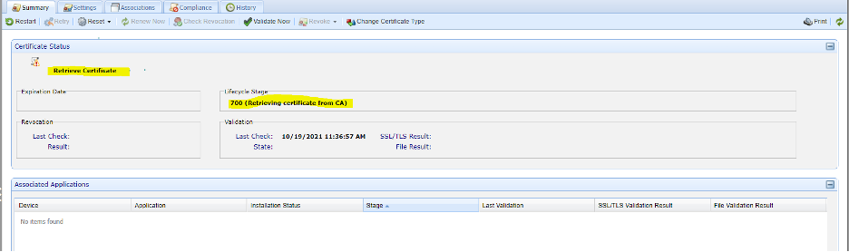
  <figcaption>Retrieving Certificate Status</figcaption>
</figure>

If any validation steps fail, an error message will be shown in the Certificate Status section on the Summary tab. The reason for the failure will be displayed as well. If a validation failure occurs, ensure that the correct validation settings are provided. 

<figure>
  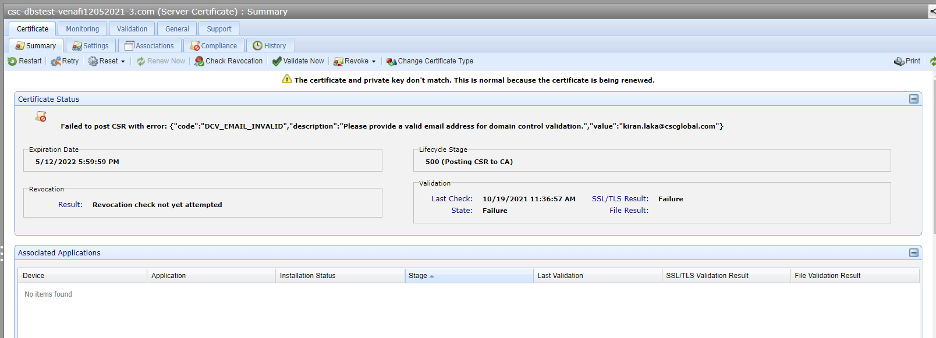
  <figcaption>Validation Error</figcaption>
</figure>

<br/><br/>

# CSC Global Certificate Import

## Synopsis
This script (**CSCGlobal_Certificate_Import.ps1**) imports certificates from a CSC Global environment. The script utilizes an API key and authorization token (generated and provided by CSC Global) to gather all ACTIVE certificates from a customers inventory. An Adaptable CA import job will need to be created in TPP.

## Instructions
1. Contact CSC Global to obtain and API key and authorization token.
1. Copy the **CSCGlobal_Certificate_Import.ps1** script to all TPP engines where the CA Import Manager module is enabled.
1. Create a Username Credentials in TPP:
    * Username: API Key
    * Password: Authorization Token
1. Create a new CA Import job in Aperture with the following details:
    | Parameter | Value |
    |---|---|
    | PowerShell Script | Select the CSCGlobal_Certificate_Import.ps1 script |
    | Username Credential | Select the Username Credential from above |
1. (Optional) Debugging may be enabled by selecting **Enable Debugging Logging**

> Important: This script will only import ACTIVE certificates. If expired or revoked certificates are needed, the scripts $global:apiUrl variable will need to be modified.
