## Overview

This Adaptable CA Driver orders CSC TrustedSecure certificates through the CSC API from Certificate Manager, Self-Hosted. It uses two sets of credentials: one for the CSC API (user token and API key), and one that stores Certificate Manager, Self-Hosted OAuth tokens (access token and refresh token) so the driver can update object attributes and keep the CSC API credentials current.

Useful CSC documentation: [CSC Domain Manager API v2](https://www.cscglobal.com/cscglobal/docs/dbs/domainmanager/api-v2/).

## Prerequisites

1. CSC Global Domain Manager API access credentials.
2. A Certificate Manager, Self-Hosted API integration with these scopes:
    - `security:manage`
    - `configuration:manage`
3. A service account or local account with these permissions:
    - Write permission on all certificate objects that use the CSC Adaptable CA Driver.
    - Write permission on the credential objects that hold the CSC API credentials and the Certificate Manager, Self-Hosted API credentials. You create these credential objects during installation.
    - Access to the API integration in item 2.
4. The CSC Adaptable CA Driver (`AdaptableCA-CSC.ps1`) and both configuration files (`AdaptableCA-CSC.json` and `properties.json`).

## Configuration Files and Custom Fields

The driver uses two configuration files and a set of custom fields to request and manage certificates through the CSC API. Copies of both configuration files must be in the same folder as the driver on every Certificate Manager, Self-Hosted engine.

### AdaptableCA-CSC.json

This file defines how the driver communicates with the CSC API and with Certificate Manager, Self-Hosted.

- **base_url**: The base URL of the CSC Global API to authenticate to.
- **venafi_auth_url**: The full URL of the token refresh endpoint, used by the script to refresh the OAuth token. Example: `https://mytppserver.corp.net/vedauth/Authorize/Token`
- **venafi_update_url**: The full URL of the Web SDK `Config/Write` endpoint, used to update custom fields, configuration values and the certificate "notes" attribute. Example: `https://mytppserver.corp.net/vedsdk/Config/Write`
- **venafi_credentials_update_url**: The full URL of the Web SDK `Credentials/Update` endpoint, used to update the stored OAuth token and refresh token. Example: `https://mytppserver.corp.net/vedsdk/Credentials/Update`
- **credentails_path**: The full DN path to the username credential object that stores the OAuth token and refresh token. Escape every `\` with a second `\` so the value is valid JSON. Example: `\\VED\\Policy\\CSC\\Administration\\CSC credential\\Venafi_api_key_token`. Store the credential as the access token, a pipe symbol and the refresh token, with no spaces: `Access Token|Refresh Token`.
- **client_id**: The client ID of the API integration the script authenticates as. Example: `CSCglobalCA`

### properties.json

This file holds the CSC request information that is not set by custom fields. Values here apply to every certificate requested through the driver unless a custom field sets them.

These fields apply only to the CSC TrustedSecure Extended Validation certificate and can stay blank for other certificate products:

- Country
- City
- State
- Date Of Incorporation
- Doing Business As
- Business Category

CSC User Defined Fields (UDFs) defined in your CSC Global account are also set here, in the `customFields` property as a JSON array. You can add up to 13 UDF name and value pairs:

```json
"customFields": [
    {
        "name": "UDF1",
        "value": "test2"
    },
    {
        "name": "UDF2",
        "value": "test-3"
    },
    {
        "name": "",
        "value": ""
    }
]
```

Available `ServerSoftware` values:

| ServerSoftware | Value |
| --- | --- |
| OTHER | -1 |
| APACHE_MODSSL | 2 |
| APACHE_SSL | 3 |
| C2NET_STRONGHOLD | 4 |
| CISCO_3000_SERIES_VPN_CONCENTRATOR | 33 |
| CITRIX | 34 |
| COBALT_RAQ | 5 |
| COVALENT_SERVER_SOFTWARE | 6 |
| ENSIM | 29 |
| H_SPHERE | 32 |
| IBM_HTTP_SERVER | 7 |
| IBM_INTERNET_CONNECTION_SERVER | 8 |
| IPLANET | 9 |
| JAVA_WEBSERVER_JAVASOFT_SUN | 10 |
| LOTUS_DOMAINO_GO | 12 |
| MICROSOFT_IIS_1X_TO_4X | 13 |
| MICROSOFT_IIS_5X_TO_6X | 14 |
| MICROSOFT_IIS_7X_TO_LATER | 35 |
| NETSCAPE_ENTERPRISE_SERVER | 15 |
| NETSCAPE_FASTTRACK | 16 |
| NGINX | 36 |
| NOVELL_WEB_SERVER | 17 |
| ORACLE | 18 |
| PLESK | 30 |
| QUID_PRO_QUO | 19 |
| R3_SSL_SERVER | 20 |
| RAVEN_SSL | 21 |
| REDHAT_LINUX | 22 |
| SAP_WEB_APPLICATION_SERVER | 23 |
| TOMCAT | 24 |
| WEBSITE_PROFESSIONAL | 25 |
| WEBSTAR_4X_AND_LATER | 26 |
| WEBTEN_FROM_TENON | 27 |
| WHM_CPANEL | 31 |
| ZEUS_WEB_SERVER | 28 |

### Custom Fields

Custom fields hold values that can differ per certificate, and can be set by policy if required.

- **Certificate Type**: String, required, applies to Certificate. Values: Premium `0`, Wildcard `1`, UCC `2`, EV `3`.
- **Domain Control Validation**: List with the options `Cname` and `Email`, required, applies to Certificate.
- **Email**: String, optional, applies to Certificate. The email address used in the validation template.
- **SAN Validation Email List**: String, optional, applies to Certificate. Domains on the certificate that are validated by email, in the format `domain1|email1, domain2|email2`.

## Installation

### 1. Fill out properties.json

Populate `properties.json` with the information for your CSC Global account. These values are set on every certificate requested through the driver. See [properties.json](#propertiesjson) above.

### 2. Create custom fields

Create the custom fields listed in [Custom Fields](#custom-fields) with exactly those names, because the CSC API uses the names as identifiers. Set each field as required or optional as listed.

### 3. Create the policy structure

Create the policy structure for CSC certificates. Contact your Certificate Manager, Self-Hosted support team if you need help.

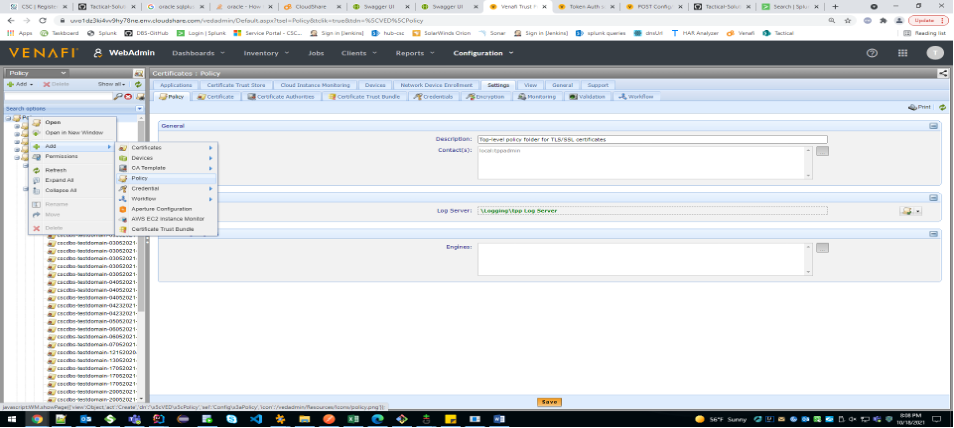

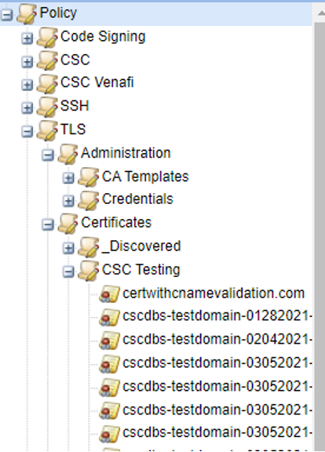

### 4. Create the CSC credential object

Create a credential object that holds the API key and user token the CSC API uses to authenticate requests. The driver keeps this credential current when it needs rotating.

Right-click your credential folder and click **Add > Credential > Username Credential**.

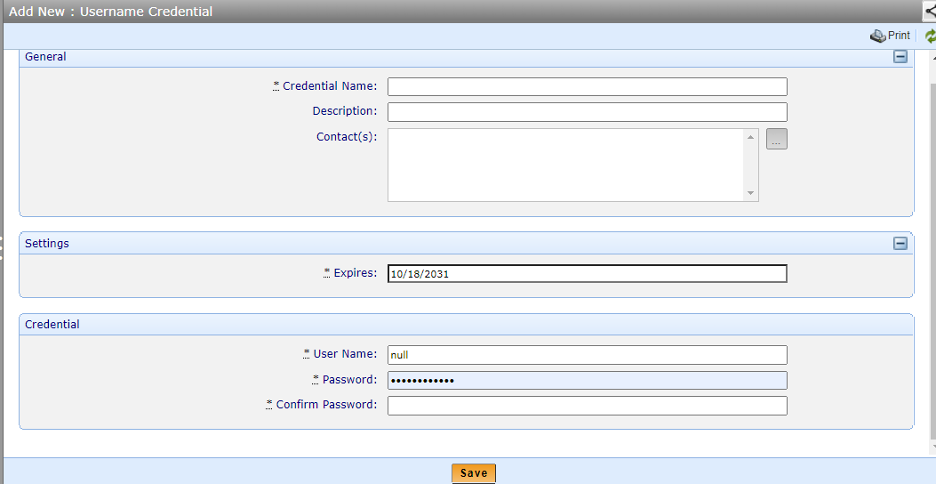

- Enter a credential name that identifies the object to other users. **CSC Global CA API Credential** is recommended.
- The CSC API does not expect a username, so the username can be `null`.
- Enter the user token and API key from CSC, separated by a pipe symbol, as the password: `USER TOKEN|API KEY`.
- Enter the same value in **Confirm Password**.

### 5. Create the API integration

Create an API integration so the driver can connect to Certificate Manager, Self-Hosted with OAuth tokens and keep the CSC API credentials current. See [Creating an API integration](https://docs.venafi.com/Docs/current/TopNav/Content/API-ApplicationIntegration/t-APIAppIntegrations-creating.php).

1. Use the product switcher to switch to the Platform menu bar.
2. Click **API > Integrations**.
3. Click **New**.
4. Configure the integration:
    - **Name**: `CSCglobalCA`
    - **ClientID**: `CSCglobalCA`
    - **Description**: API integration for use with the CSC Global AdaptableCA Driver
    - Click **Next**.
    - Grant the `configuration:manage` and `security:manage` scopes.
    - Use the global default token refresh settings.
    - Click **Next**.
    - Grant the service account or local user access to the API integration.
5. Click **Done**.

### 6. Create the platform credential object

Create a credential object that can update the **Notes** attribute on the **Support** tab of a certificate object. You need the OAuth access token and refresh token returned when you authenticate with the API integration from step 5.

To get the tokens from the built-in Swagger page:

1. Log in to Certificate Manager, Self-Hosted.
2. Go to `https://<your-server>/vedsdk/#/authorize/AuthorizeOAuth`.
3. On the `POST /vedauth/authorize/oauth` endpoint, click **Try it out**.
4. Paste the JSON example token request from your API integration, and change the username and password to the account granted access to the `CSCglobalCA` integration.
5. Click **Execute**.
6. Copy the `access_token` and `refresh_token` values from the response.

Then right-click your credential folder and click **Add > Credential > Username Credential**.


- Enter a credential name. **CSC Global Venafi API Credential** is recommended.
- The username can be `null`, because the driver authenticates with the OAuth tokens stored in the password.
- Enter the access token and refresh token, separated by a pipe symbol with no spaces, as the password: `ACCESS_TOKEN|REFRESH_TOKEN`.
- Enter the same value in **Confirm Password**.

### 7. Create the CA template object

The CA template holds the credentials, custom fields and renewal window. Right-click your target policy folder and click **Add > CA Template > Adaptable**.

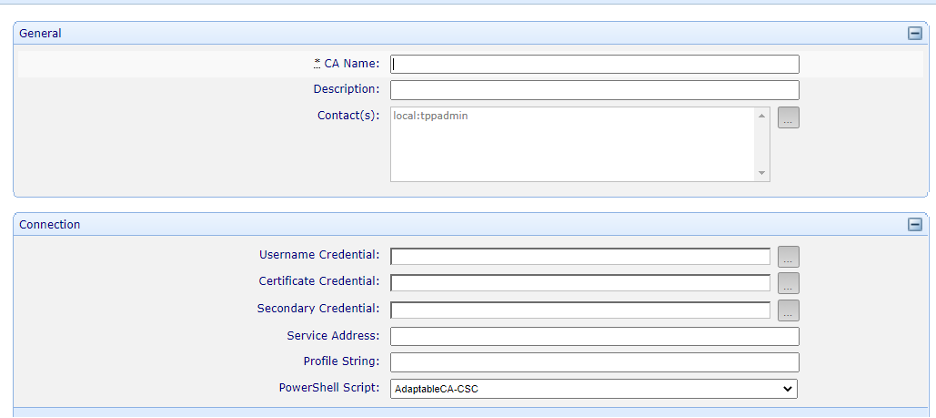

- Enter a CA name to use as an identifier.
- For **Username Credential**, select the CSC credential from step 4.
- For **Secondary Credential**, select the platform credential from step 6.
- For **PowerShell Script**, select the CSC Adaptable script.

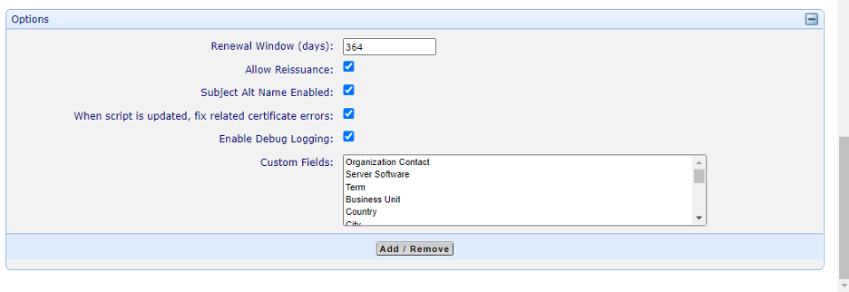

- **Renewal Window (days)**: Outside the renewal window, **Renew Now** requests a certificate reissue. Inside the renewal window, **Renew Now** requests a certificate renewal.
- **Custom fields**: Add the custom fields from step 2 as required by the certificate product. Most fields are common to all certificate product types.

### 8. Fill out AdaptableCA-CSC.json

Populate `AdaptableCA-CSC.json` with the endpoint and client ID information for the CSC Global API and Certificate Manager, Self-Hosted. See [AdaptableCA-CSC.json](#adaptableca-cscjson) above. The `client_id` must match the client ID of the API integration from step 5.

### 9. Copy the driver and configuration files

Copy these files to `<Venafi root directory>\Scripts\AdaptableCA\` on every engine in your cluster:

- `AdaptableCA-CSC.ps1`
- `AdaptableCA-CSC.json`
- `properties.json`

## Usage

### Request a certificate

Create a certificate object before you request a certificate. Right-click and click **Certificate > Add > Certificates > Server Certificate**.

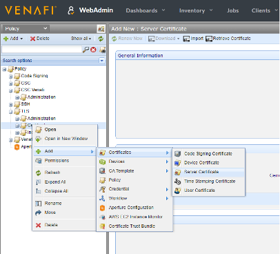

On the **Add New : Server Certificate** screen, enter the required information. Fields marked with `*` are required.

- **Certificate Name**: A name for the certificate object.
- **CSR Generation**: Choose **Service Generated CSR** to enter the details in the Subject DN section and have the CSR generated for you, or **User Provided CSR** to upload your own CSR.

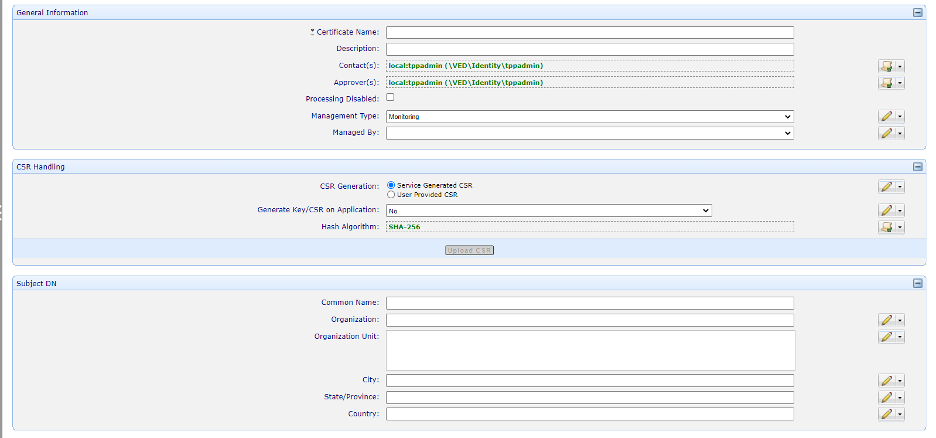

- **Subject Alternative Name(s)**: Use **Add or Remove** to add names validated by CNAME, with SAN type **DNS** and comma-separated domain names. Enter domains validated by email in the **SAN Validation Email List** custom field instead, in the format `domain1|email1,domain2|email2`.
- **CA Template**: Select the CA template from installation step 7.
- **Renewal Window**: The lead time before expiration for renewal. If **Disable Automatic Renewal** is **No**, the certificate is renewed automatically when the renewal window starts.

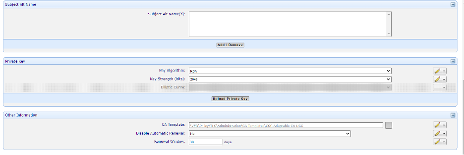

Populate the **Certificate Type**, **Domain Control Validation**, **Email** and **SAN Validation Email List** custom fields if your administrator has not already set them by policy.

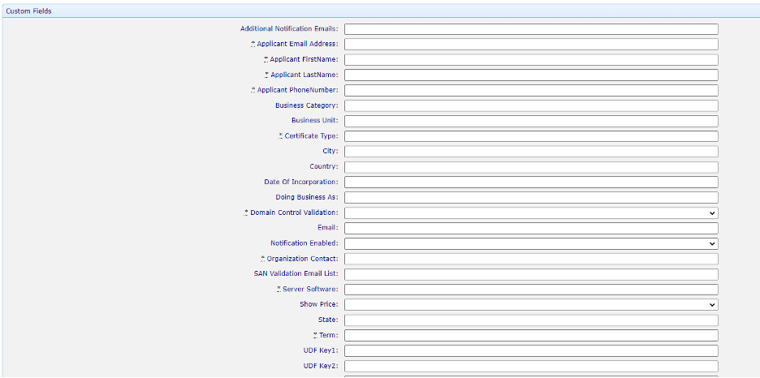

Click **Save**.

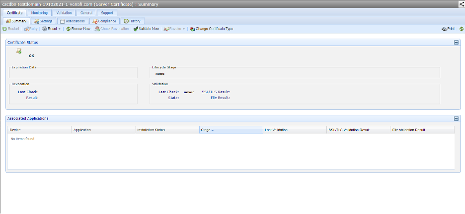

To submit an order or renew a certificate, click **Renew Now**. Certificate data is shown on the **Settings** tab. The certificate stays in the **Retrieving Certificate** stage until it is issued. If you chose email for domain control validation, you may receive emails asking you to validate the request.

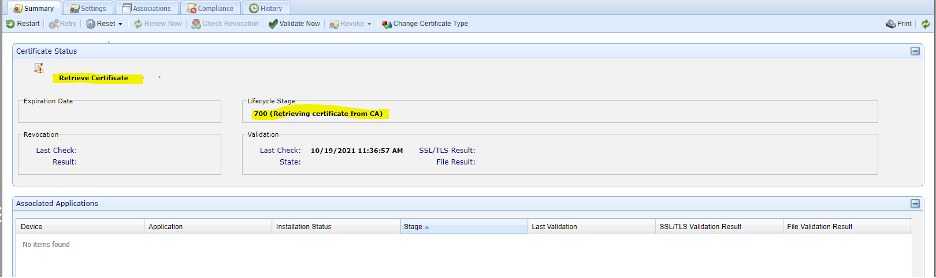

### Import certificates from CSC Global

`CSCGlobal_Certificate_Import.ps1` imports all ACTIVE certificates from your CSC Global inventory, using an API key and authorization token from CSC Global, through an Adaptable CA import job.

1. Contact CSC Global to obtain an API key and authorization token.
2. Copy `CSCGlobal_Certificate_Import.ps1` to every engine where the CA Import Manager module is enabled.
3. Create a username credential with the API key as the username and the authorization token as the password.
4. Create a CA Import job in Aperture:
    - **PowerShell Script**: `CSCGlobal_Certificate_Import.ps1`
    - **Username Credential**: The credential from step 3
5. Optionally, select **Enable Debugging Logging**.

The script imports only ACTIVE certificates. To import expired or revoked certificates, modify the `$global:apiUrl` variable in the script.

## Troubleshooting

If a validation step fails, the **Certificate Status** section on the **Summary** tab shows an error message and the reason for the failure. Check that the validation settings are correct.

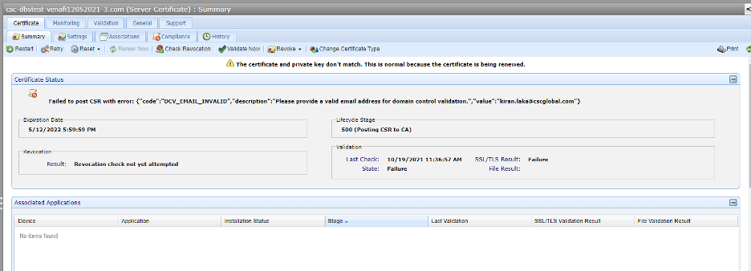
