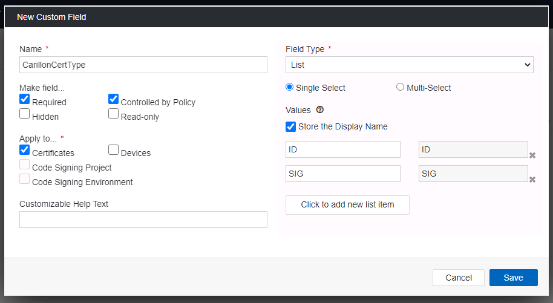
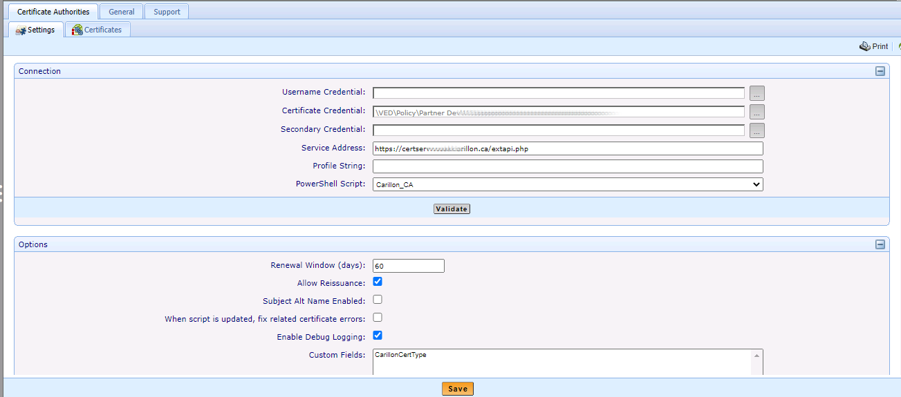
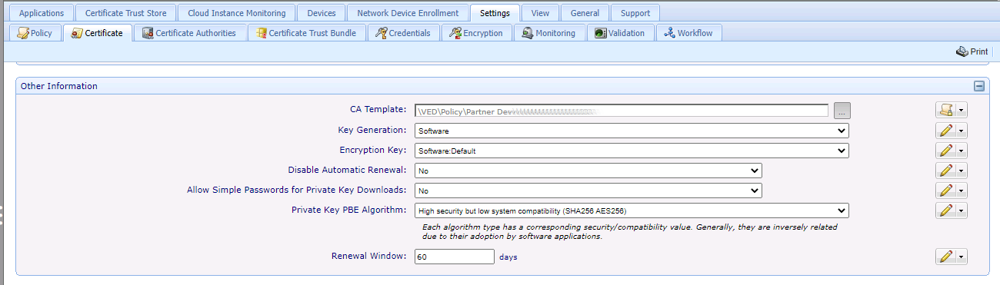
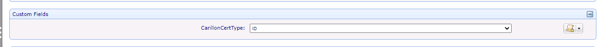

# Carillon CA Integration README

The purpose of this document is to provide information regarding the integration of Carillon's CertServ PKI Suite with with Venafi Trust Protection Platform (TPP) by means of an Adaptable CA script.

*The information provided in this document is considered proprietary and confidential.*

>This integration guide, as well as the software and/or products described in it, are furnished under agreement with Carillon Information Security Inc. ("Carillon") and may be used only in accordance with the terms of such agreement. Except as permitted by such agreement, no part of this publication may be reproduced, stored in a retrieval system, or transmitted, in any form or by any means, electronic, mechanical, recording, or otherwise, without prior written permission of Carillon.

## TABLE OF CONTENTS

- [About Us](#about-us)
- [Integration with Venafi](#integration-with-venafi)
- [Prerequisites](#prerequisites)
- [Installation and Configuration](#installation-and-configuration)
  - [Installation](#installation)
  - [Credential Configuration](#credential-configuration)
  - [Certificate Type Configuration](#certificate-type-configuration)
  - [Adaptable CA Connector Configuration](#adaptable-ca-connector-configuration)
  - [Per-certificate-type Policy Configuration](#per-certificate-type-policy-configuration)
- [Usage](#usage)
- [Troubleshooting](#troubleshooting)
- [Appendix A - Carillon Contact Information](#appendix-a---carillon-contact-information)

## About Us

Since 2000, Carillon Information Security Inc. provides a complete spectrum of identity management solutions that are designed to prevent identity theft, promote the migration from paper to electronic authentication, and avoid loss of intellectual property.

From consulting services, to validation software and managed identity services, Carillon can provide the skill sets and tools to help companies take control of their corporate digital credentials.

[For more information...](https://www.carillon.ca/)

## Integration with Venafi

Carillon's CertServ PKI Suite can integrate with Venafi’s Trust Protection Platform by way of an Adaptable CA script.  This allows lifecycle management operations (issuance, renewal, revocation) for a defined set of types of certificates in a Carillon managed PKI to be carried out using the Venafi TPP interface.

## Prerequisites

Before following the steps in this integration guide, the following prerequisites must be met:

- Venafi Trust Protection Platform is installed and configured
- A Carillon managed PKI using CertServ PKI Suite is operational and available ("the MPKI")
- A client certificate and keypair, in PKCS#12/PFX format, issued by the MPKI, is available for the Adaptable CA script to use
- The MPKI's extreq API is available and configured with a list of certificate types that TPP should be able to manage.  Requestable certificate types must use the delegated automation retrieval workflow.

## Installation and Configuration

### Installation

To enable Trust Protection Platform integration with the Carillon CertServ PKI Suite, the Carillon Adaptable CA script must be copied into place on the Venafi TPP application server.

- `C:\Program Files\Venafi\Scripts\AdaptableCA\Carillon_CA.ps1`

### Credential Configuration

The Carillon Adaptable CA connector must be configured with a certificate credential to digitally sign requests to the MPKI.

- Configure a Certificate Credential in the Venafi TPP Policy Tree, importing a PKCS#12/PFX file.  (Carillon will create the certificate on receipt of a PKCS #10 CSR file.)

### Certificate Type Configuration

If only a single certificate type in the MPKI is to be managed through Venafi TPP, its name can be configured in the Windows registry on the TPP application server:

- `HKLM\SOFTWARE\Carillon\extreq\certtype`

If multiple certificate types in the MPKI are to be managed through Venafi TPP, we recommend creating a Custom Field in TPP.  The Custom Field must be called `CarillonCertType`.

- The field should be **Required**, and **Controlled by Policy**.
- It should apply to **Certificates**.
- We recommend using a **Single Select List** field type, store the display name, and make available the list of names of certificate types to be managed.

For example:

### Adaptable CA Connector Configuration

In your Policy Tree, `Add`, `CA Template`, `Adaptable`

- Provide a name for the CA template in the policy tree.
- In the `Connection` pane:
  - For `Certificate Credential`, choose the credential imported earlier.
  - For `Service Address`, enter the API URL value provided by Carillon.
  - For `Powershell Script`, choose `Carillon_CA`.
  - Press `Validate`.

- In the `Options` pane:
  - For `Renewal Window`, enter 60 days, or other value provided by
      Carillon.
  - We recommend enabling `Allow Reissuance`.
  - Optionally `Enable Debug Logging` if you wish.
  - For `Custom Fields`, add the `CarillonCertType` field created
      earlier.

- Save the configuration.

For example:

### Per-certificate-type Policy Configuration

We recommend creating a policy in the policy-tree for each certificate type in the Carillon MPKI that will be managed through Venafi TPP.

- In the Policy Tree, `Add`, `Policy`, and give it a name.
- After saving, go to the `Certificate` tab.
- In the `General Information` pane:
  - For `Management Type`, select `Enrollment`, and policy-lock it.
  - For `Managed By`, select `Aperture`, and policy-lock it.

- In the `Other Information` pane:
  - For `CA Template`, select the Adaptable template created earlier, and policy-lock it.

- In the `Custom Fields` pane:
  - For `CarillonCertType`, select the appropriate value and policy-lock it.

- Other settings may be customized as needed.

For example:

## Usage

The Carillon CertServ PKI Suite requires that subscriber entities be sponsored in the CertServ GUI, including all necessary registration
attributes, **before** certificate issuance through Venafi TPP will be possible.

Therefore:

1. Sponsor a subscriber in CertServ.
2. Request a credential for that subscriber, using a workflow featuring delegated-automation for the retrieval step.
3. In Venafi TPP, `Add`, `Certificates`, `Device Certificate` or `Server Certificate`.
    - Provide the subscriber name for the certificate, and put the same value for `Common Name`.
    - Other values will be inherited from the policy.
    - Provide any other appropriate values needed.
4. Use the `Renew Now` button to issue a certificate.

If an error occurs, it will be shown.

During the certificate's renewal window, use `Renew Now` again to issue a new certificate.

At any time, you can use `Revoke` to permanently revoke the certificate.

After revocation, it is necessary to make a new credential request in CertServ before issuance will be possible again.

## Troubleshooting

If an error is encountered, it will be displayed within the Trust Protection Platform.

If debug logging is enabled for the CA adapter, the debug logs can be viewed in

- `C:\Program Files\Venafi\Logs\`

## Appendix A - Carillon Contact Information

Phone: 1-514-485-0789

E-mail: customer_service@carillon.ca
