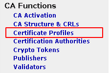
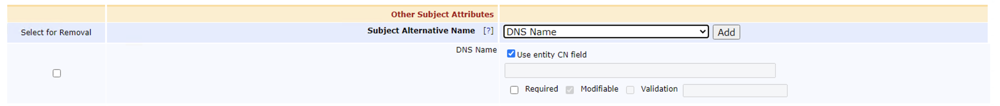
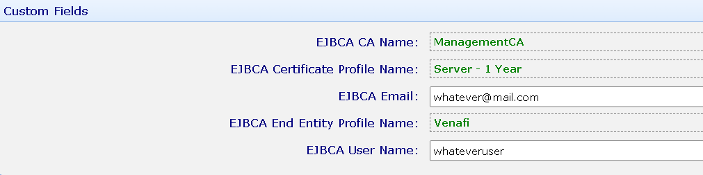

# Venafi EJBCA Integration

This document describes the steps to follow to configure a new REST EJBCA server to issue certificate for TPP. 

## EJBCA configuration

It's possible that the configuration on the EJBCA side has already been completed. If not, the following general guidance can be followed to setup an End Entity Profile that will work for Venafi Trust Protection Platform.

If your EJBCA instance is already setup, you can skip to the [TPP Configuration](#tpp-configuration) section. 

1. Go to Certificate Profiles

    

2. Next clone the CA template to suit your needs: 

    - For example, add a 1-year server template by cloning the SERVER profile 

        

    - For each template if there is any change in the certificate profile go to edit and save the changes, for example, changing the validity period to 1 year and then click save.

        

3. Next, create a new RA Entity Profile:

    

    - And name it Venafi 

        

    - Add the subject DN attributes for this profile: C, ST, L, O and OU

        

    - And associate it with the certificate templates you want this RA entity to use ie:

        

    - And add Subject Alternate Name DNS Name = Use entity CN field: 

        

4. Certificate Import (Optional)

    - If certificates shall be imported the V2 of the rest API has to be enabled. System Configuration -> Protocol Configuration

        

5. For issuance, renewal and revocation enable the V1 REST API

    - Go to System Configuration -> Protocol Configuration and enable "REST Certificate Management	/ejbca/ejbca-rest-api/v1/certificate"

        

At this point the CA configuration is complete.

## TPP Configuration

Users must add EJBCA_REST.ps1 script to the `"C:\Program Files\Venafi\Scripts\AdaptableCA"` directory on the Venafi platform servers in order to call EJBCA APIs through the script. Before using this template, users must configure the following custom fields in Trust Protection Platform. Please note that these custom field names should be configured with exact names and values.

1. Install the adaptable driver into the `C:\Program Files\Venafi\Scripts\AdaptableCA` folder on the Trust Protection Platform server 

    

2. Create the custom fields in Aperture

    

    > For more information about the necessary Custom Fields, please see the [custom field reference](#custom-field-reference) at the bottom of this page.

3. Add the following 5 entries (They are expected by the driver)

    

    > For the Certificate Profile name, make sure it includes the charset you will be using, ie: `^[A-Za-z0-9-_\s]*$`

4. Configure the EJBCA driver in vedadmin

    > Cert credential are needed to pass the “validate” check.

5. Create the EJBCA CA Template object and configure it as below:

    

    - To utilize a proxy:
        - Set `Profile String` to the proxy url
        - Optionally, set `Secondary Credential` to a Username Credential with the proxy credentials

6. Configure the Policy folder to use that CA Template:

    

    - The only 3 *strict* fields are listed below - they ARE case-sensitive:
        - “EJBCA CA Name” ("ManagementCA" is the default EJBCA CA name)
        - “EJBCA End Entity Profile Name” ("Venafi" is the example used above)
        - "EJBCA Certificate Profile Name" ("Server - 1 Year" is the example used above)

            

Congratulations! You should now be able to issue certificates.

## Additional Resources

### Custom Field Reference

The values which can be configured as part of custom field should as follows:

| Field name 								| Example 												| Reference                     |
| ---                                       | ---                                                   | ---                           |                                   
| EJBCA CA Name 							| ManagementCA       								    | Details [here](https://doc.primekey.com/ejbca/ejbca-introduction/ejbca-concepts#EJBCAConcepts-CertificationAuthority(CA)) |
| EJBCA Certificate Profile Name 			| Server - 1 Year                                       | Details [here](https://doc.primekey.com/ejbca/ejbca-introduction/ejbca-concepts#EJBCAConcepts-CertificateProfile) |
| EJBCA End Entity Profile Name 			| Venafi                								| Details [here](https://doc.primekey.com/ejbca/ejbca-introduction/ejbca-concepts#EJBCAConcepts-EndEntityProfile) |
| EJBCA Email								| john.doe@example.com    				    			| |
| EJBCA User Name							| John      											| |

