# EJBCA Enterprise for Certificate Manager, Self-Hosted

This guide configures an EJBCA Enterprise server with the REST API so that Certificate Manager, Self-Hosted can request, renew, revoke and import certificates through the `EJBCA_REST.ps1` Adaptable CA driver.

## Prerequisites

- An EJBCA Enterprise instance reachable from the Certificate Manager, Self-Hosted servers.
- A client authentication certificate for the EJBCA REST API, stored as a credential in Certificate Manager, Self-Hosted.
- Administrator access to Certificate Manager, Self-Hosted.
- The `EJBCA_REST.ps1` driver from this listing.

## EJBCA Configuration

The EJBCA side may already be configured. If it is, skip to [Certificate Manager, Self-Hosted Configuration](#certificate-manager-self-hosted-configuration). Otherwise, use these general steps to set up an end entity profile that works with Certificate Manager, Self-Hosted.

1. Go to **Certificate Profiles**.

    

2. Clone a certificate profile to suit your needs.

    - For example, add a 1-year server profile by cloning the **SERVER** profile.

        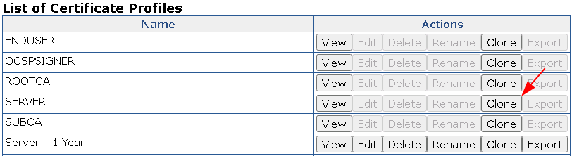

    - Edit each new profile as needed, for example change the validity period to 1 year, and click **Save**.

        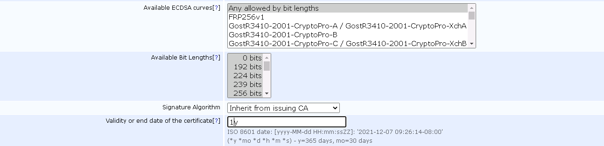

3. Create a new end entity profile.

    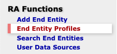

    - Name it, for example `Venafi`.

        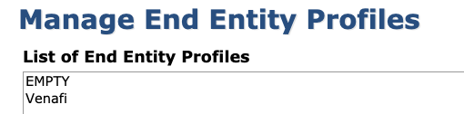

    - Add the subject DN attributes C, ST, L, O and OU.

        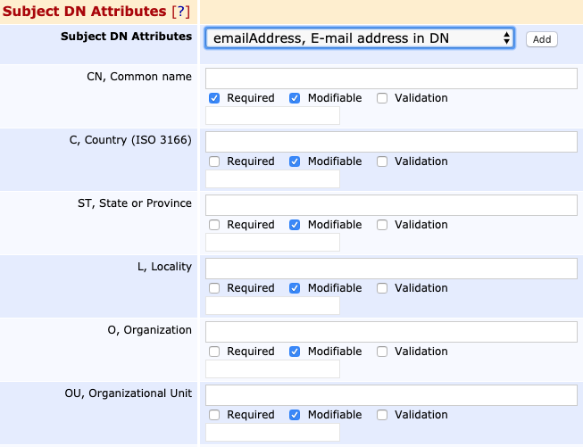

    - Associate it with the certificate profiles this end entity should use.

        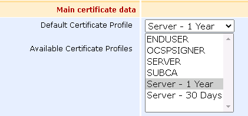

    - Add the Subject Alternative Name **DNS Name** and select **Use entity CN field**.

        

4. (Optional) To import certificates, enable version 2 of the REST API under **System Configuration** > **Protocol Configuration**.

    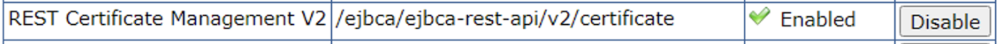

5. For issuance, renewal and revocation, enable the version 1 REST API under **System Configuration** > **Protocol Configuration**: **REST Certificate Management** (`/ejbca/ejbca-rest-api/v1/certificate`).

    

The CA configuration is now complete.

## Certificate Manager, Self-Hosted Configuration

The driver reads its settings from custom fields, which must be created with the exact names listed in the [custom field reference](#custom-field-reference).

1. Copy `EJBCA_REST.ps1` to `C:\Program Files\Venafi\Scripts\AdaptableCA` on every Certificate Manager, Self-Hosted server.

    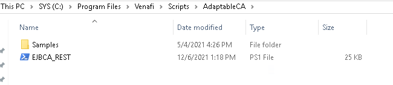

2. In the web console, create the custom fields.

    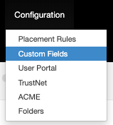

3. Add the five entries the driver expects.

    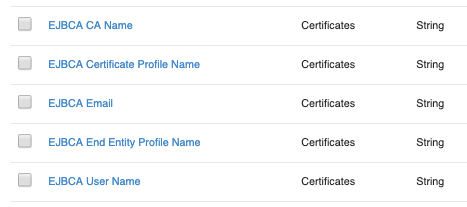

    For the certificate profile name, make sure the field allows the characters you will use, for example `^[A-Za-z0-9-_\s]*$`.

4. In the Admin console (VEDAdmin), configure the EJBCA driver. A certificate credential is needed to pass the **Validate** check.

5. Create the EJBCA CA template object and configure it as shown.

    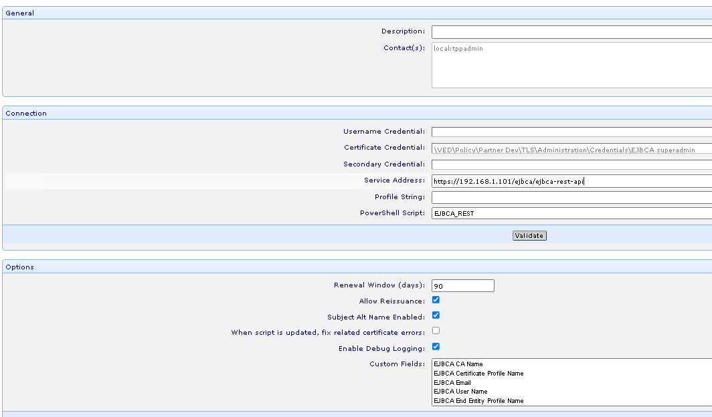

    To use a proxy, set **Profile String** to the proxy URL, and optionally set **Secondary Credential** to a username credential with the proxy credentials.

6. Configure the policy folder to use the CA template.

    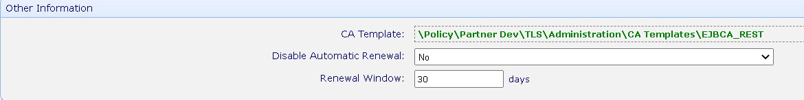

    These three fields are strict and case-sensitive:

    - **EJBCA CA Name** (`ManagementCA` is the default EJBCA CA name)
    - **EJBCA End Entity Profile Name** (`Venafi` in the example above)
    - **EJBCA Certificate Profile Name** (`Server - 1 Year` in the example above)

    

You can now issue certificates from EJBCA through Certificate Manager, Self-Hosted.

## Custom Field Reference

| Field name | Example | Reference |
| --- | --- | --- |
| EJBCA CA Name | ManagementCA | [Certification Authority](https://doc.primekey.com/ejbca/ejbca-introduction/ejbca-concepts#EJBCAConcepts-CertificationAuthority(CA)) |
| EJBCA Certificate Profile Name | Server - 1 Year | [Certificate Profile](https://doc.primekey.com/ejbca/ejbca-introduction/ejbca-concepts#EJBCAConcepts-CertificateProfile) |
| EJBCA End Entity Profile Name | Venafi | [End Entity Profile](https://doc.primekey.com/ejbca/ejbca-introduction/ejbca-concepts#EJBCAConcepts-EndEntityProfile) |
| EJBCA Email | john.doe@example.com | |
| EJBCA User Name | John | |
