# Integration README

The purpose of this document is to provide information regarding the configuration of Secur Solutions' EJBCA Legacy adaptable driver for integration with Venafi Trust Protection Platform (TPP).

*The information provided in this document is considered proprietary and confidential.*

>This integration guide, as well as the software and/or products described in it, are furnished under agreement with Secur Solutions and may be used only in accordance with the terms of such agreement.
>Except as permitted by such agreement, no part of this publication may be reproduced, stored in a retrieval system, or transmitted, in any form or by any means, electronic, mechanical, recording, or otherwise, without prior written permission of Secur Solutions.

## TABLE OF CONTENTS

- [About Us](#about-us)
- [Integration with Venafi](#integration-with-venafi)
- [Prerequisites](#prerequisites)
- [Installation and Configuration](#installation-and-configuration)
    - [EJBCA Configuration](#ejbca-configuration)
    - [TPP Configuration](#tpp-configuration)

## About Us
### &nbsp; **SECUR SOLUTIONS GROUP**

**Innovation is in our DNA.**

Secur Solutions Group's mission is market leadership in Smart Card issuance and Digital Identity. 

We seek to be a forward thinking and process centred organisation that delivers innovative solutions to our customers while consistently outperforming our peers. We do so by being market aware and providing a dynamic and challenging environment for our internal team. 

We are privately owned, with a Ministry of Finance (Singapore) S8 qualification. In territory, we have majority coverage of the financial card issuance and government card issuance space, and partnerships with the major System Integrators. We have achieved the Singapore Quality Class (SQC 2017) and are Bizsafe certified. 

We are the pioneering and oldest Entrust distribution partner in Southeast Asia and a multiple award winner within the Entrust network.

## Integration with Venafi

Venafi’s Trust Protection Platform integrates with the Secur Solutions's EJBCA Legacy adaptable driver for the purposes of customizing and issuing certificates with a configurable and randomized serial number with a prefix value. The primary benefit of this is to provide a way to issue certificates with a configurable serial number for legacy applications which are using EJBCA.

## Prerequisites

Before following the steps in this integration guide, the following prerequisite items must be installed and configured:

- Venafi Trust Protection Platform
- **EJBCA Enterprise** 

## Installation and Configuration

### EJBCA configuration

It's possible that the configuration on the EJBCA side has already been completed. If not, the following general guidance can be followed to setup an End Entity Profile that will work for Venafi Trust Protection Platform.

If your EJBCA instance is already setup, you can skip to the [TPP Configuration](#tpp-configuration) section. 

1. Go to Certificate Profiles

    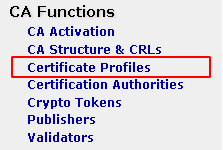

2. Next clone the CA template to suit your needs: 

    - For example, add a 1-year server template by cloning the SERVER profile 

        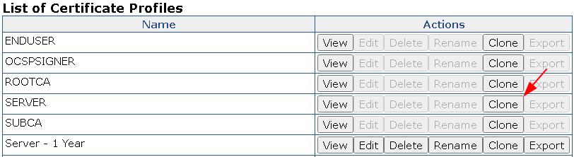

    - For each template if there is any change in the certificate profile go to edit and save the changes, for example, changing the validity period to 1 year and then click save.

        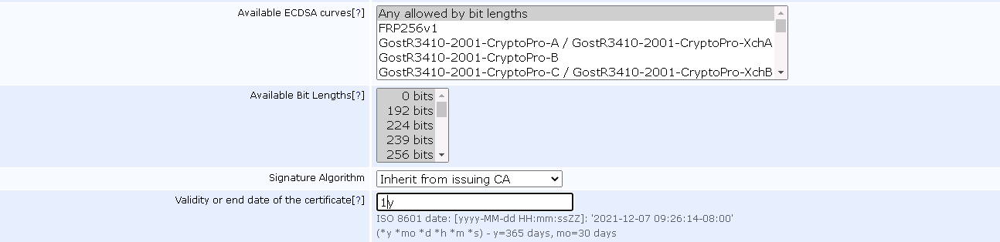

3. Next, create a new RA Entity Profile:

    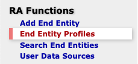

    - And name it Venafi 

        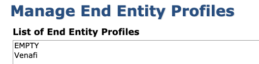

    - Add the subject DN attributes for this profile: C, ST, L, O and OU

        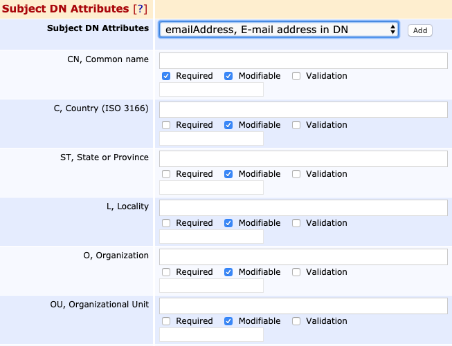

    - And associate it with the certificate templates you want this RA entity to use ie:

        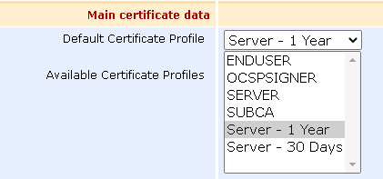

    - And add Subject Alternate Name DNS Name = Use entity CN field: 

        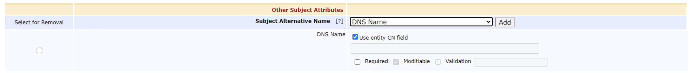

4. Certificate Import (Optional)

    - If certificates shall be imported the V2 of the rest API has to be enabled. System Configuration -> Protocol Configuration

        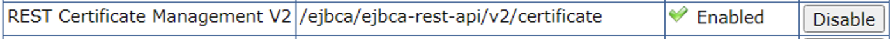

5. For issuance, rewnewal, recovation enable the V1 REST API

    - Go to System Configuration -> Protocol Configuration and enable "REST Certificate Management	/ejbca/ejbca-rest-api/v1/certificate"

        

6. Additionally for renewal of the certificate, please ensure to disable the enforce unique DN for the certificate authority
     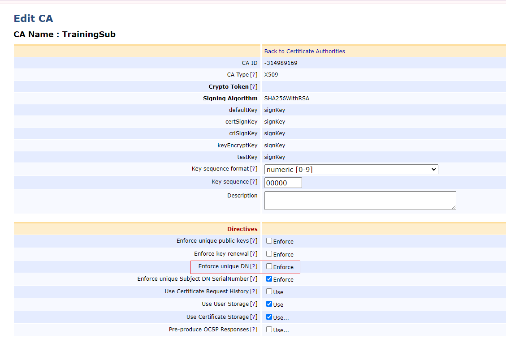

At this point the CA configuration is complete.

## TPP Configuration

Users must add Secur EJBCA script.ps1 script to the `"C:\Program Files\Venafi\Scripts\AdaptableCA"` directory on the Venafi platform servers in order to call EJBCA APIs through the script. Before using this template, users must configure the following custom fields in Trust Protection Platform. Please note that these custom field names should be configured with exact names and values.

1. Install the adaptable driver into the `C:\Program Files\Venafi\Scripts\AdaptableCA` folder on the Trust Protection Platform server 

    

2. Create the custom fields in Aperture

    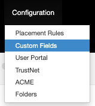

    > For more information about the necessary Custom Fields, please see the [custom field reference](#custom-field-reference) at the bottom of this page.

3. Add the following 7 entries (They are expected by the driver)

    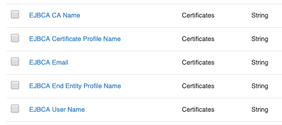
    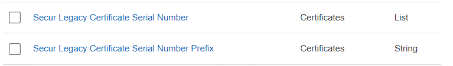

    > For the Certificate Profile name, make sure it includes the charset you will be using, ie: `^[A-Za-z0-9-_\s]*$`

4. Configure the EJBCA driver in vedadmin

    > Cert credential are needed to pass the “validate” check.

5. Create the EJBCA CA Template object and configure it as below, making sure that the 2 additional custom fields are selected as well:

    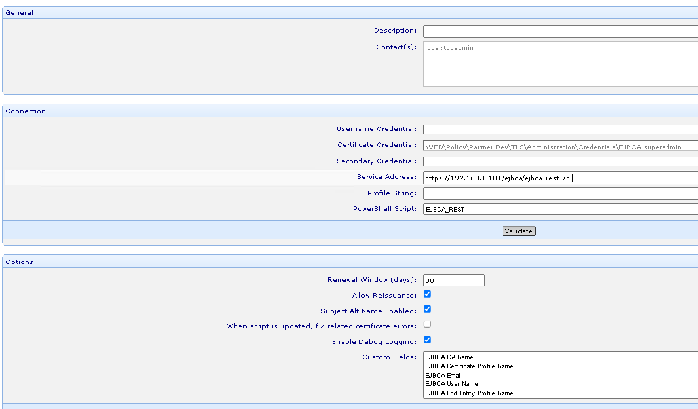

6. Configure the Policy folder to use that CA Template:

    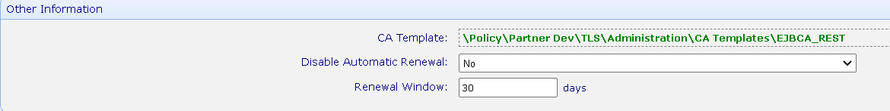

    - The only 5 *strict* fields are listed below - they ARE case-sensitive:
        - “EJBCA CA Name” ("ManagementCA" is the default EJBCA CA name)
        - “EJBCA End Entity Profile Name” ("Venafi" is the example used above)
        - "EJBCA Certificate Profile Name" ("Server - 1 Year" is the example used above)
        - "Secur Legacy Certificate Serial Number"
        - "Secur Legacy Certificate Serial Number Prefix"

            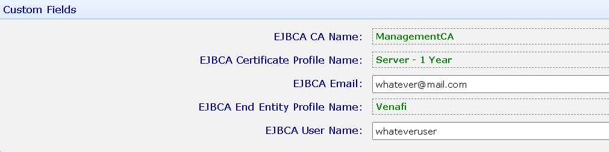
            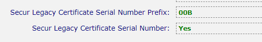

Congratulations! You should now be able to issue certificates.

## Additional Resources

### Custom Field Reference

The values which can be configured as part of custom field should as follows:

| Field name 								| Example 												| Reference                     |
| ---                                       | ---                                                   | ---                           |                                   
| EJBCA CA Name 							| ManagementCA       								    | Details [here](https://doc.primekey.com/ejbca/ejbca-introduction/ejbca-concepts#EJBCAConcepts-CertificationAuthority(CA)) |
| EJBCA Certificate Profile Name 			| Server - 1 Year                                       | Details [here](https://doc.primekey.com/ejbca/ejbca-introduction/ejbca-concepts#EJBCAConcepts-CertificateProfile) |
| EJBCA End Entity Profile Name 			| Venafi                								| Details [here](https://doc.primekey.com/ejbca/ejbca-introduction/ejbca-concepts#EJBCAConcepts-EndEntityProfile) |
| EJBCA Email								| johndoe@venafi.com    				    			| |
| EJBCA User Name							| John      											| |
| Secur Legacy Certificate Serial Number | Yes, No | |
| Secur Legacy Certificate Serial Number Prefix | 00A | |

