# F5 Distributed Cloud (XC) Installation and Configuration Guide

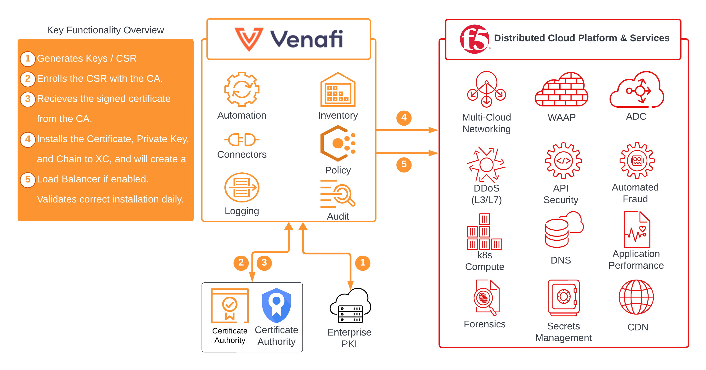

This guide covers the F5 Distributed Cloud Adaptable Application driver for Certificate Manager, Self-Hosted. The integration guide, software and products described in it are furnished under agreement with F5 and may be used only in accordance with the terms of that agreement.

## Prerequisites

- Certificate Manager, Self-Hosted
- An F5 Distributed Cloud tenant
- An F5 Distributed Cloud API token. See [Generate API Tokens](https://docs.cloud.f5.com/docs/how-to/user-mgmt/credentials).

F5 Distributed Cloud API tokens have a maximum age of 90 days, so plan for renewal. Token renewal can be automated but is out of scope for this driver.

## Installation

The driver file is `F5DistributedCloudAdaptableAppDriver.ps1`. It must be installed on all Certificate Manager, Self-Hosted servers acting as log servers and application servers, and configuration is required after installation.

1. Place the script file in the `<Certificate Manager Home>\Scripts\AdaptableApp` folder on all Certificate Manager, Self-Hosted servers.
2. Restart the `ved` and `venafilogserver` services on each server.
3. Restart IIS on servers acting as web servers.

## Configuration

### Configure a Username Credential Object

1. Create a username credential in Certificate Manager, Self-Hosted. The **Password** field contains the API token and the **Username** field can be `null`.

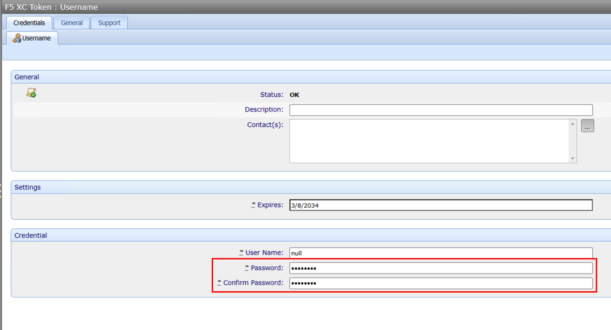

### Configure the XC Adaptable App Policy

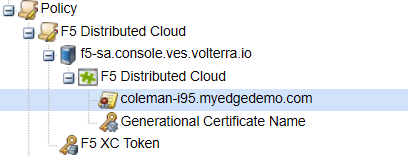

1. Configure a policy folder to use the F5 Distributed Cloud Adaptable Application driver. This can be done at the top level, or you can create a new F5 Distributed Cloud policy.
2. Browse to or create the policy folder that will hold the F5 Distributed Cloud device and application objects.
3. Go to **Applications** > **Adaptable**.
4. Set the **PowerShell Script** field to the F5 Distributed Cloud Adaptable Application driver.
5. Specify a namespace for the certificate configurations. This is where the certificate is stored on XC, and it must be an application namespace.
6. Specify a **Loadbalancer FQDN**. It is used by the certificate extraction function for validation.
7. (Optional) Set **Static Asset Name** to a static name for the certificate object in Distributed Cloud. If you leave it blank, the certificate subject and short serial are used, which may create duplicate objects in XC and require extra steps to apply a renewed certificate.
8. Select whether to enable driver debugging.
9. Select whether to create a load balancer. If this is not enabled, you must update the certificate binding to the load balancer in the XC Console yourself.

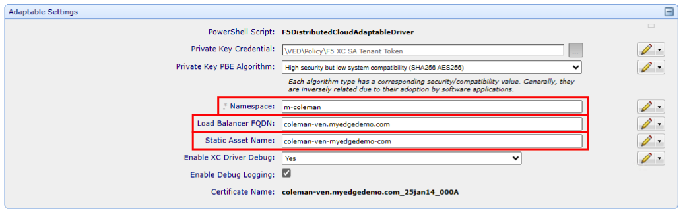

### Configure Device, Application and Certificate Objects

1. Create a device object.
2. Set the **Hostname/Address** field to `[tenant-name].console.ves.volterra.io`.
3. Set the credential.

   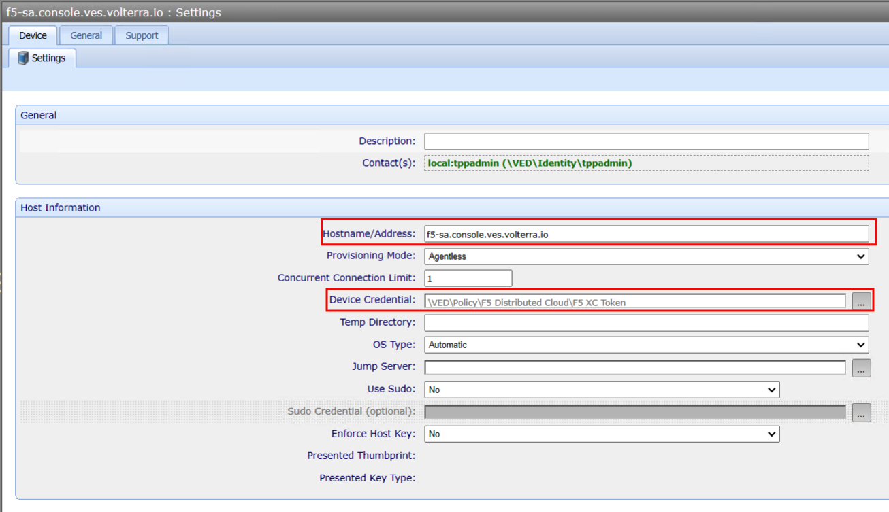

4. Create an application object.
5. If the values were not set in the policy, set them now. Otherwise they are inherited from the policy.

   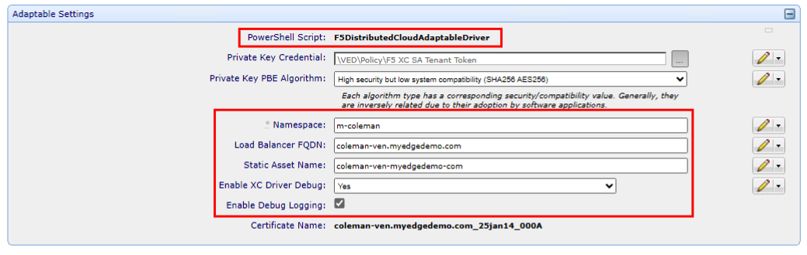

6. Create a certificate object.
7. Make sure **Management Type** is **Provisioning**.
8. Make sure **CSR** is set to **Service Generated**.
9. Populate the certificate values as needed.
10. Make sure **Private Key (bits)** is set to at least 2048.

    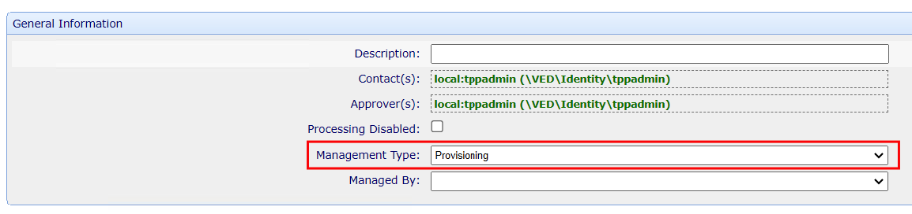
    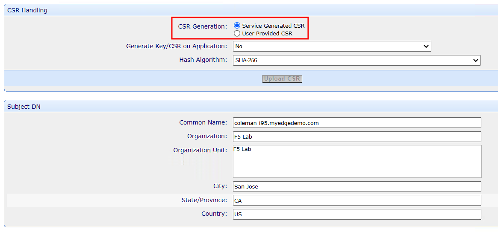
    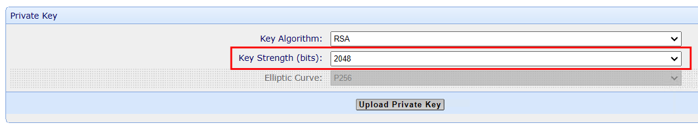

## Usage

From Certificate Manager, Self-Hosted you can generate the certificates and keys needed for application delivery and install them on F5 Distributed Cloud for use with one or many applications.

### Push Certificate

1. Sign in to Certificate Manager, Self-Hosted.
2. Select the application object.
3. Click **Push**.

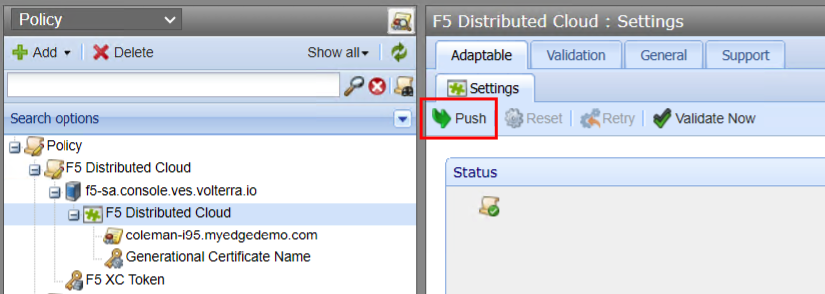

### Validate Certificate

Validation connects to the application URL, which is the load balancer FQDN unless you specify another on the **Validate** tab.

1. Sign in to Certificate Manager, Self-Hosted.
2. Select the application object.
3. Click the **Validate** tab and verify the settings.

   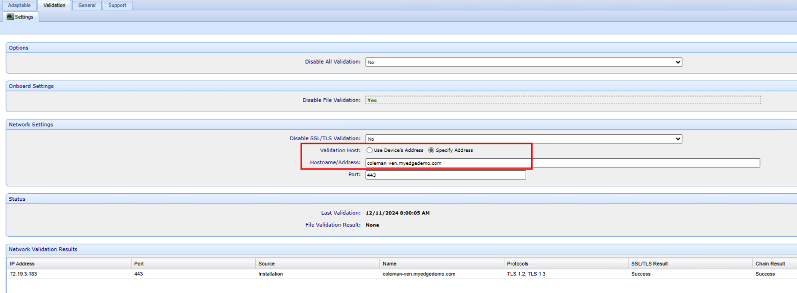

4. Go back to the **Application** tab and click **Validate**.

### Modify Load Balancer Config

If **Create Load Balancer** was enabled, a new load balancer is created with an FQDN matching the certificate CN and set to **Do Not Advertise**.

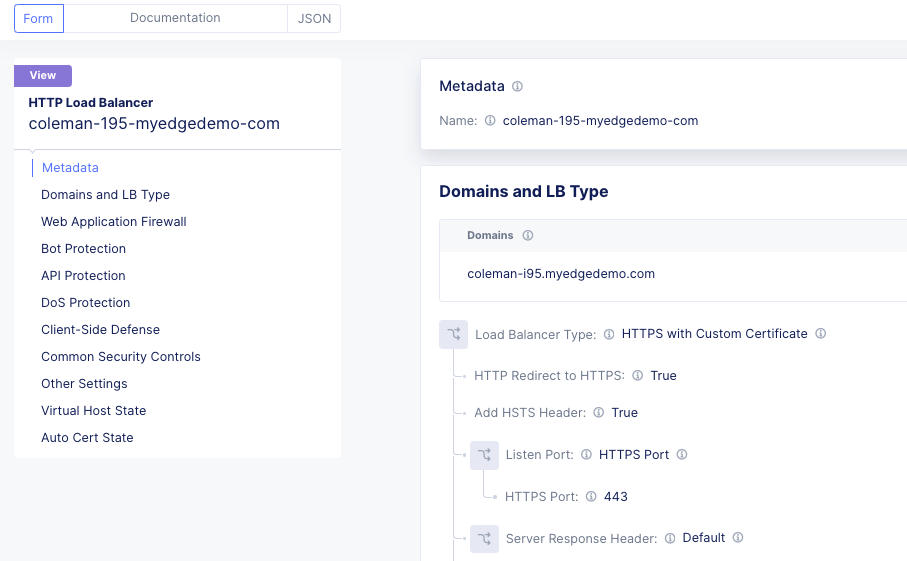

1. Sign in to the F5 Distributed Cloud Console.
2. Select the application namespace, then **Manage** > **Loadbalancers**, and select the new load balancer.
3. Configure security as desired.
4. Change **Advertisement** to the desired selection.

   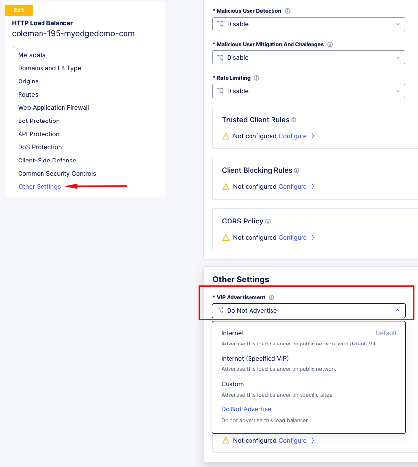

### Create New Load Balancer Config

If **Create Load Balancer** was disabled, no load balancer is created and you must create one separately. See [HTTP Load Balancer](https://docs.cloud.f5.com/docs/how-to/app-networking/http-load-balancer) in the F5 Distributed Cloud documentation.

## Troubleshooting

If an error occurs, the driver displays an error message in Certificate Manager, Self-Hosted. If debugging is enabled, logs are also written to the Certificate Manager, Self-Hosted logs folder. Providing the entire error message speeds up diagnosis.

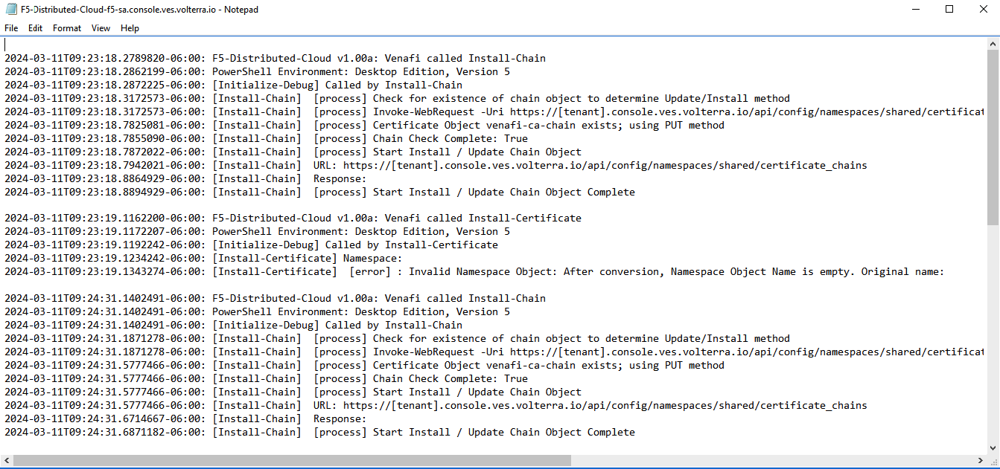

| Error Message | Description |
| --- | --- |
| Unauthorized: The API key for F5 Distributed Cloud is incorrect or deleted from the F5 Distributed Cloud Console | Caused by a bad API token. |
| Invalid Cert/Key Object: After conversion, Cert/Key Object Name is empty. | Certificate names are modified for Distributed Cloud. If the name is empty after cleanup, it cannot be created on the platform. |
| Invalid Namespace Object: After conversion, Namespace Object Name is empty. | A namespace is required for object creation. |
| Failed to create load balancer: {"code":6,"details":[],"message":"Object already exists"} | A load balancer with the same name already exists. |
| Not Found: Object Not Found in Namespace | The object was not found in the specified namespace. |
