# F5 Distributed Cloud (XC) Installation & Configuration Guide

  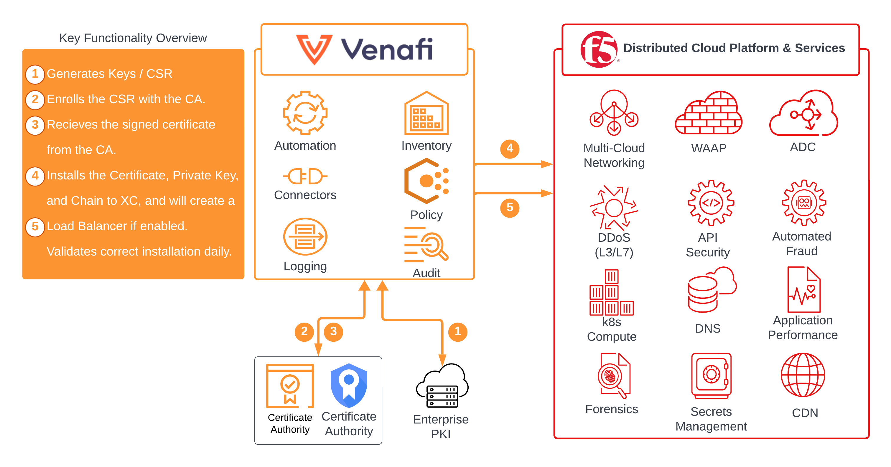

## Introduction

**Secure Your Digital World: Automating HTTPS Encryption at Scale**

In an era where digital security is paramount, HTTPS encryption stands as the bedrock of online privacy and security. However, as essential as this encryption is, scaling it effectively to protect the vast expanse of web applications and data in the cloud presents a significant challenge for application teams. Recognizing this critical need, F5 Distributed Cloud and Venafi have forged a groundbreaking partnership, offering a seamless solution to automate the deployment and management of keys and certificates - the lifeline of HTTPS encryption.

Leveraging the power of **F5 Distributed Cloud's** cutting-edge services, including the **Distributed Cloud Web Application Firewall and API Protection**, organizations can now safeguard their web applications and data more efficiently than ever. This managed service not only ensures robust security against evolving threats but also simplifies the encryption process, enabling teams to focus on innovation rather than the intricacies of digital security. Let's delve into how this partnership is revolutionizing the way we secure our digital landscape.

This page outlines the installation and configuration steps required for **F5 Distributed Cloud** integration with Venafi’s TPP system.

*The information provided in this document is considered proprietary and confidential.*

>This integration guide, as well as the software and/or products described in it, are furnished under agreement with `F5` and may be used only in accordance with the terms of such agreement.
>Except as permitted by such agreement, no part of this publication may be reproduced, stored in a retrieval system, or transmitted, in any form or by any means, electronic, mechanical, recording, or otherwise, without prior written permission of `F5`.

## TABLE OF CONTENTS

- [About Us](#about-us)
- [Integration with Venafi](#integration-with-venafi)
- [Prerequisites](#prerequisites)
- [Installation and Configuration](#installation-and-configuration)
  - [Installation](#installation)
  - [Configuration](#configuration)
- [Usage](#usage)
  - [Push Certificate](#push-certificate)
  - [Created Load Balancer Config](#created-load-balancer-config)
  - [Create New Load Balancer Config](#create-new-load-balancer-config)
- [Troubleshooting](#troubleshooting)
  - [Error Messages](#error-messages)

## About Us

F5 provides solutions for an application world. F5 helps organizations seamlessly scale cloud, data center, and software defined networking (SDN) deployments to successfully deliver applications to anyone, anywhere, at any time, including on-premises, in the cloud, or at the edge. F5 solutions broaden the reach of IT through an open, extensible framework and a rich partner ecosystem of leading technology and data center orchestration vendors. This approach lets customers pursue the infrastructure model that best fits their needs over time. The world’s largest businesses, service providers, government entities, and consumer brands rely on F5 to stay ahead of cloud, security, and mobility trends. The range of identity and data protection solutions from Thales secures the front-end and back-end of F5 BIG-IP deployments with industry-leading solutions available on-premises or in the cloud.

F5's products and services include:

- Application security
- API Protection
- Multi-cloud management
- Online fraud prevention
- Application delivery networking (ADN)
- Network security
- Access and authorization 

## Integration with Venafi

F5 and Venafi have teamed up to provide a secure and scalable web application delivery solution for SaaS, data center and cloud environments by integrating the **F5 Distributed Cloud Platform** and the **Venafi TLS Protect Platform**. The joint solution provides Certificate Lifecycle Management, application delivery, security, flexibility, and compliance at scale while encrypting communications and securing digital credentials.

## Prerequisites

Before following the steps in this integration guide, the following prerequisite items must be installed and configured:

- Venafi Trust Protection Platform
- F5 Distributed Cloud Tenant

To securely connect to F5 Distributed Cloud Console, an API token is required.
- Follow the steps here to [Generate API Tokens](https://docs.cloud.f5.com/docs/how-to/user-mgmt/credentials).

> :warning: **F5 Distributed Cloud** API Tokens have a max age of 90 days, please plan accordingly.  A renewal process can be automated, but is out of scope of this driver.

## Installation and Configuration

The section outlines the procedure to install the **“F5DistributedCloudAdaptiveAppDriver.ps1”** file. F5 Distributed Cloud integration is enabled using the Adaptable Application driver feature in TPP. The script needs to be installed **on all TPP systems acting as Log servers and application servers**. Please note that after the installation, configuration is mandatory.

### Installation

To enable Trust Protection Platform integration, the following must be completed:

1. Place the script file into the **{TPP Home}\Scripts\AdaptableApp** folder on all TPP servers.
2. Restart `ved` and `venafilogserver` services on each TPP server.
3. Restart IIS on TPP servers acting as Web servers. 

### Configuration

#### Configure a Username Credential Object

1. Create a username credential in TPP. The “password” field will contain the API key and the “username” field can be “null”.
    
   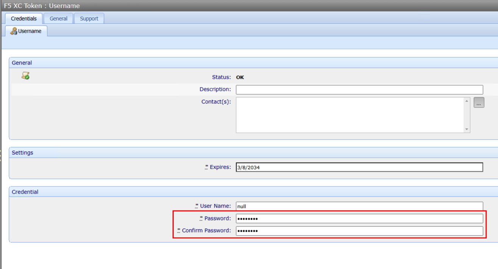

#### Configure the XC Adaptable App Policy

   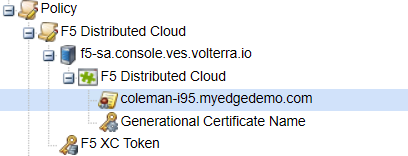

1. An administrator must configure a Policy Folder to use the F5 Distributed Cloud Adaptable Application driver.
    - This can be done at the top level, or you can create a new F5 Distributed Cloud Policy.
2. Browse / Create the policy folder selected to hold the F5 Distributed Cloud Device/Application objects.
3. Go to -> Applications -> Adaptable.
4. Set the “PowerShell Script” field to point to the F5 Distributed Cloud Adaptable Application Driver.
5. Specify a namespace for the certificate configurations, this will be where the certificate is stored on XC.  This **MUST** be an Application Namespace.
6. Specify a Loadbalancer FQDN, the FQDN of the load balancer is used for Certificate-Extraction function used for Validation.
7. (Optional) Populate Static Asset Name with a static name for the certificate object in Distributed Cloud.  Leaving this field blank will use the certificate subject and short serial, which may cause duplicate objects in XC configurations along with additional steps to apply the renewed certificate.
8. Select whether or not to enable driver debugging.
9. Select whether or not to create a load balancer.  If this is not enabled, there will be extra steps to update the certificate binding to the load balancer in the XC Console.

   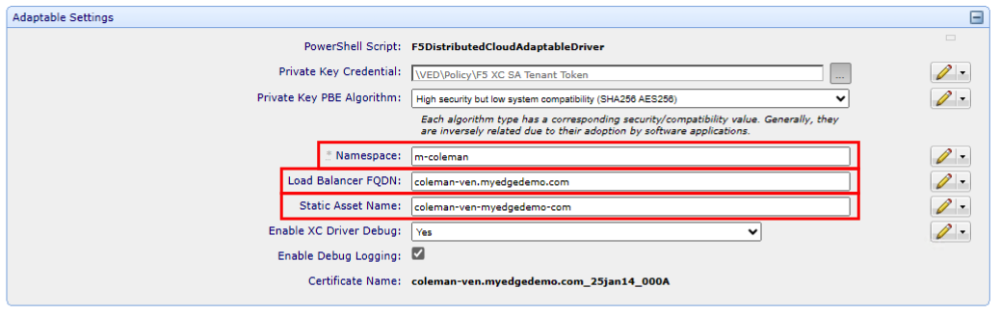

### Configure **Device**, **Application** and **Certificate** Objects

1. Create a Device object.
2. Set the Hostname/Address field: **[tenant-name].console.ves.volterra.io**
3. Set the credential.

   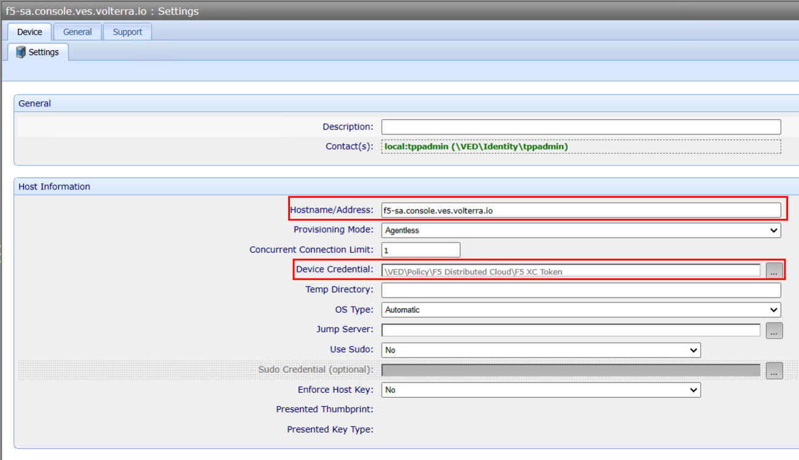

4. Create an Application object.
5. If the values were not set previously in the Policy, you can set them now, otherwise they will inherit from Policy.

    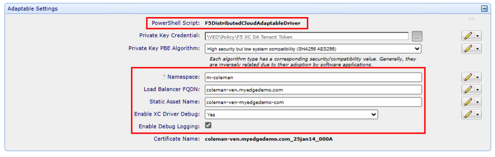

6. Create a “certificate object”.
7. Make sure Management type is “Provisioning”.
8. Ensure that CSR is set to Service Generated.
9. Populate your Certificate values as needed.
10. Ensure that Private Key (bits) is set to **at least** 2048.

    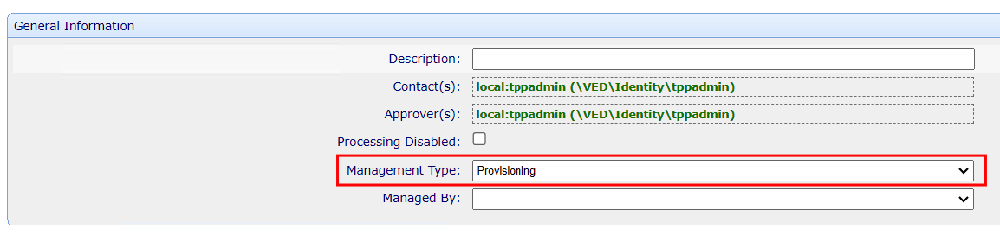
    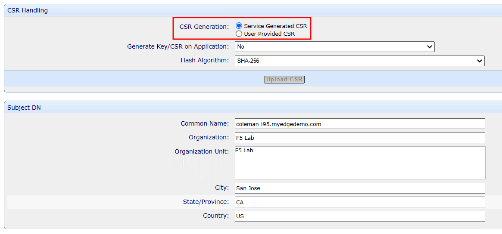
    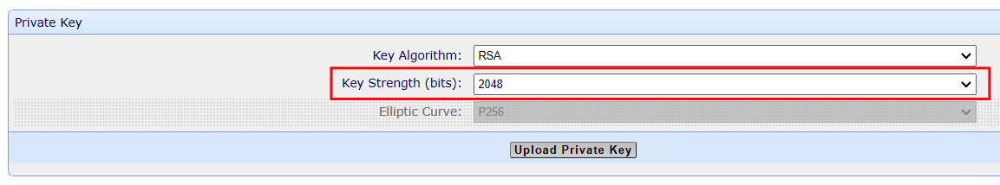

-------

## Usage

There are several ways to utilize the functions implemented in this solution.  From the TLS Protect side, it is possible to generate the certificate and keys needed for application deliver, securly install those on F5 Distributed Cloud for use with many or single applications.

### Push Certificate

To install the certificate to Distributed Cloud, select the Application Object and click Push.

1. Log into Trust Protection Platform.
2. Select the Application Object.
3. Click Push.
4. SUCCESS!

   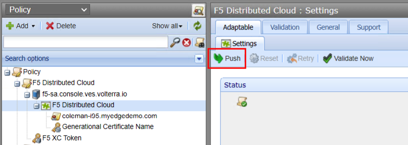

### Validate Certificate

To validate the certificate, the system needs to be configured to point to the application URL, this is where the Load Balancer FQDN is used, but you can also specify in the Validate tab.

1. Log into Trust Protection Platform.
2. Select the Application Object.
3. Click Validate Tab.
4. Verify Settings.

   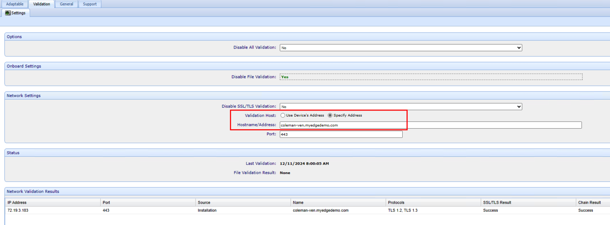

5. Go back to Application Tab, click Validate.

### Modify Load Balancer Config

If **Create Load Balancer** was enabled in the configuration, a new load balancer will be created with an FQDN matching the certificate CN.  The newly created Load Balancer will be set to **Do Not Advertise**.

   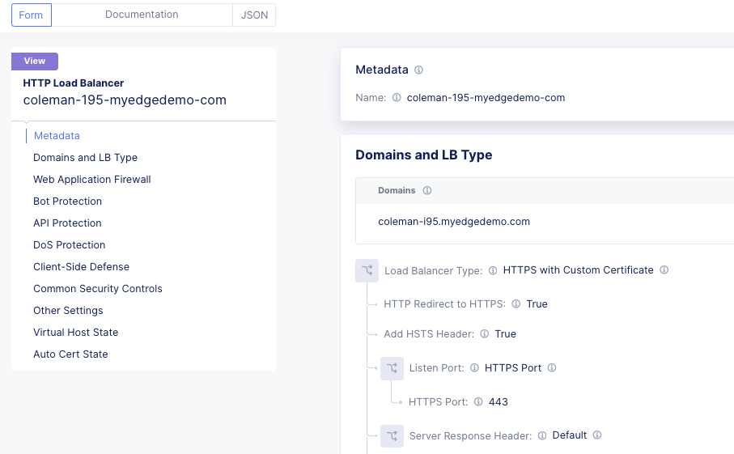

1. Log into F5 Distributed Cloud Console.
2. Select the Application Namespace -> Manage -> Loadbalancers -> Select the newly created load balancer.
3. Configure Security as desired.
4. Change Advertisement to desired selection.

   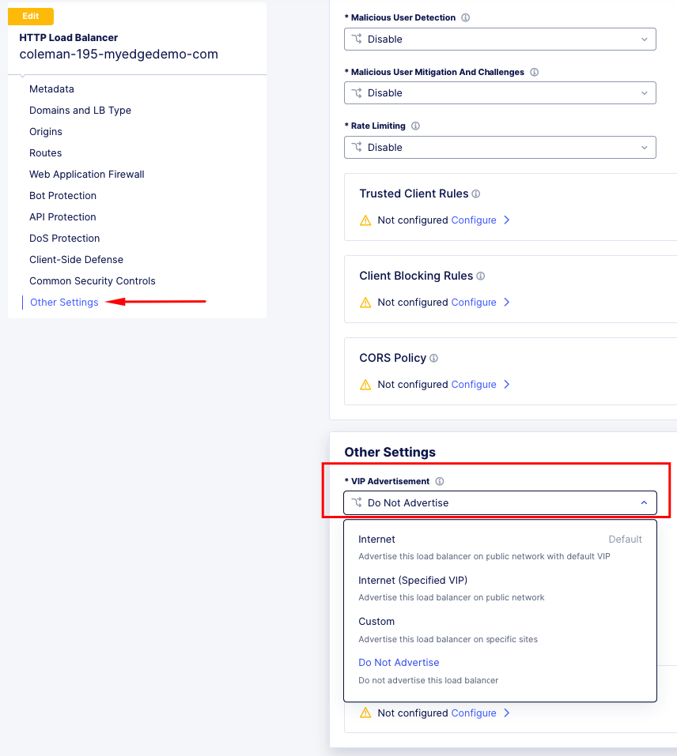

### Create New Load Balancer Config

If **Create Load Balancer** was disabled in the configuration, a new load balancer will **NOT** be created, and it will need to be created out of band.  For guidance on how to configure via click-ops you can review guidance here:  [https://docs.cloud.f5.com/docs/how-to/app-networking/http-load-balancer](https://docs.cloud.f5.com/docs/how-to/app-networking/http-load-balancer)

-------

## Troubleshooting

### Error Messages

If an error is encountered, Distributed Cloud Adaptive Driver should provide an error message that is displayed within Trust Protection Platform.  If debug is enabled, there will also be logs recorded in the TPP logs folder.

 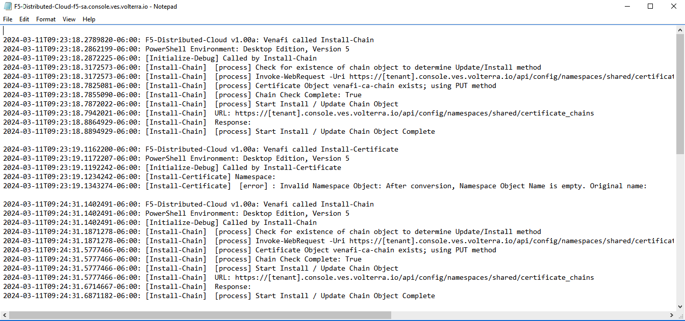

When troubleshooting error messages, providing the entire message displayed by Trust Protection Platform can speed the diagnosis and resolution.

| Error Message | Description |
| ---           | ---         |
| Unauthorized:  The API key for F5 Distributed Cloud is incorrect or deleted from the F5 Distributed Cloud Console | Caused by a bad API token. |
| Invalid Cert/Key Object: After conversion, Cert/Key Object Name is empty. | Certificate names are modified for Distributed Cloud, if the name is empty after cleanup, it cannot be created on the platform. |
| Invalid Namespace Object: After conversion, Namespace Object Name is empty. | A Namespace is required for object creation. |
| Failed to create load balancer: {"code":6,"details":[],"message":"Object already exists"}           | Load Balancer could not be created due to an existing Load Balancer with the same name.         |
| Not Found:  Object Not Found in Namespace | Object was not found in the specific namespace. |

For additional support, it is possible to open at ticket from the Distributed Cloud Console.