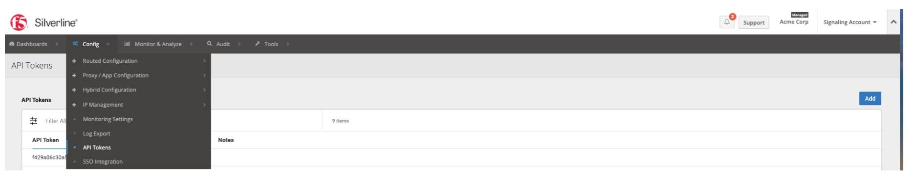
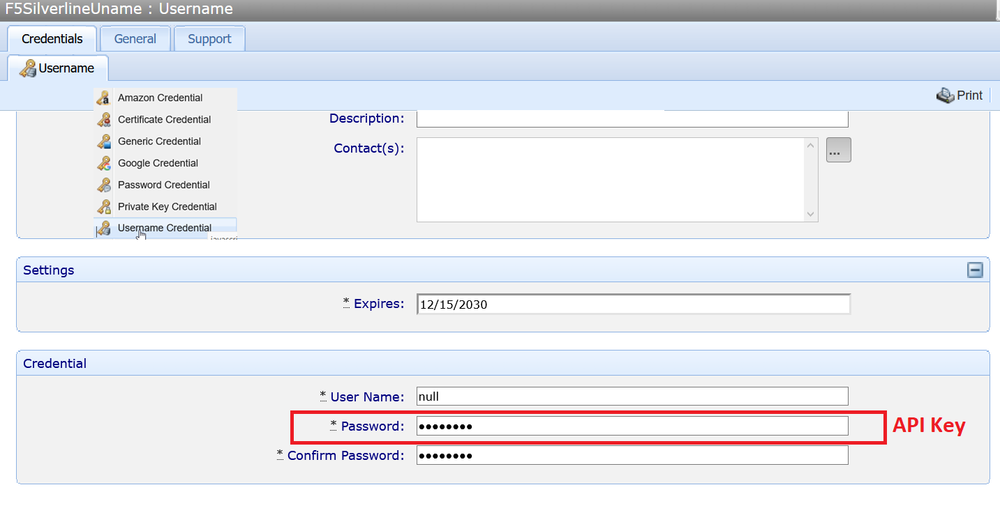
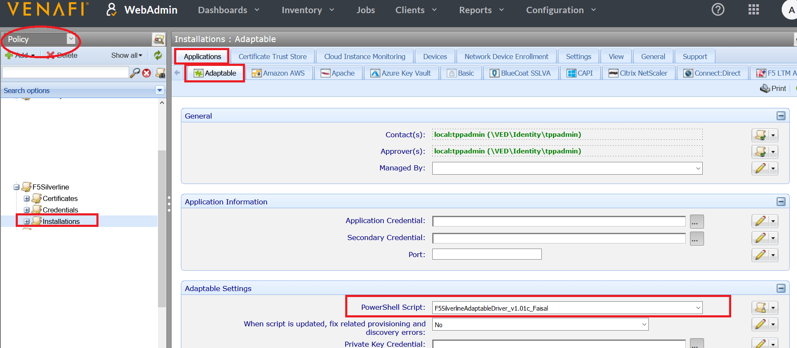
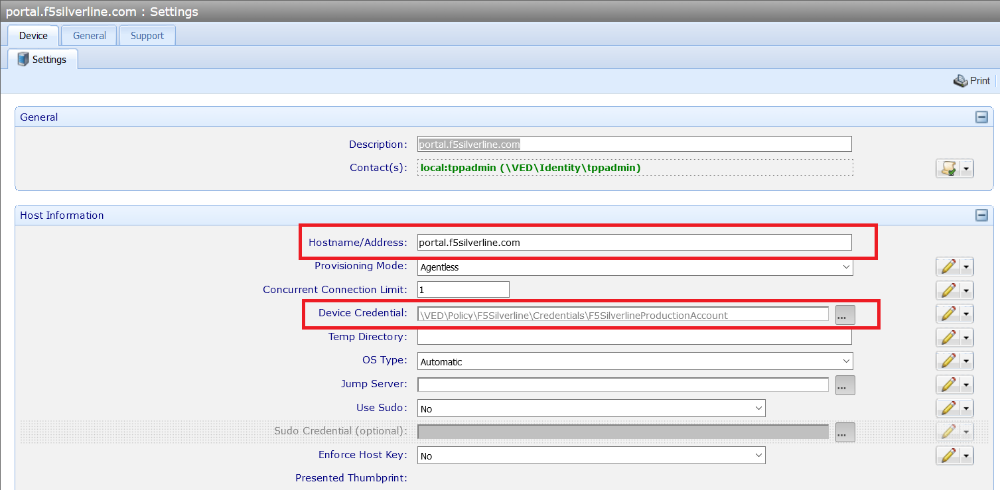
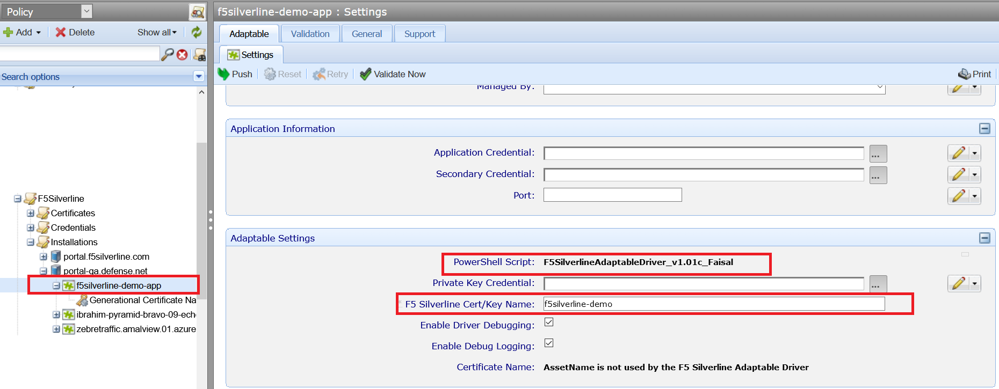
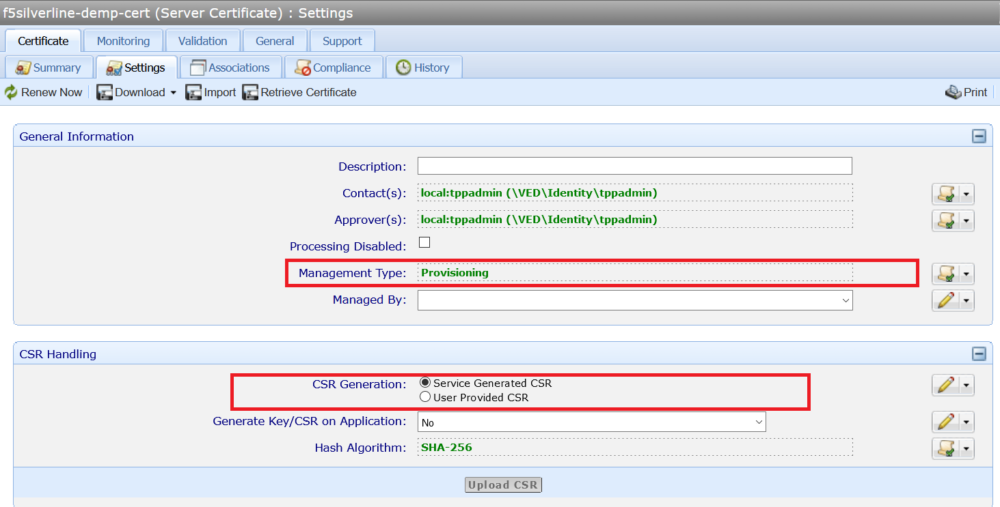
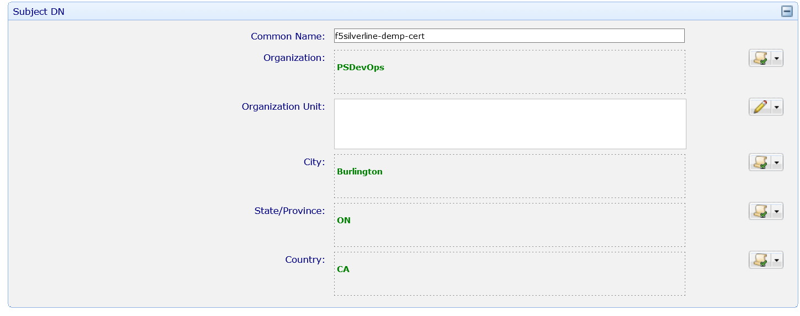
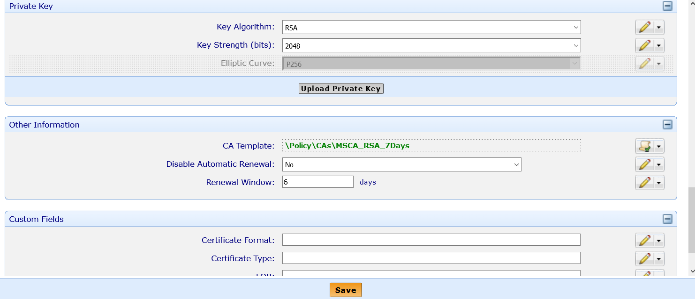

# F5 Silverline Installation & Configuration Guide

## Introduction

HTTPS encryption is more prevalent than ever but can be difficult to scale. F5 Silverline and Venafi have teamed up to make it easy to automate the use of keys and certificates for application teams using the following products from Silverline:

- **Silverline DDoS Protection -** Silverline detects and mitigates even the largest of volumetric DDoS attacks at layer 3-7, before they reach your network.

- **Silverline Web Application Firewall -** Available as a managed service, Silverline protects web apps and data, while ensuring compliance with PCI DSS.

- **Silverline Shape Defense -** Prevents large scale fraud and degraded user experiences by detecting bots, fake users, and unauthorized transactions.

This page outlines the installation and configuration steps required for F5 Silverline
integration with Venafi’s TPP system.

```
NOTE: The certificate being provisioned to F5 Silverline **must** be issued by an Intermediate CA and **must not** be issued directly by the Root CA
```

## Prerequisites

To securely connect to F5 Silverline portal, an API key is required.

1. From the Silverline Portal a user needs to go to Configuration and select API Tokens.
2. Simple click the “Add” button to provision a new Token.
3. Only a user in “Customer Admin” group can request a token.

    

- The minimum Venafi Trust Protection Platform version is 20.3+

## Installation

The section outlines the procedure to install the **“F5SilverlineAdaptableDriver.zip”** file. Unzip the contents of the file and a PowerShell script will be available. F5 Silverline integration is enabled using the Adaptable Application driver feature in TPP. The script needs to be installed **on all TPP systems acting as Log servers and application servers**. Please note that after the installation, configuration is mandatory.

1. Place the script file into the **{TPP Home}\Scripts\AdaptableApp** folder on all TPP servers.
2. Restart `ved` and `venafilogserver` services on each TPP server.
3. Restart IIS on TPP servers acting as Web servers. 

## Configuration

### Configure a Username Credential Object

1. Create a username credential in TPP. The “password” field will contain the API key and the “username” field can be “null”.
    
    

### Configure the Adaptable App at the Policy Folder (Zone) Level

1. An administrator must configure a Policy Folder to use the F5 Silverline adaptable application driver.
2. Browse to the policy folder selected to hold the F5 Silverline Device/Application objects.
3. Go to -> Applications -> Adaptable.
4. Set the “PowerShell Script” field to point to the F5 Silverline adaptable application driver.

    

### Configure **Device**, **Application** and **Certificate** Objects

1. Create a Device object.
2. Set the Hostname/Address field: **portal.f5silverline.com**
3. Set the credential.

    

4. Create an Application object.
5. Set the “F5 Silverline Cert/Key Name” field.

    

6. Create a “certificate object”.
7. Make sure Management type is “Provisioning”.
8. Renew the certificate.

    
    
    