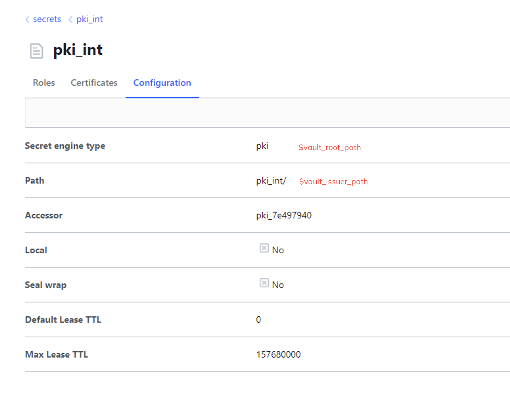
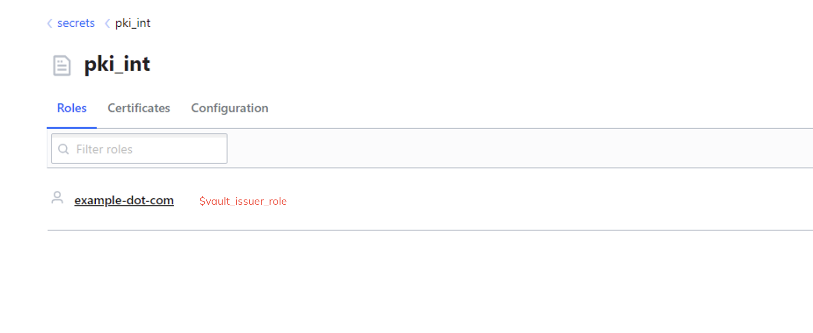

# HashiCorp Vault Adaptable CA

## Prerequisites

- A HashiCorp Vault instance, reachable from the Certificate Manager, Self-Hosted servers, with the PKI secrets engine enabled. The script assumes a Vault that contains both a root CA and an issuing CA, so it can return the full chain.
- An issuer role configured on the issuing CA mount.
- A Vault token with permission to use that role.

## Installation

1. Download `HashicorpVaultAdaptableCA.ps1` from this listing.
2. Copy it to the Adaptable CA scripts folder on every Certificate Manager, Self-Hosted server.

## Configuration

1. Edit the variables at the top of the script to match your Vault:

   ```powershell
   $vault_url = "https://<your-vault-url>:8200/v1"
   $vault_root_path = "pki"
   $vault_issuer_path = "pki_int"
   $vault_issuer_role = "example-dot-com"
   $vault_key_gen = $false
   ```

   - `$vault_url`: the Vault API base URL, including `/v1`.
   - `$vault_root_path`: the mount path of the root CA PKI secrets engine.
   - `$vault_issuer_path`: the mount path of the issuing (intermediate) CA PKI secrets engine.
   - `$vault_issuer_role`: the PKI role used to sign or issue certificates.
   - `$vault_key_gen`: set to `$true` to have Vault generate the key pair (`issue`); leave `$false` to submit a CSR (`sign`).

   The mount and role values correspond to what Vault shows for the issuing CA mount:

   

   

2. In Certificate Manager, Self-Hosted, create a Username credential whose password is the Vault token. The username is not used.
3. Create an Adaptable CA template that uses the script and the credential.
