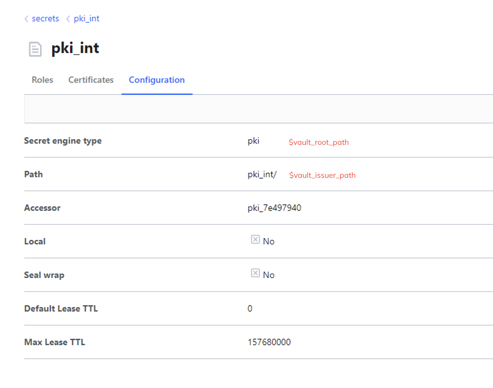
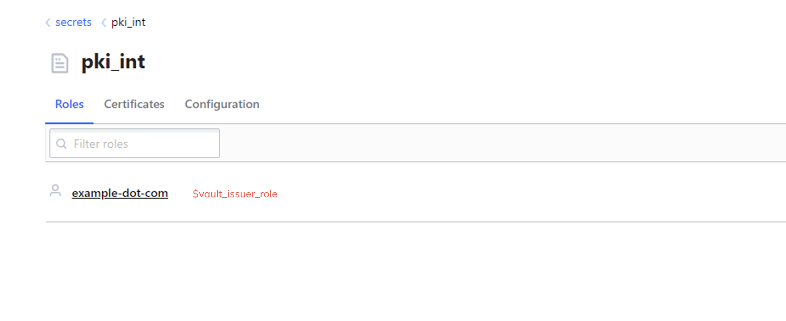

# Hashicorp Adaptable CA

## Configuration

The following variables have to be defined in the script:

$vault_url = "https://<your-vault-url>:8200/v1"

$vault_root_path = "pki"

$vault_issuer_path = "pki_int"

$vault_issuer_role = "example-dot-com"

