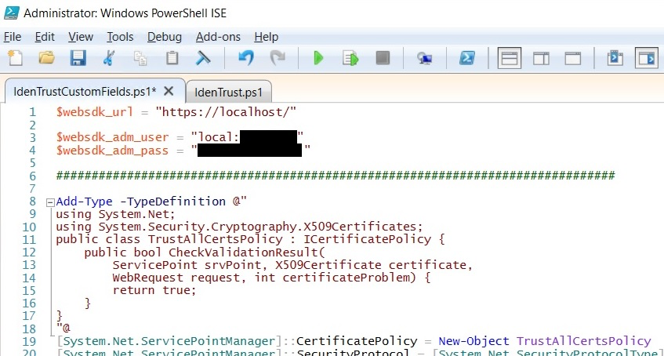
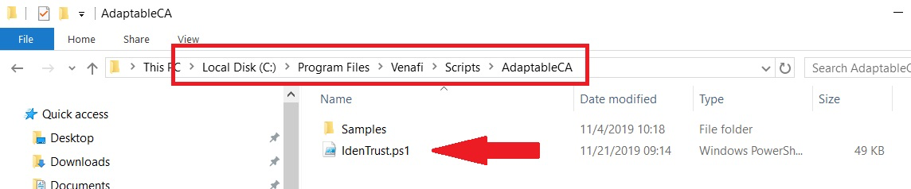
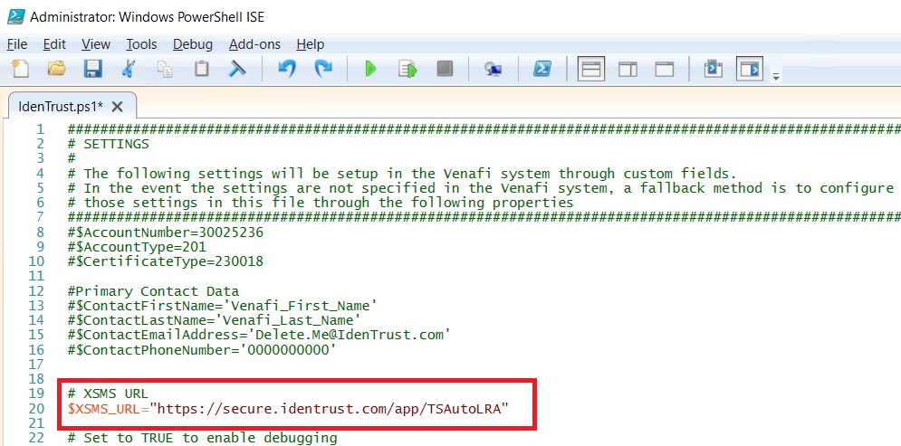

# IdenTrust Certificate Management Integration Guide

## Prerequisites

- Certificate Manager, Self-Hosted with the Adaptable framework.
- An account with WebSDK access on the Certificate Manager, Self-Hosted server.
- An IdenTrust account. Contact your IdenTrust Delivery Team representative for the account type, certificate type and account number to use.

## Installation

Run the custom fields script to create the custom fields the Adaptable CA script uses: **IdenTrust: Account Type**, **IdenTrust: Certificate Type**, **IdenTrust: Account Number** and the contact first name, last name, email address and phone number.



1. Open `IdenTrustCustomFields.ps1` and update the three fields at the top with the address of the Certificate Manager, Self-Hosted server (`localhost` works if you run it locally) and the username and password of an account with WebSDK access.
2. Save the changes to the script.
3. Run the script.

Place the Adaptable CA script, `IdenTrust.ps1`, in the `AdaptableCA` folder on every Certificate Manager, Self-Hosted server. The default location is:

```
C:\Program Files\Venafi\Scripts\AdaptableCA
```



## Configuration

If you use an IdenTrust test environment before going into production, update the service URL inside `IdenTrust.ps1`. Check the environment URL with Delivery@IdenTrust.com first.


