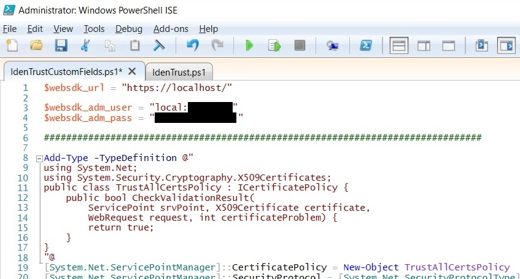
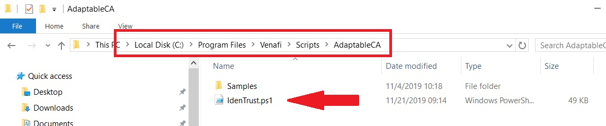
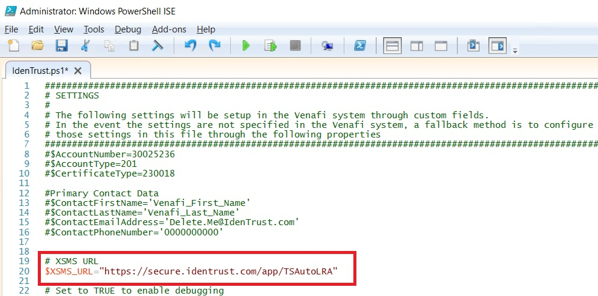

# IdenTrust Certificate Management Integration Guide

## How to Use IdenTrust Adaptable CA Scripts

### Custom Fields Script

Inside the `IdenTrustCustomFields.ps1` script you will need to add the login information for the Venafi Trust Protection Platform server.



1. These three fields will need to be updated with the address of the Venafi Server (localhost will work if running locally), along with the username and the password for an account with WebSDK access.
2. Save the changes to the script.
3. Run the script.

### Adaptable CA Script

The Adaptable CA script, `IdenTrust.ps1`, must be placed in the AdaptableCA folder on the Trust Protection Platform server(s) located by default at:

```
C:\Program Files\Venafi\Scripts\AdaptableCA
```



If running in an IdenTrust test environment before going into production, the URL will need to be updated inside the script. Please check with Delivery@IdenTrust.com to verify the environment URL. If modification to the URL is necessary, it will be done here:

