# APIIDA Broadcom Layer7 API Gateway

```
Documentation Version: 1.
Documentation Date: November 2019
```

## Prerequisites

- Restman must be enabled for the port specified in `Application.TcpPort`
- The certificate the gatgeway serves must be trusted by the Venafi Trust Protection Platform server communicating with the gateway

## Installation

### High-Level Steps

1. [Download the Adaptable Driver](#1-download-the-adaptable-app-driver)
2. [Install the Adaptable Driver on the TPP Server](#2-install-the-adaptable-driver-on-the-tpp-server)
3. [Validate the API Gateway Account](#3-validate-the-api-gateway-account)
4. [Create the API Gateway Account Credential Object in TPP](#4-create-the-api-gateway-account-credential-object-in-tpp)
5. [Determine Policy Structure](#5-determine-policy-structure)
6. [Configure an Adaptable Application for Each Policy](#6-configure-an-adaptable-application-for-each-policy)
7. [Add a Device Object for each API Gateway](#7-add-a-device-object-for-each-api-gateway)
8. [Add an Application Object for each API Gateway](#8-add-an-application-object-for-each-api-gateway)
9. [Configure the Application Object](#9-configure-the-application-object)
10. [Provision the Certificate to the API Gateway](#10-provision-the-certificate-to-the-api-gateway)

### **1. Download the Adaptable App Driver**

Download the driver from the [Venafi Marketplace](https://marketplace.venafi.com)

### **2. Install the Adaptable Driver on the TPP Server**

Place the .ps1 script in `Program Files\Venafi\Scripts\AdaptableApp`

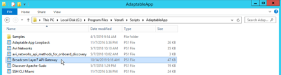

### **3. Validate the API Gateway Account**

Confirm which user on the API Gateway will be used by Venafi to install certificates & private keys. The user must have at least the **Manage Private Keys** and **Manage Certificates** roles. You can do so by accessing the user's details page in the Policy Manager.

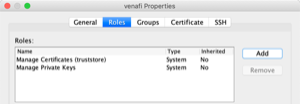

### **4. Create the API Gateway Account Credential Object in TPP**

Create a `Credential Object` in Trust Protection Platform that has access to this API Gateway User.

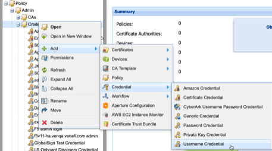

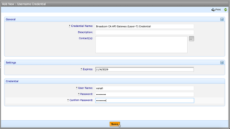

### **5. Determine Policy Structure**

Clarify how the certificate and private key objects are organized in the Policy Tree.

```
NOTE: If you wish to provision certificates to both the 'Private Key' and 'Certificates' target locations on the API Gateways, you will need one folder for each.
```

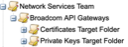

### **6. Configure an Adaptable Application for Each Policy**

Select each folder and navigate to `Applications > Adaptable` and select the Adaptable Application driver from [Step 1](#1-download-the-adaptable-app-driver). Repeat this for each folder, as needed (e.g. once for 'Certificates Target Folder' and once for 'Private Keys Target Folder').

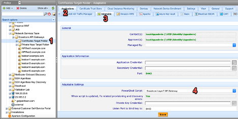

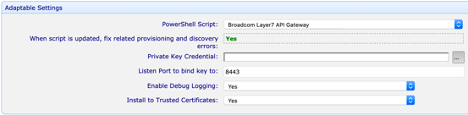

In order for certificates to be installed on the API Gateway's 'Certificates' location, select `Yes` to the ***Install Trusted Certificates*** option.

In order for certificates to be installed on the API Gateway's 'Private Keys' location, select `No` to the ***Install Trusted Certificates*** option.

Also, pay close attention to what ***Listen Port*** the certificate/key should be bound to on the API Gateway.

### **7. Add a Device Object for each API Gateway**

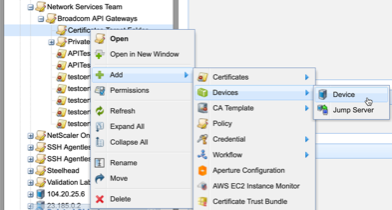

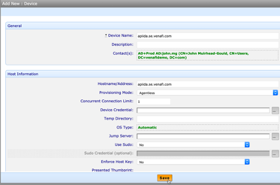

### **8. Add an Application Object for each API Gateway**

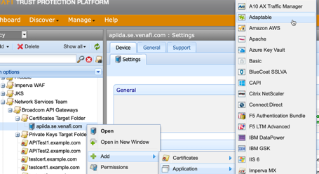

### **9. Configure the Application Object**

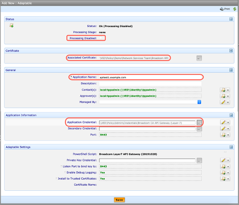

### **10. Provision the Certificate to the API Gateway**

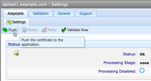

## Reference

The following options can be configured for the adaptable app:

| Name | Description |
| --- | --- |
| Listen port to bind key to | If you push private keys to API gateway (those that will be used by the gateway itself during SSL/TLS handshakes) you can this option to decide for which port this key should be used. Leaving it blank will set this key to be the default key that is used when a port has no dedicated private key configured. |
| Certificate Mode | A comma separated list of modes that should be applied to certificates that are pushed to the gateway. Possible values are: <ul><li>revocationChecking</li><li>trustAnchor</li><li>trustAnchor</li><li>samlAttesting</li><li>samlIssuer</li><li>signClients</li><li>signServers</li><li>ssl</li><li>verifyHostname</li></ul>|
| Enable Debug Mode | yes/no - If set to `yes`, the driver creates detailed logs of its operations that you can use to check for errors. |
| Skip Activation | If toggled, keys and certificates are not activated on the gateway after they have been provisioned. You need to activate them using Policy Manager in order to use them. |
| Install to Trusted Certificates | If toggled, the certificates are pushed as trusted certificates instead of private keys. For more information on which version to use, please refer to the Layer7 documentation. |

## Troubleshooting

Troubleshooting logs are written locally on the Venafi Application Server, e.g.:

```
Dir C:\Windows\System32\logs\VED\Policy\Demo\Network Services Team\Broadcom API Gateways\Certificates Target Folder\apiida.se.venafi.com\apitest1.example.com
```

The file `messages.log` contains a full rundown of all operations performed. For more details on individual operations there are additional transcript logs written for every call that is issued by the Venafi platform to the adaptable driver. 

If no logs are written, check if application has an AppObjectDN as that is used as the directory name the log files are written to. If this value is null no log files are written.

### Common Error Messages

Some error messages that are frequently encountered

- Resource validation failed due to 'INVALID_VALUES'
    - A required value is either missing or has invalid data. Most common cause is a missing alias, which is required by the gateway

- Permission denied for user `<USER>`
    - This is typically caused by forgetting to set the proper permissions for the user configured. If you want to push private keys AND trusted certificates the user needs both rights as described in this integration guide.
