# Oracle HTTP Server Adaptable Driver Integration Guide

## Introduction
This page outlines the necessary setup of the Oracle HTTP Server Adaptable Driver to manage and maintain machine identities used by Oracle HTTP Server. Using this script, we can onboard the existing OHS wallets and automatically renew them from Venafi Trust Protection Platform.

### Prerequisites

- Java 1.8.0_51+ must be installed on the TPP server
- Sudo User with **No Password** option enabled. This user will be used by Venafi to connect to the target Oracle server and perform necessary actions.

    > Example setting on sudoers file: \<USER> ALL=(ALL) NOPASSWD: ALL

### Bypass nodemanager Password

While using startComponent.sh/stopComponent.sh in script, it will prompt for the nodemanager password. This will be applicable from OHS 12c.

We can avoid entering the password every time you launch the server with startComponent.sh/cmd by starting it with the storeUserConfig option for the first time, like below:

1. At the command prompt, enter the following command:

    `$DOMAIN_HOME/bin/startComponent.sh componentName storeUserConfig`

    The system will prompt you for your Node Manager password, and a warning prompt will appear which states: "Creating a key file can reduce the security of your system if it is not stored in a secured location after it is created. Do you want to create the key file? y or n"

2. Type `Y` to store your Node Manager password. It will no longer be needed the next time you run this command. 

    > This creates hidden files in the user's home directory. These files contain domain information.
    >
    > If you have already gone through these steps and want to return to default behavior, please follow these steps:

    1. Stop OHS
    2. Delete hidden files in the user's home directory

## Installation & Configuration

### Setup ORAPKI Utility on Venafi Server

1. Go to Oracle Fusion Middleware download site http://www.oracle.com/technetwork/middleware/fusion-middleware/downloads/index.html
 
2. Select **Fusion Middleware Infrastructure Installer** and click **Download File**. It will redirect to Oracle Login screen.

    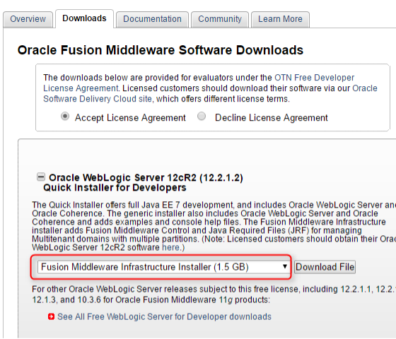

3. Unzip the downloaded .zip file into a folder

4. Run Command Prompt as administrator.

    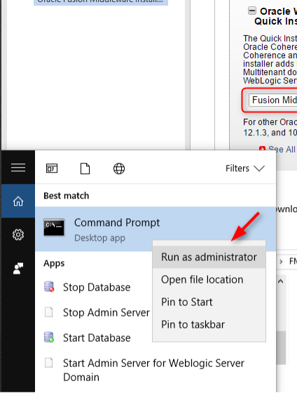

5. Go to the unzipped directory and run c:\jdk1.7.0_80\bin\java -jar fmw_12.2.1.2.0_infrastructure.jar

    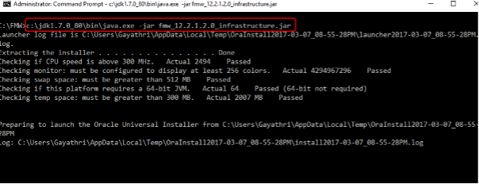

6. Follow the prompts by clicking **Next**

7. Keep "Skip Auto Updates" selected and click **Next**

    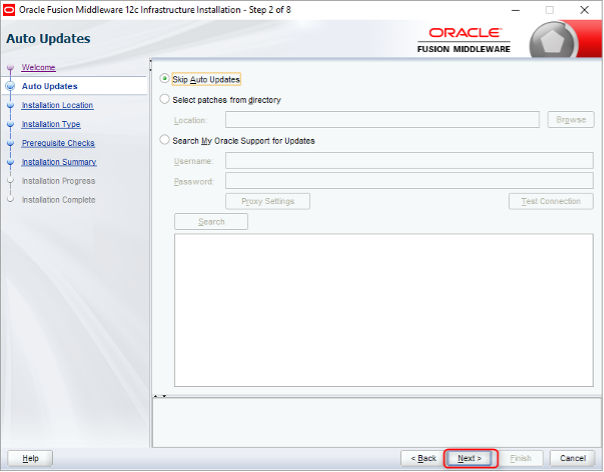

8. Choose an empty folder where Oracle Fusion Middleware will reside

    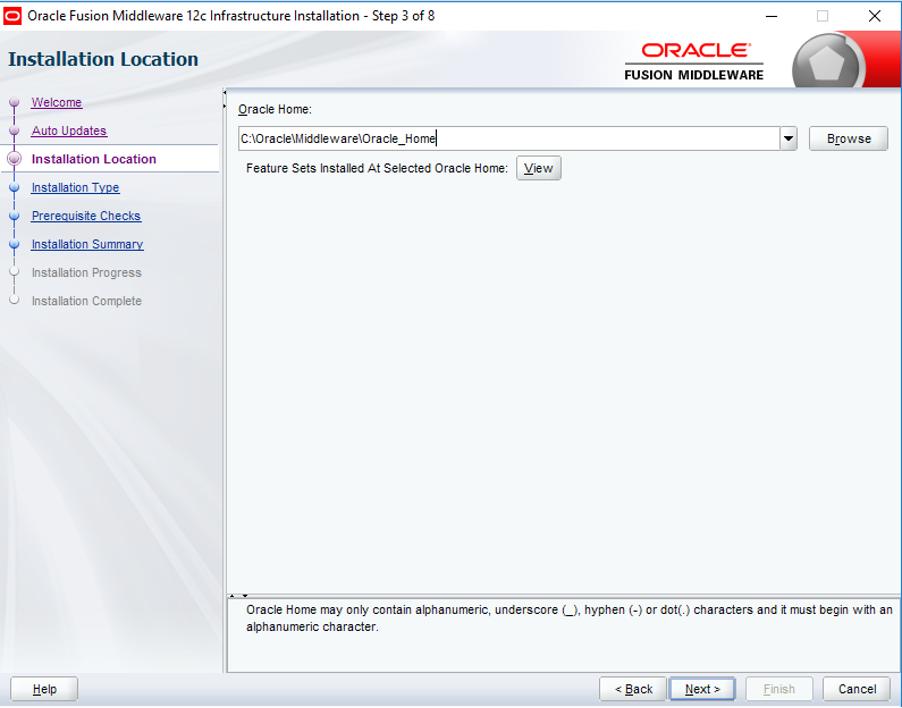

9. Select "Fusion Middleware Infrastructure" and click **Next** through the following screens, leaving all values default/blank

10. Click **Install**

11. When the installation is completed, click **Next**, and then **Finish**

12. The Oracle Fusion Middleware installation is completed, and the installation files are placed in the directory specified in Step 

13. Copy all the files under `C:\Oracle\Middleware\Oracle_Home\oracle_common\jdk\jre` to `C:\Oracle\Middleware\oracle_common\jdk` - this will help to run the “orapki” utility to run without setting JAVA environment all the time while running “orapki”.

> NOTE: If you don’t find the jdk directory under `C:\Oracle\Middleware\Oracle_Home\oracle_common\` please copy the local JDK files to this location.
>
> For example, we have used java from `C:\Program Files\Java\jdk1.8.0_241` to install FMW infrastructure, so we can copy the files under `C:\Program Files\Java\jdk1.8.0_241` to `C:\Oracle\Middleware\oracle_common\jdk`.

### Posh-SSH Installation Instructions

Posh-SSH is needed by PowerShell to make SSH connections to the target Oracle servers.

1. Download zip from https://github.com/darkoperator/Posh-SSH/releases
2. Unzip it on your Venafi Trust Protection Platform server
3. Move the directory to `C:\Windows\system32\WindowsPowerShell\v1.0\Modules`
4. Rename the directory to "Posh-SSH"

### Setup Oracle HTTP Server Policy in Venafi

1. Login to https://\<YOUR VENAFI SERVER URL>/vedadmin 
2. Update the downloaded PowerShell script "Oracle HTTP Server.ps1" by changing the path of `$orapki` variable to match the installation directory from above

    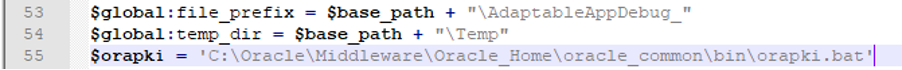

3. Copy the PowerShell script to `C:\Program Files\Venafi\Scripts\AdaptableApp` on the Venafi server.
4. Create or select the Venafi Policy that will be used to manage machine identities for this use case
5. Apply the **Oracle HTTP Server** script according to [Official Venafi Documentation](https://docs.venafi.com/Docs/current/TopNav/Content/Drivers/cco-drivers-AdaptableApp-Overview.php?Highlight=adaptable%20app)
6. Add **Wallet Credential** at the Policy level

    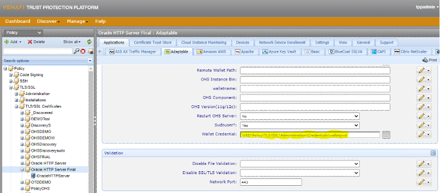

7. Add the Device object under the policy created above
8. Add the HTTP server details and Device Credential to the device object

    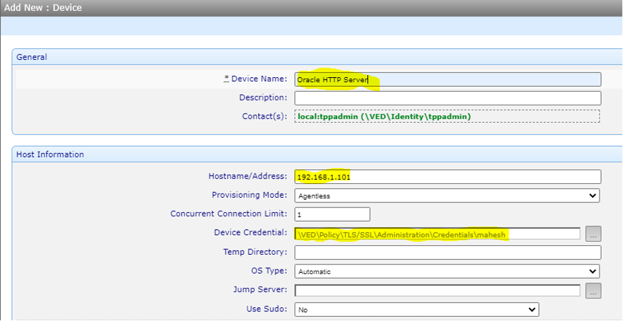

9. Ensure the following Certificate Policy settings are correct:

    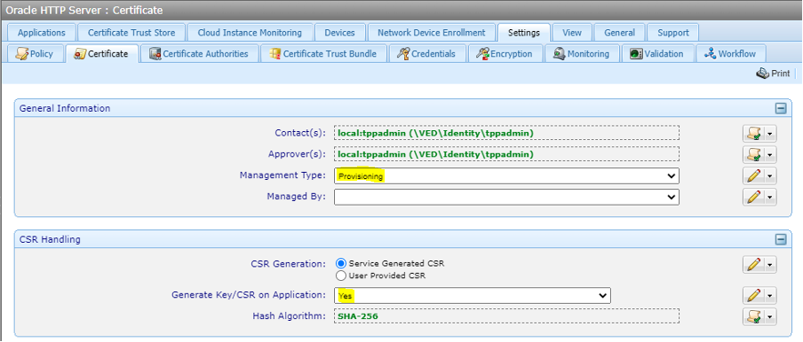
    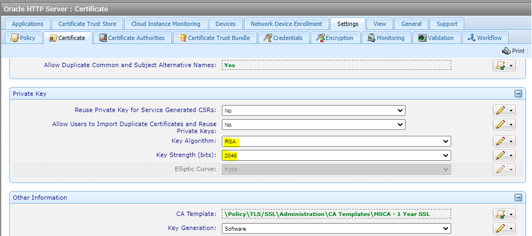

10. Click **Save**

### Onboard Discovery of the Oracle HTTP Server

1. Login to Aperture: https://\<YOUR VENAFI SERVER URL>/aperture
2. Create a Venafi **Job** for Onboard Discovery
3. Fill in the Job Details, making sure to specify "Adaptable" for the **Installation Type** and click **Next**

    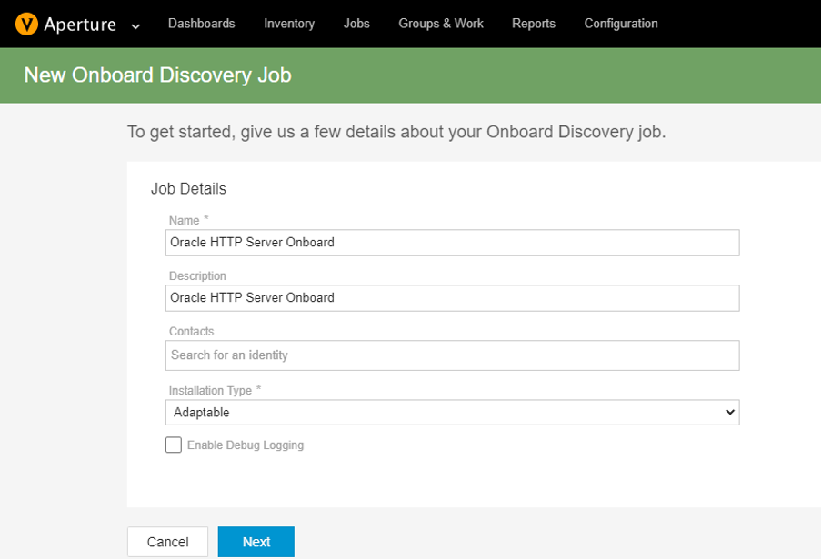

4. Add the Device under the Policy configured earlier and click **Next**

    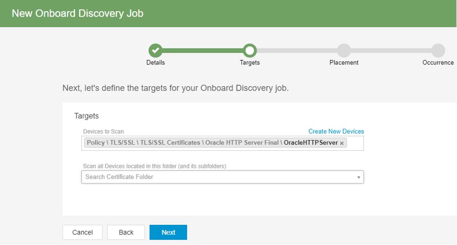

5. Be sure to place newly discovered certificates "With this device"

    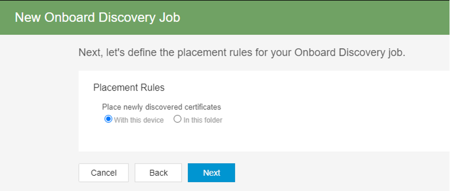

6. Click **Next** and then **Create Job**
7. Navigate back to the main Jobs page and click **Run Now** on the newly created Job
8. Once the Job is completed, Adaptable Application objects will have been created for each certificate in the Oracle HTTP Server and the corresponding certificates will be imported. 

### Renewing Certificates

At this point, Venafi will resume normal operating procedure for these certificates. They can be renewed manually, or automatically according to the defined Venafi Policy. In both cases, they will be automatically provisioned according to the details gathered during the Onboard Discovery Job.