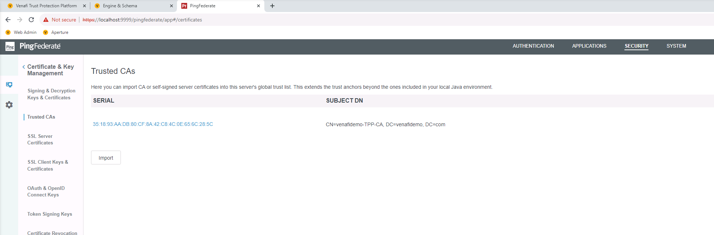
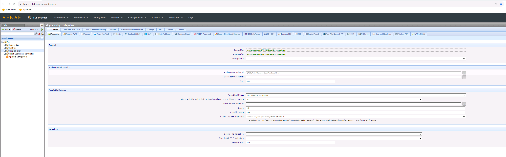
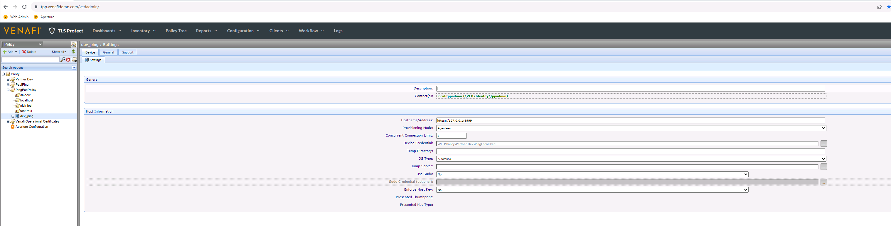
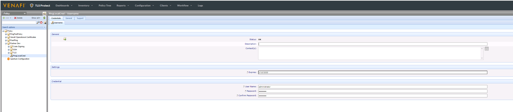
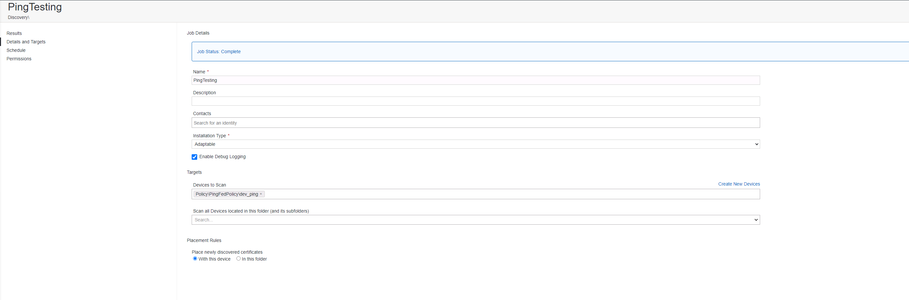
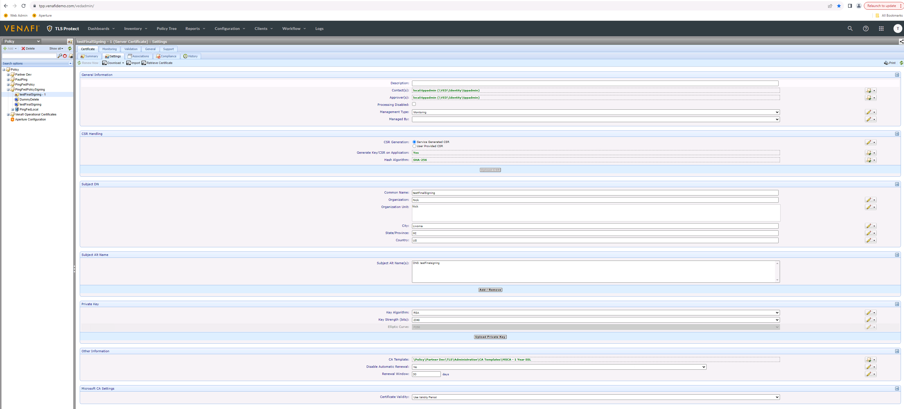
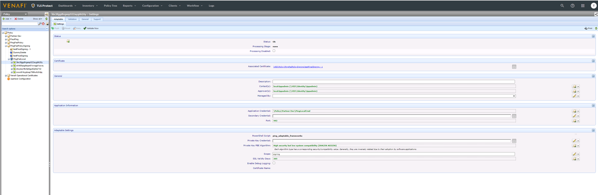
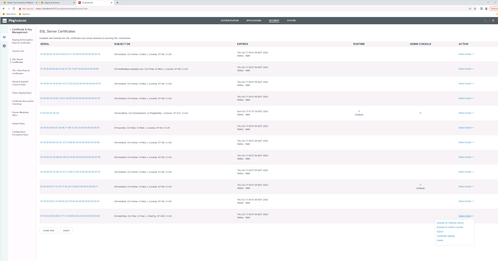

# Ping Adaptable Application Driver #

This readme is for the ping adaptable framework installation / configuration for the Venafi platform.  This adaptable script can be used to manage signing and ssl certificates in the Ping Federate platform.  Instructions below outline the installation / configuration and issues with the script / resolutions.

## Contact Information ##

Author: Nick Hunt
Company: IDMWORKS LLC
Date: 2023/11/19

## Notes ##

The ping adaptable framework extension manages SSL and Signing certificates in the Venafi platform.  Given limitations / capabilities of Ping, Venafi does not manage the private keys that are generated, but handles the signing of certificates generated within Ping.  This will create keys / certificates then send them for signing in Venafi so all operations are maintained locally within Ping using its default keystore configuration.

- <i>NOTE: you cannot import an externally generated private key / certificate into the Ping / Venafi configuration</i>

## References ##

[Venafi Trust Platform Developer Docs](https://docs.venafi.com/Docs/current/TopNav/Content/Drivers/c-drivers-AdaptableApp-PowerShell-reference.php?Highlight=adaptable)

## Requirements / Runtime ##

The main requirement when running this script is you use a supported Venafi platform.

Additionally, any CA that Venafi will use to sign certificate requests from Ping will need to have it's root certificate imported into the Ping platform.  This is so the Ping platform can trust the CA that is signing the certificates.  This is not needed if you are using a CA that is already included in the standard Java Keystore on the Ping platform nodes.



To be able to connect / run the script, the TPP platform will need a user with administrative / API rights in the ping platform.  This is so the platform can enumerate and manage certificate objects in the platform.

## Configuration Screenshots / Settings ##

### Intro ###

In most cases, the process will start with Onboard Discovery to find out what certificates are already in use in the Ping platform and then import then into Venafi's inventory. Once imported, any renewal operation initiated through Venafi will automatically provision the new certificate into Ping.

### Config ###

The below screenshots outline the setup / configuration of the platform and components to be able to manage the different certificate operations ("ssl" and "signing").

- Create a new policy and add the adaptable configuration / script.



When adding this policy, be sure to set the 'Scope' to either ssl or signing.  Also, be sure to set the SSL Validity Days since this is the lifetime of the certificates that are created / managed in the policy.

- Create the ping admin / device under the policy with the target location.



Be sure when specifying the Hostname/Address, you use the format of ```https://<host>:<port>```.  The rest of the path for the URL endpoints should not be needed unless you have a custom path for the administrative / API endpoints.

- Credentials Configuration



When adding the credentials for the policy, be sure to specify the username / password for the API user.  

- Discovery Job Configuration



Be sure to configure the discovery job to pull the existing certificate information out of ping upon initial configuration.  This does not pull the private keys, but does reference the certificate / application object so can be updated.

- Application and Certificate Configuration



Add the certificate under the device as a reference to the certificate.

Under the device, add an adaptable application for it so can be resolved (this may be discovered when running the discovery job).



This will link the certificate with the application in the Ping platform depending on the scope of the certificate.

- Activating a Certificate Post Issuance / Add



Once the certificate has been provisioned successfully, you can login to the Ping Administrator console and active the certificate for SSL (above) or attach it to a policy / connection.