# Radware Cloud Web Application API Protection

## Prerequisites

- Certificate Manager, Self-Hosted 22.1 or later.
- The `CWAF.ps1` driver script, downloaded from this listing.
- A Cloud WAAP **API user**. Contact Radware support if needed.
- The Cloud WAAP **Tenant ID**.
- Each certificate in the Cloud WAAP tenant managed by Certificate Manager, Self-Hosted must have a unique Common Name (CN) across the tenant.
- Each certificate in the Cloud WAAP tenant managed by Certificate Manager, Self-Hosted should be associated with an application object in Certificate Manager, Self-Hosted.

## Configuration

### Create a Policy

1. In Certificate Manager, Self-Hosted, create a new policy named **Radware Cloud WAAP** (or any other relevant name).
2. Click **Save**.

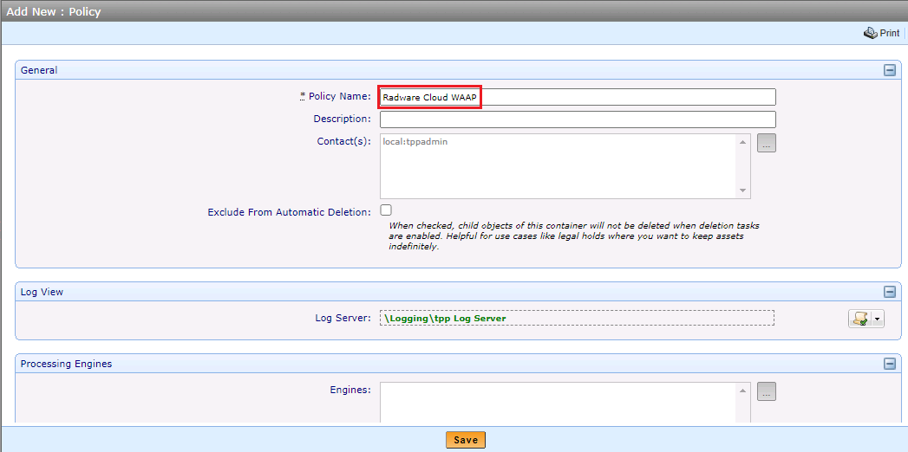

### Create a Credential Object

1. Right-click the policy and select **Add** > **Credential** > **Username Credential**.
2. Under **General**, enter a **Credential Name**.
3. Under **Settings**, fill in the **Expires** fields.
4. Under **Credential**, enter **User Name**, **Password** and **Confirm Password**. Use the Cloud WAAP **API credential**. Contact Radware support if needed.
5. Click **Save**.

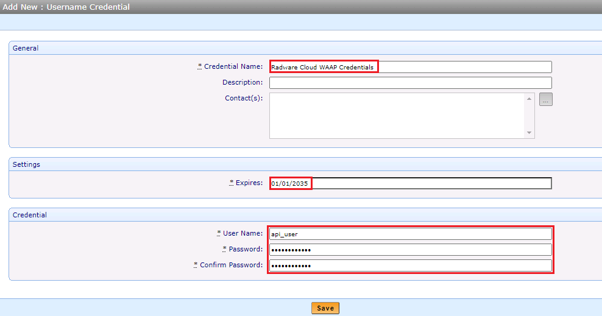

### Update the Policy

1. Click the policy and open the **Application** tab.
2. Under **Application Credential**, select the credential object you created.
3. Under **PowerShell Script**, select the driver script.
4. Click **Save**.

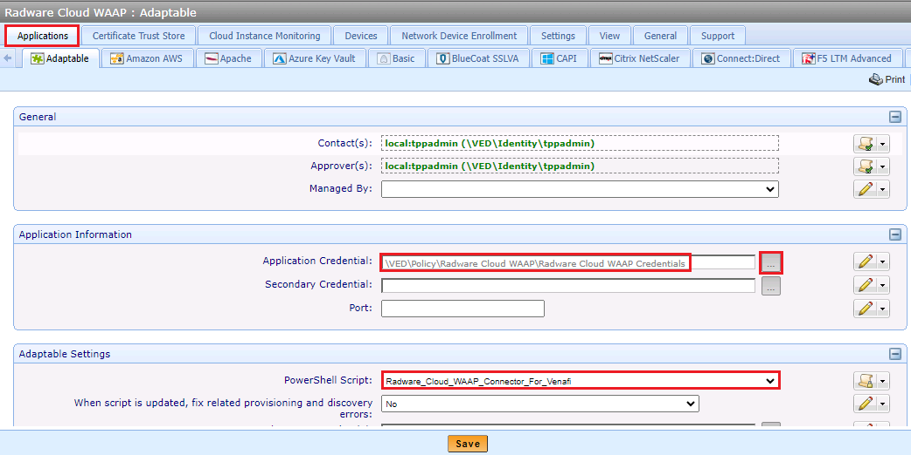

### Create a Device

1. Right-click the policy and select **Add** > **Devices** > **Device**.
2. Under **General**, enter a **Device Name**.
3. Under **Host Information**, enter the **Tenant ID** in **Hostname/Address**. Contact Radware support if needed.
4. Click **Save**.

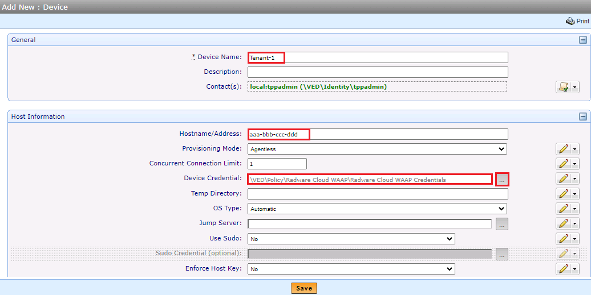

### Create an Application

1. Right-click the device and select **Add** > **Application** > **Adaptable**.
2. Clear **Processing Disabled** to enable the application.
3. Under **Associated Certificate**, select the certificate. If you don't have a certificate to associate yet, leave the field empty and create one as described in the next section.
4. Under **General**, enter an **Application Name**.
5. Under **Adaptable Settings**, fill in **Placeholder Cert Common Name**. This is used for applications created in the cloud without an appropriate certificate, so their certificate can be replaced later.
6. Under **Self Signed**, select a value from the list.
7. Select **Enable Debug Logging** if needed.
8. Click **Save**.

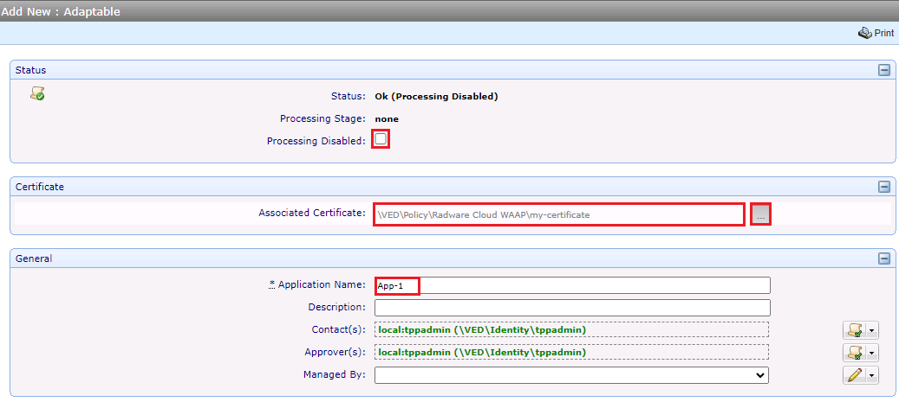

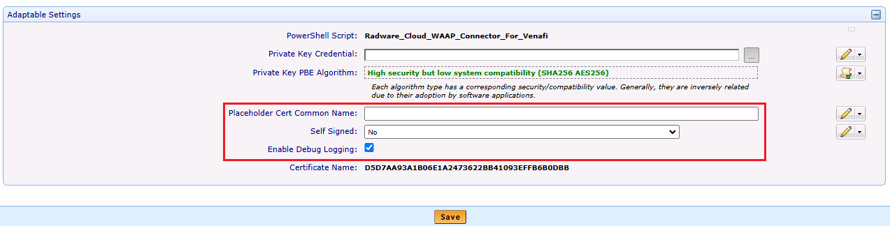

### Create a Certificate (Optional)

If you haven't associated a certificate with the application yet, use these example steps to create one.

1. Right-click the application and select **Add** > **Certificates** > **Server Certificate**.
2. Under **General Information**, enter a **Certificate Name**.
3. Set **Management Type** to **Provisioning**.
4. Under **Subject DN**, enter the certificate **Common Name**.
5. (Optional) Under **Subject Alt Name(s)**, add more domain entries.
6. Select the **CA Template**.
7. Click **Save**.
8. Open the application again and associate the new certificate.

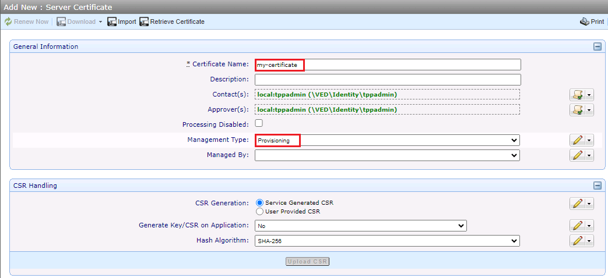

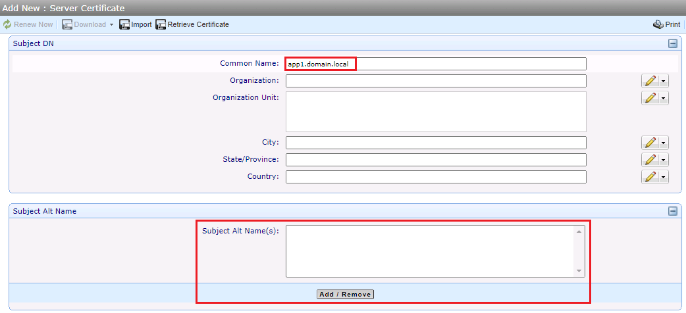

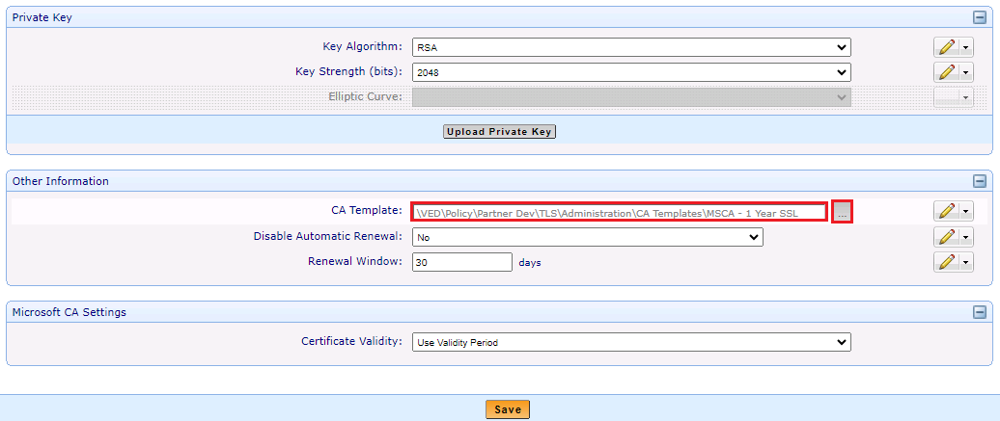

## Usage

1. Push or renew the certificate from Certificate Manager, Self-Hosted.
2. In the Cloud WAAP portal, go to **Assets** > **Certificates** and search for the certificate to confirm that the new certificate is present.
3. To view the Cloud WAAP logs, click the **Activity Logs** icon at the top right.

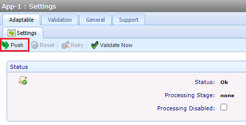

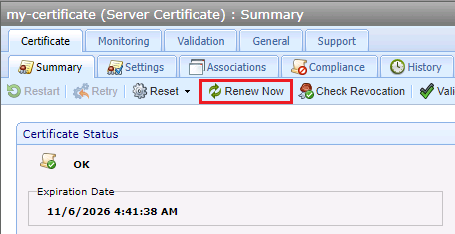

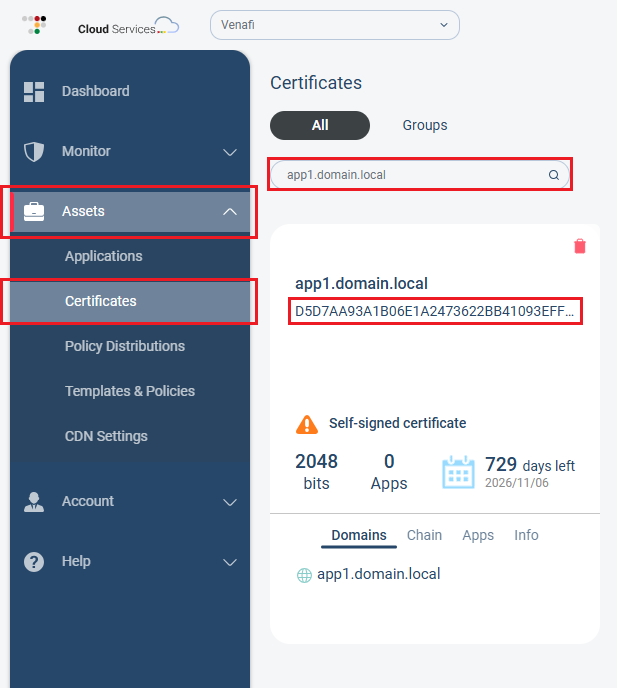

## Covered Scenarios

When a certificate is pushed or renewed, the driver:

1. Uploads the certificate to Radware Cloud WAAP.
2. Reassigns all existing applications that use the old certificate to the new certificate.
3. Rebinds applications under the **Placeholder Cert Common Name** whose main domain matches the CN or a SAN of the new certificate, including wildcard entries.
4. Updates SNI certificate groups if necessary.
5. Deletes the old certificate.

## Logs

When **Enable Debug Logging** is selected on the application, the driver writes its logs to the Certificate Manager, Self-Hosted `Logs` folder.

## Disclaimer

This script is for use at your own choice. The script is provided as is without any warranty of any kind and Radware disclaims any and all liability regarding any use of the script.
