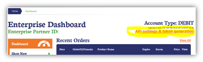
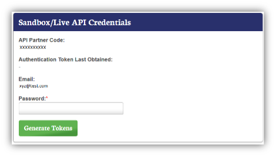
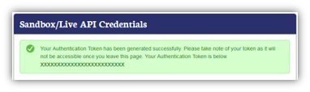

# The SSL Store Adaptable Drivers Configuration

## Paramteters

| Parameter Name | Detail |
| ---            | ---    |
| Username | Use `Partner Code` as username |
| Password | Use `Auth Token` as password |
| Common Name | The common name for an Order - For an SSL Order, this can be a FQDN, or possibly a wildcard domain |
| Organizational Unit | *Optional* |
| Organization | The name of the Organization applying for the product. This applies to Organization Vetted products. |
| City/Locality | Organization City name |
| State/Province | Organization Region name |
| Country | Organization Country code (e.g. United States = US) |
| DNS Name(s) | A commma-separated list of additional domain names  **Note: This field only applys to products with SAN enabled**|
| Email Address(es) | A comma-separated approver email list respective DNS Names entry. (Note: email address list must be in sequence as per DNS Names inserted.  E.g., Suppose DNS Names as `abc.com`, `xyz.com`, `123.com` then in Email Address fields must be insert `admin@abc.com`, `admin@xyz.com`, `admin@123.com` sequence as per DNS names.) |
| Validity Period | Use integer value as a validity period for certificates (e.g. 12, 24, 36) |
| Approver Email | Insert the appropriate approver email based on Common Name |
| Full Name | Use full name of Admin user |
| Phone | Organization phone number |
| Postal Code | Organization postal code |

## Script defaults to set before use

Each `.ps1` driver sets two defaults near the top of the file. Replace them with your organization's details before you use the driver:

| Variable | Used for |
| ---      | ---      |
| `$global:AdminEmail` | Admin contact email on every order |
| `$global:AdminPhone` | Admin contact phone on every order, and the organization phone when the Phone field is empty |

## TheSSLstore.com Configuration Steps

To generate the Partner Code and Auth Token from TheSSLstore.com, please see below:

1. Click on **API settings & token generation**

    

2. Below is API Settings page. Please insert your password and click **`Generate Token`**

    

3. When complete, the screen will show success and the Auth Token will be sent to the registered email address. 

    