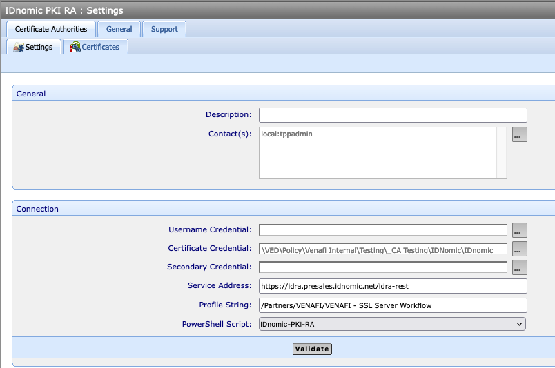

# IDnomic Adaptable CA Driver

This driver can be used to integrate with IDnomic RA REST API. The driver is written in PowerShell and uses the Invoke-RestMethod cmdlet to communicate with the API.

!!! warning Certificate Authentication
    You will need a certificate credential to authenticate with the IDnomic API. Please see the IDnomic documentation or contact your IDnomic representative for more information on obtaining a certificate.

This file has the basic functions supported by Adaptable CA template:

- Test-Settings
- Submit-CsrAsNew
- Submit-CsrAsRenewal
- Submit-CsrAsReplacement
- Retrieve-Certificate
- Revoke-Certificate
- Get-ChainCertificates (Not implemented)
- Prepare-ForRequest (Not implemented)
- Approve-Request (Not implemented)

## Installation

Users can add IDnomic_adaptable.ps1 script to the `C:\Program Files\Venafi\Scripts\AdaptableCA` folder on the Venafi server.

## Configuration

The following configuration is underneath the header at the top of the script. The default values are shown below and shouldn't need to be changed unless the IDnomic API requirements change.

``` yaml

# Local Temporary dir
$global:temp_dir = $base_path + "\Temp"

# Content Type Header Variable
$global:vnd_idnomic_pki_ra = 'application/vnd.idnomic.pki.ra.v1+json'

# This is also configurable in the "Profile String" field of the Adaptable CA template
$global:defaultWorkflow = 'SSL Server Workflow'
```

## Creating the Adaptable CA Template

- Username Credentials are not used because we are using a client certificate.
- A Certificate Credential object is necessary to authenticate with the CA. Please make sure this is already created in Venafi before creating the Adaptable CA Template object.
- Service Address is the URL of the IDnomic REST API.
- Profile String is the workflow name that will be used for the request. If this field is left blank, the default workflow from the script will be used, which won't work unless it has been configured at the IDnomic Admin interface.



## Additional Considerations

- Important to have the IDnomic header content type properly configured. The current default is `application/vnd.idnomic.pki.ra.v1+json`.
- The script currently uses a combination of issuerDn and serialNumber as a TransactionId because a unique id does not exist in the IDnomic API at this time.
